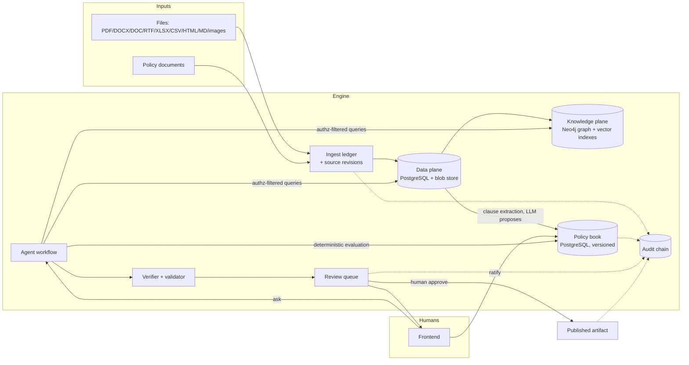
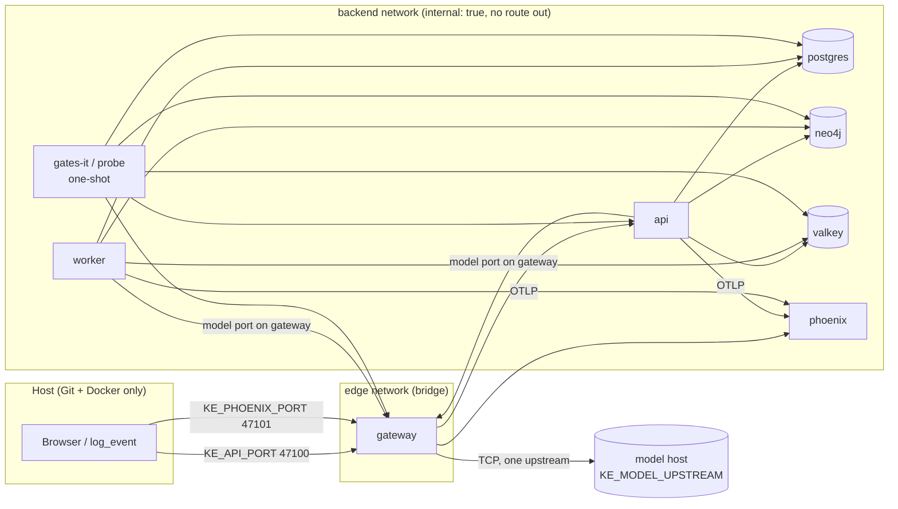
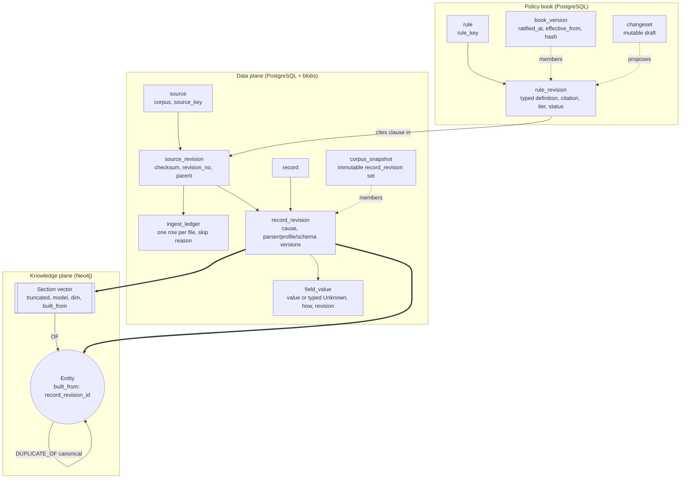
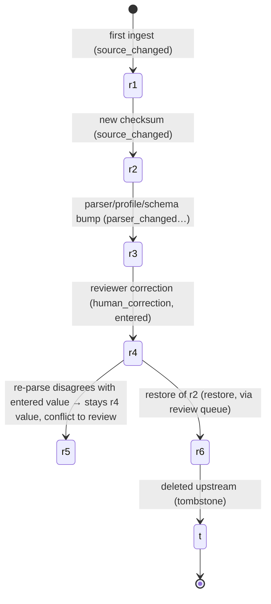
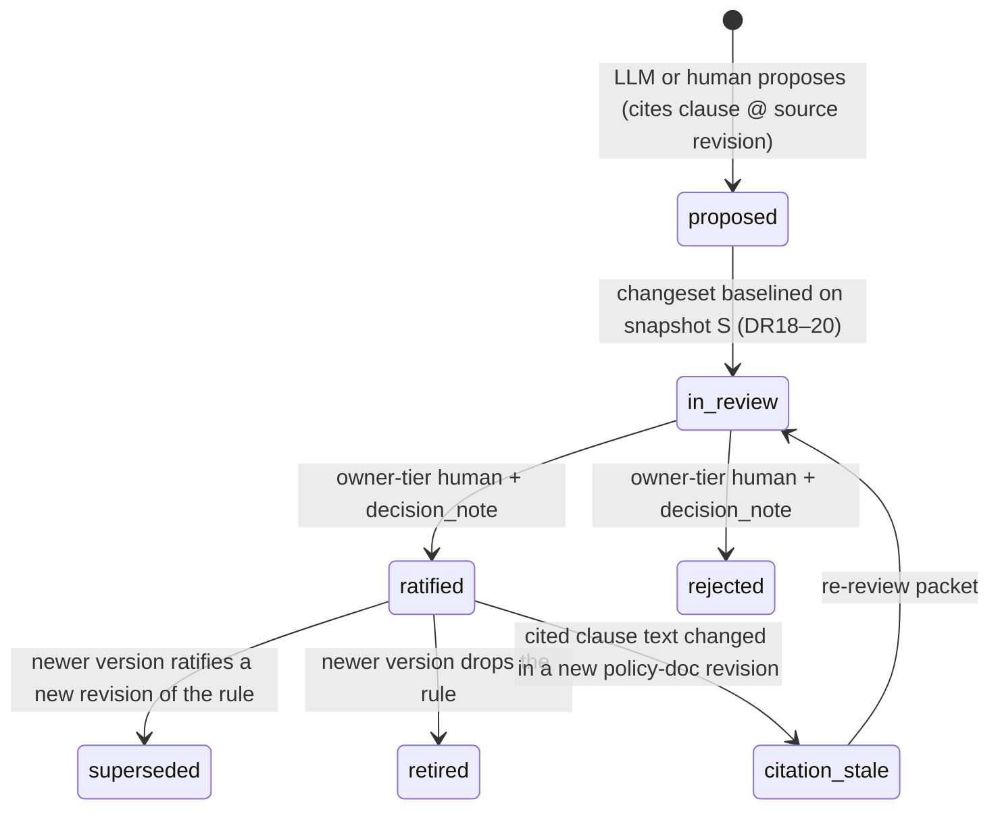
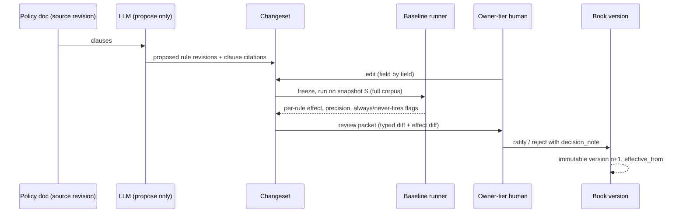
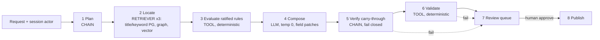
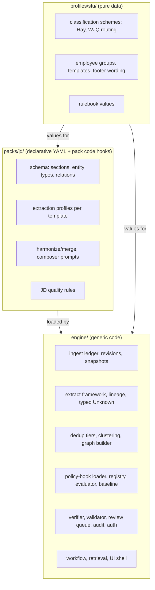

# Architecture

Maintained by the `architect` agent. This page describes the **current state**
and is rewritten whole whenever the design changes. ADRs follow the overview.

**Current state (2026-10-18):** the repository holds the `monitored-harness`
template (tracing helpers, the Copilot role agents, and test and smoke scripts).
The branch `agent/harness-claude-code` adds the Claude Code port (ADR-KE-001):
`CLAUDE.md`, eight `.claude/agents/`, the commit hook in
`.claude/settings.json`, and `scripts/verify.sh`, which runs every gate in the
one-shot `gates` compose service with no network. The engine itself still does
not exist: none of the engine described below has been built. This document is the **proposed
design** for plan approval. Each section is marked *proposed* until the plan
item that builds it is committed. Assumptions `(A<n>)` refer to
[open-questions.md](open-questions.md).

**Next to build (2026-10-18):** `platform-skeleton`, split into
`platform-config` → `platform-stack` → `platform-offline` (§2, ADR-KE-009 to
ADR-KE-012). ADR-KE-009 answers Q19 (formerly PS-Q7): how the gates reach real
stores and a clean Docker daemon. It amends the as-built gates of ADR-KE-001.

## 1. What the system is

The system is a knowledge engine in a box: an on-premises, offline stack. It
turns an institution's documents into three queryable planes, plus a versioned
**policy book**. It answers through a fixed agentic workflow in which a local LLM
only composes wording. **AI is the interface, not the source of truth.** Every
answer traces to ratified rule revisions and to source record revisions. A
deterministic validator re-judges every AI output, and nothing publishes
without a human.



## 2. Platform (proposed, `platform-skeleton`)

Criteria: `docs/requirements.md` § platform-skeleton (PS-1.x, PS-2.x, PS-3.x).
Decisions: ADR-KE-009 (gates topology), ADR-KE-010 (configuration and egress),
ADR-KE-011 (stack topology and job queue), ADR-KE-012 (offline bundle).
Every image is pinned by digest. **No tag or digest is chosen in this
document.** The developer resolves and records each one at implementation
time, in the sub-item's handoff.

### 2.1 Containers and networks

Everything runs under docker compose. The compose file sets the top-level
`name: knowledge-engine`, so volumes keep their names whatever the checkout
directory is called. **Only `gateway` touches a network with a route out.**

| Service | Image (digest pinned at implementation) | Networks | Restart | Role |
|---|---|---|---|---|
| `gateway` | `ke-gateway`, built `FROM` the official nginx image (unprivileged variant) with the config baked in | `edge`, `backend` | `unless-stopped` | Publishes the only host ports. Reverse-proxies `api` and `phoenix`, and forwards one TCP port to the model host |
| `api` | `ke-app` (`docker/app.Dockerfile`): Python 3.12, FastAPI, uvicorn | `backend` | `unless-stopped` | HTTP API, server-rendered UI, `/healthz`, `/readyz` |
| `worker` | `ke-app` | `backend` | `unless-stopped` | RQ worker (ADR-KE-011). Only the no-op job for now |
| `postgres` | official `postgres`, major 16 | `backend` | `unless-stopped` | records, revisions, ledger, policy book, review queue, audit chain |
| `neo4j` | official `neo4j`, 5.x community | `backend` | `unless-stopped` | graph and vector indexes (ADR-KE-002) |
| `valkey` | `valkey/valkey`, major 8, AOF on | `backend` | `unless-stopped` | job queue only |
| `phoenix` | `arizephoenix/phoenix` (today `version-20.22.0`; digest added) | `backend` | `unless-stopped` | traces for the product and the harness (Q2 ruling) |
| `gates` | `ke-gates` (`docker/gates.Dockerfile`) | `network_mode: none` | none | one-shot: lint and unit gates (unchanged from ADR-KE-001) |
| `gates-it` | `ke-gates` (same YAML anchor) | `backend` only | none | one-shot: unit, integration, coverage and mypy against the real stores (ADR-KE-009) |
| `probe` | `ke-app` | `backend` only | none | one-shot: the live-smoke checks (`python -m engine.ops.smoke`) |
| `dind` | official `docker` image, `dind` variant, privileged | `offline` (internal) | none | clean daemon for the offline check (ADR-KE-009, ADR-KE-012) |
| `offline-client` | `ke-gates` | `offline` (internal) | none | runs install, launch and smoke against `dind` |
| model host | external, OpenAI-compatible | — | — | Ollama now, vLLM later. Reached only through `gateway` |

`gates`, `gates-it`, `probe`, `dind` and `offline-client` are behind compose
profiles (`gates`, `probe`, `offline`), so `up` never starts them.



Stack services (everything without a profile) use **named volumes only, with
no bind mounts**, so the same compose file runs unchanged inside `dind`. Only
the one-shot gate services bind-mount the checkout.

Blob storage holds original files and revision content. It is a volume mounted
into `api` and `worker`, content-addressed by SHA-256 and encrypted per source
(A11). It arrives with `ingest-ledger`.

### 2.2 How `verify.sh` runs the gates (ADR-KE-009, answers Q19)

**Status: proposed, pending human ruling Q30** (F1: DR31 names testcontainers).
`platform-stack` waits on Q30; `platform-config` does not.

`scripts/verify.sh` keeps its two halves.
- **Host half:** only Docker orchestration, which calls other scripts.
- **Container half:** only calls `scripts/lint.sh` and `scripts/test.sh`.

No gate command is ever written in `verify.sh`
(`test_verify_sh_has_no_inlined_commands` stays as it is).

- **Isolation.** Each run uses its own compose project,
  `ke-verify-<random suffix>`. It reads `--env-file .env.example`, then
  `--env-file config/verify.env`, which holds only the verify overrides.
  `docker-compose.verify.yml` resets every `ports:` to an empty list (`!reset`,
  Compose ≥ 2.24), so a verify run publishes nothing. It therefore never
  collides with the live stack or with a parallel verify run.
- **No model reachable.** `config/verify.env` sets `KE_MODEL_UPSTREAM` to a
  name under the reserved `.invalid` TLD, so the gateway's model port leads
  nowhere. The test socket guard also refuses that port.
- **`fast`:** unchanged. `docker compose … --profile gates run --rm --build
  gates scripts/verify.sh fast` → `lint.sh`, `test.sh fast`.
- **`full`:**

```mermaid
sequenceDiagram
  participant H as verify.sh (host)
  participant D as host Docker daemon
  participant G as gates-it (backend net)
  participant S as smoke.sh (host)
  participant O as offline_check.sh (host)
  H->>H: trap → teardown.sh --volumes (this project)
  H->>D: build.sh (ke-app, ke-gateway, ke-gates; store images by digest)
  H->>D: launch.sh (up -d --no-build --wait)
  H->>G: compose run gates-it scripts/verify.sh full
  G->>G: lint.sh; test.sh full (unit + integration, coverage, mypy)
  H->>S: smoke.sh
  S->>D: launch.sh (idempotent), run probe, stop/start valkey, run probe
  S->>D: run gates scripts/smoke.sh (inner half: OTLP export check, no network)
  S->>D: teardown.sh --volumes
  H->>O: offline_check.sh (platform-offline; §2.5)
```

- **Two-sided scripts.** `smoke.sh` has the same two-sided shape as
  `verify.sh`, keyed on `KE_IN_GATES`.
  - On the host it runs the live-stack smoke (PS-2.8).
  - In `gates` it runs today's OTLP check (`smoke_otlp.py`).
  - `smoke.sh --live` runs the host half only. The offline check uses it,
    because the bundle carries no gates image.
- **Store-down cases.** Because `gates-it` has no Docker socket, it cannot stop
  a container. Integration tests make a store "down" in process, by pointing
  one store's settings at a closed port on a stack host. The real stop and
  start of a container happens in `smoke.sh` on the host.
- **Container health.** Health of the running containers is proven by
  `launch.sh --wait`, which fails unless every healthcheck passes, and by the
  probe.
- **Lint.** `lint.sh` runs shellcheck over `scripts/**/*.sh` and
  PSScriptAnalyzer over `scripts/*.ps1`. It runs in both modes. The gates image
  gains `shellcheck` and `pwsh` with a version-pinned PSScriptAnalyzer, plus the
  Docker CLI and compose plugin, which `offline-client` needs.

### 2.3 platform-config (ADR-KE-010)

**Package.** First-party code lives in one new package, `engine/`, next to
`harness_telemetry/`. `pyproject.toml` is changed as follows:
- project `knowledge-engine`
- `requires-python = ">=3.12,<3.13"` (Q11 ruling)
- wheel packages `engine` and `harness_telemetry`
- a `dev` dependency group with coverage, mypy and type stubs

```
engine/
  __init__.py
  config/      settings.py (Settings + sub-models), loader.py (sources, ConfigError)
  egress.py    EgressPolicy, EgressDenied, GuardedTransport (httpx), is_local_endpoint()
  startup.py   startup() → Settings; StartupRefused(setting, reason); warnings
  telemetry.py configure_tracing(settings) – export only to a local collector
  llm/client.py ModelClient: per-pass, guarded httpx client (OpenAI-compatible)
config/defaults.yaml   every non-secret key's default (repo root, copied into images)
```

**Settings.** One `pydantic-settings` `Settings` object. The sources are, in
order of precedence:
1. init arguments (tests);
2. environment variables;
3. `config/defaults.yaml`, located through `KE_CONFIG_FILE`, defaulting to
   `config/defaults.yaml` relative to the working directory. A missing file is
   a `ConfigError` that names the path.

Environment variables:
- **Naming:** `KE_` prefix, with `__` for nesting, e.g.
  `KE_STORES__POSTGRES__PORT`.
- **`KE_` names only (F2 ruling):** the requirement names map to `KE_ENV`,
  `KE_EGRESS_ALLOWLIST`, `KE_MODEL_UPSTREAM` and `KE_MODELS__<PASS>__BASE_URL`.
  Unprefixed names (`ENV`, `EGRESS_ALLOWLIST`, `MODEL_BASE_URL`) are ignored,
  with no aliases (`test_config_ignores_unprefixed_names`).
- **Standard tool names stay:** variables other tools already read keep their
  own names: `PHOENIX_COLLECTOR_ENDPOINT`, `HARNESS_TRACING`,
  `OPENINFERENCE_HIDE_INPUTS`, `OPENINFERENCE_HIDE_OUTPUTS`.
- **Lists:** comma-separated in the environment.

`defaults.yaml` layout. The values shown are the A7 defaults:

```yaml
env: prod                    # dev | ci | prod; fail-closed default
auth: {enabled: true}
egress_allowlist: []         # hosts; exact, case-folded, no wildcards
stack:
  service_names: [gateway, api, worker, postgres, neo4j, valkey, phoenix]  # drift-tested against compose
api: {listen_port: 8080}
stores:
  postgres: {host: postgres, port: 5432, database: engine, user: engine}
  neo4j:    {host: neo4j, port: 7687, user: neo4j}
  valkey:   {host: valkey, port: 6379}
models:                      # one block per pass (DR29); no inheritance between passes
  model_upstream: null       # gateway's upstream host:port, checked against the allowlist
  compose: {base_url: null, model: qwen2.5:14b-instruct, fallback_model: llama3.1:8b, timeout_s: 120}
  rewrite: {base_url: null, model: qwen2.5:14b-instruct, fallback_model: llama3.1:8b, timeout_s: 120}
  audit:   {base_url: null, model: qwen2.5:14b-instruct, fallback_model: llama3.1:8b, timeout_s: 120}
  embed:   {base_url: null, model: nomic-embed-text, dim: 768, timeout_s: 60}
telemetry: {tracing: otlp, collector_endpoint: "http://phoenix:6006", hide_inputs: true, hide_outputs: true}
readiness: {timeout_s: 2}
```

The numbers above are the images' own defaults and A7's values, and are listed
here for the layout only. They live **only** in this file.

**Secrets (F3 ruling).** Passwords are `SecretStr` with **no** YAML default, an
accepted exception to PS-1.1. They come from the environment only. A missing
secret is a `ConfigError` that names the key
(`test_config_missing_secret_names_key`). `.env.example` carries clearly
marked dev placeholders, which are refused outside `dev` (PS-1.9, startup
refusal 5 below).

**Errors.** A bad type (PS-1.1) raises `ConfigError`. Its message names the
environment variable or YAML key, never the value.

**Egress guard (DR30, PS-1.3/1.4).**
- **Startup.** For every pass whose `base_url` is set, the host must be in
  `egress_allowlist`; the same applies to the host of `models.model_upstream`.
  Any configured host with an empty allowlist also fails. The error names the
  host.
- **Runtime.** `ModelClient` builds its `httpx.Client` with
  `transport=GuardedTransport(policy, httpx.HTTPTransport())` and
  `trust_env=False`, so proxy environment variables cannot reroute it.
  - `GuardedTransport.handle_request` checks `request.url.host` **before**
    calling the inner transport. A denied host therefore opens no socket.
  - Every redirect hop also passes through the transport.
  - If a later item adopts the `openai` SDK, it is given the same client
    (`http_client=`).
- **Network layer.** The network topology in §2.1 is the second layer. A
  Python audit hook is not used, because libpq does not go through Python
  sockets.

**No-hardcoded scan (PS-1.2, PS-2.2).** `engine/…` holds no scanner. The scan
is a pure function, `find_hardcoded(files, declared_values, exemptions)`, in
`tests/hardcoded_scan.py`.
- **Two rules:**
  1. Every host, port and model value declared in `config/defaults.yaml` and
     `.env.example` must not appear as a literal in the scanned files.
  2. Any `scheme://host[:port]` string literal, or any integer port assigned to
     a `*port*` name, in Python source is flagged.
- **Scanned:** `engine/`, `harness_telemetry/`, `scripts/`, `docker/`,
  `docker-compose*.yml`, `.github/`.
- **Allowed locations:** `config/defaults.yaml`, `.env.example`,
  `config/verify.env` (F4 ruling: an accepted literal exemption under PS-1.2),
  `tests/`, `docs/`, and compose `${VAR:-default}`
  defaults for container-internal listen ports. A drift test checks those
  compose defaults against `defaults.yaml`.
- **Mutation test:** a planted literal must be flagged (DR38).

**`harness_telemetry` default collector (orchestrator input, 2026-10-18).**
`DEFAULT_COLLECTOR` stays a literal (`http://localhost:47101`), because the
harness is a standalone template package with no config system, and
`log_event` runs on the host. It is the scanner's **single** exemption: path,
symbol and reason are recorded in the exemption list in the test file. A drift
test, `test_harness_default_collector_matches_env_example`, asserts that its
port equals `KE_PHOENIX_PORT` in `.env.example`, so PS-2.2 holds.
- **Rejected alternative:** reading `.env.example` at import time depends on
  the working directory and ties a template package to this repo's layout.

**Startup refusals (PS-1.5).** `startup.check(settings)` raises
`StartupRefused(setting, reason)` on the first of the following:
1. `auth.enabled=false` while `env≠dev`;
2. tracing `otlp` to a non-local collector. "Local" (Q3 ruling) means
   `localhost`, 127.0.0.0/8, `::1`, or a name in `stack.service_names`;
3. `hide_inputs` or `hide_outputs` not true while `env≠dev`;
4. the egress startup check;
5. a secret whose value equals its `.env.example` placeholder while `env≠dev`
   (F3 ruling, PS-1.9). The placeholder values are read from the
   `.env.example` that the app image copies alongside `config/`; the refusal
   names the key, never the value.

In `dev`, cases 1 and 3 log a warning instead (Q4 ruling); case 5 is allowed.

**Tracing does not leak before the checks pass.** `telemetry.configure_tracing`
attaches the OTLP exporter **only if** the collector is local, and decides
that from the raw environment before the traced startup runs. A refused
startup still produces spans, but they go nowhere.

**Spans (PS-1.7).** All are `harness_telemetry` spans:

| Span | Kind | Notes |
|---|---|---|
| `engine.startup` | CHAIN | root; attribute `ke.env`; ERROR on refusal |
| `engine.config.load` | CHAIN | key names overridden from the environment, never values |
| `engine.startup.refusals` | CHAIN | `ke.refused_setting` on refusal |
| `engine.egress.startup_check` | CHAIN | host names checked |
| `model.<pass>` | LLM | wraps every `ModelClient` call; model name; `EgressDenied` marks it ERROR |

**Quality gates (PS-1.6, Q5 ruling).**
- **Coverage:** `[tool.coverage]` in `pyproject.toml` sets `branch = true`,
  `source = ["engine", "harness_telemetry"]` and `fail_under = 80`.
- **mypy:** `[tool.mypy]` sets `strict = true` with the pydantic plugin, and
  `files = ["engine", "harness_telemetry"]`.
- **Out of scope:** `scripts/*.py` and tests (orchestrator ruling,
  2026-10-18).
- **`test.sh`:**
  - Unit tests run under `coverage run -p`.
  - In `full`, integration tests also run under `coverage run -p` (inside
    `gates-it`).
  - Then `coverage combine`, `coverage report` and `mypy`. Both modes enforce
    the threshold on what that mode ran.
- The tests stay on `unittest`, and every `uv run` keeps `--locked`.

### 2.4 platform-stack (ADR-KE-011)

**Ports (A6, Q2 ruling).**
- **Published:** only `gateway` publishes host ports.
  - `KE_API_PORT=47100`: API and UI.
  - `KE_PHOENIX_PORT=47101`: Phoenix UI and OTLP/HTTP, for both the product and
    the harness's `log_event`.
- **Reserved:** 47102–47199 is reserved, and every new published port takes the
  next free number.
- **Not published:** Phoenix's gRPC port 4317 is dropped, because nothing uses
  it. Stores publish nothing; use `docker compose exec` for psql, cypher-shell
  or valkey-cli.
- **Compose:** host ports in compose are `${KE_…_PORT:?set in .env}`, so a
  missing value fails loudly and there is no second default to drift.

**`.env.example`** holds:
- the published ports;
- `KE_MODEL_UPSTREAM`, the host:port of the model host. The dev default is
  chosen at implementation and marked as a placeholder;
- `KE_EGRESS_ALLOWLIST=gateway,<upstream host>`;
- `KE_ENV=dev`;
- `KE_AUTH__ENABLED=false`, because auth arrives in auth-audit;
- the dev secret placeholders.

`api` and `worker` dial `http://gateway:<model listen port>/v1`.

**`/healthz` (PS-2.4).** Returns `200 {"status":"ok"}` from process state only,
with no I/O. It is untraced, because it is liveness and is called every few
seconds. The compose healthchecks of `api` and `gateway` use it.

**`/readyz` (PS-2.5, Q6 ruling).** The response looks like this:
```json
{"ready": true,
 "checks": {"postgres": {"ok": true, "reason": null},
            "neo4j": {...}, "valkey": {...},
            "model_host": {"ok": false, "reason": "refused", "required": false}}}
```
- `ready` = postgres ∧ neo4j ∧ valkey. The status code is 200 if ready,
  otherwise 503.
- **Probes:**
  - postgres: `SELECT 1`.
  - neo4j: `RETURN 1`.
  - valkey: `PING`.
  - model host: `GET {compose.base_url}/models` through `ModelClient`, so it
    passes the egress guard.
- **Timeouts:** each probe has `readiness.timeout_s`.
- **Reasons:** a fixed vocabulary (`timeout | refused | auth_failed |
  egress_denied | error:<ExceptionClass>`). It never includes a DSN, host
  credential or message text.
- **Spans:** `api.readyz` (CHAIN), with one `readyz.<dep>` (TOOL) per
  dependency.

**Worker (PS-2.6).**
- The worker is RQ on Valkey, started as `python -m engine.worker`, and listens
  on one queue, `default`.
- `engine.worker.jobs.noop(token)` runs `INCR ke:noop:<token>` and returns.
- RQ records the job as `finished`.
- Each job runs in a `job.<name>` CHAIN span carrying the job id.
- The integration test enqueues to the real `worker` container from
  `gates-it`. It then asserts that the status is `finished` and the counter
  is 1.

**Images.**
- `docker/app.Dockerfile` reuses the pinned `python:3.12-slim-bookworm` and
  `uv` bases, runs `uv sync --locked --no-dev`, runs as a non-root user, and
  copies `engine/`, `config/` and `.env.example` (for the placeholder-secret
  refusal, §2.3).
- `docker/gateway.Dockerfile` is the pinned nginx image plus templates. Its
  upstreams resolve per connection, so the gateway **starts and serves the
  other routes when any upstream is absent**: CI has no model host, and the
  harness may run `phoenix` without `api`.

**Scripts (PS-2.9).** Each script is a bash file for Linux and macOS plus a
PowerShell twin for Windows. They contain only `docker compose` calls.

| Script | Does |
|---|---|
| `build.sh` / `.ps1` | `compose build` (ke-app, ke-gateway, ke-gates), then `compose pull` of the digest-pinned images |
| `launch.sh` / `.ps1` | Copies `.env.example` to `.env` if it is missing (and says so). Checks Compose ≥ 2.24. Runs `compose up -d --no-build --wait`. Prints the URLs from the port variables |
| `teardown.sh` / `.ps1` | `compose --profile '*' down --remove-orphans`, and `--volumes` only when asked |
| `smoke.sh` | the two-sided live smoke (§2.2) |

All scripts honor `KE_ENV_FILE` and `COMPOSE_PROJECT_NAME`. `docs/quickstart.md`
names only these scripts and the prerequisites: Git, and Docker with Compose
≥ 2.24.

### 2.5 platform-offline (ADR-KE-012)

**Bundle (PS-3.1).** `scripts/bundle.sh` / `.ps1` writes
`dist/knowledge-engine-<git sha>/` (and a `.tar` of it) containing:
- `images/*.tar`: `docker save` of every image `docker compose config --images`
  lists for the stack services, plus `ke-app`, `ke-gateway`, `ke-gates` and the
  `dind` image. The gates image is included so that verification can run on the
  box;
- no wheels: the images carry their dependencies (bundle ruling);
- `assets/`: vendored assets (none until `frontend`);
- `compose/`: `docker-compose.yml`, `.env.example`, `config/`, `scripts/`,
  `docs/quickstart.md`;
- `bundle.json`: git sha, creation time, and each image's name and digest;
- `MANIFEST.sha256`: `sha256sum` format, covering every file except itself.

**Platform.** The bundle is linux/amd64 only. macOS on Apple silicon (arm64
images) is recorded under Q20.

**Install.** `scripts/install.sh` / `.ps1` verifies the manifest before
anything else. It rejects a mismatch, a missing file, or **any file not listed
in the manifest**. Only then does it run `docker load` for each image.
- **Tools:** bash uses `sha256sum -c --strict` plus a listing comparison;
  PowerShell uses `Get-FileHash`.
- **Integrity, not authenticity:** `bundle.sh` prints the manifest's own hash
  for an out-of-band comparison. Signing is out of scope (flagged to security).

**Gates (both are stages inside `verify.sh full`, not separate CI jobs).**
- `ci/offline` (PS-3.3) runs in `smoke.sh` against the verify stack.
  - Assertion: `docker compose exec api` and `exec worker` each attempt a TCP
    connection to `KE_OFFLINE_PROBE_TARGET`, and the attempt must fail.
  - Control: the same probe from a throwaway `ke-app` container on `edge` must
    succeed. If the control fails, the gate fails as *inconclusive*; it never
    passes silently.
  - The target is chosen at implementation and recorded in the handoff.
- `ci/deployable-offline` (PS-3.2) is `scripts/offline_check.sh` (host):
  1. `bundle.sh`.
  2. Start `dind` (a fresh anonymous `/var/lib/docker`, on the internal network
     `offline`, TLS certificates on a shared volume).
  3. In `offline-client`:
     - assert `docker image ls -q` is empty;
     - `install.sh`;
     - `launch.sh`;
     - `smoke.sh --live`;
     - `teardown.sh`.
  4. `down -v` of the `ke-offline-<suffix>` project.

  Any pull or package-index call fails, because the inner daemon has no route
  out.

  **F5 ruling:** it runs in every local `full`, so CI stays identical to
  local. A daemon that cannot run privileged containers is a blocker, never a
  skip. Revisit if `full` exceeds about 15 minutes locally.

`.github/workflows/ci.yml` keeps its single step. **F6 ruling:**
`timeout-minutes` is set to the measured duration of `verify.sh full` plus 50%
(PS-3.4, `test_ci_job_has_timeout`); the measurement is recorded in the
sub-item's handoff.

### 2.6 First failing tests

Suggested first test per sub-item, followed by the order of the rest.

- **platform-config.** First: `test_config_defaults_and_env_override`.
  Then:
  1. `test_config_rejects_bad_type`, where the message names the key, not the
     value.
  2. `test_config_ignores_unprefixed_names` (F2) and
     `test_config_missing_secret_names_key` (F3).
  3. `test_egress_guard_startup`.
  4. `test_egress_guard_runtime`, with a socket spy recording zero connects,
     plus `test_egress_guard_mutant_goes_red`.
  5. `test_startup_refuses_unsafe`, one subTest per case, plus the dev
     warnings; then `test_startup_refuses_placeholder_secrets` (PS-1.9).
  6. `test_startup_is_traced`, using the in-memory exporter, which also proves
     nothing is exported to a non-local collector.
  7. `test_no_hardcoded_ports` and `test_no_hardcoded_hosts_or_models`:
     scanner on fixtures first, then the repository.
  8. `test_harness_default_collector_matches_env_example`.
  9. `test_test_sh_enforces_coverage_and_mypy`, plus recorded RED runs.
  10. `test_python_pinned_to_312`.
- **platform-stack.** First: `test_compose_services_have_restart_policy`
  (fast; parse the compose YAML).
  Then the fast tests:
  1. `test_compose_images_pinned_by_digest`.
  2. `test_env_example_ports_in_range_and_unique`.
  3. `test_only_gateway_on_edge_network` (PS-2.10).
  4. `test_no_docker_socket_mounted` (PS-2.11).
  5. `test_stack_services_have_no_bind_mounts` (PS-2.12).
  6. `test_quickstart_names_existing_scripts`.
  7. `test_healthz`, in process with a socket spy, so it can be fast.

  Then integration in `gates-it` (blocked on Q30, like PS-2.4 to PS-2.7). The
  first one is
  `test_socket_guard_blocks_outbound`, which proves ADR-KE-009's wiring:
  - the guard refuses a non-stack host;
  - with the guard off, a raw connection out still fails, because the network
    is internal.

  After it:
  - `test_readyz_reports_each_dependency`;
  - `test_readyz_fails_when_store_down`;
  - `test_worker_consumes_noop_job`.
- **platform-offline.** First: `test_bundle_manifest_rejects_tamper` (fast).
  It covers both `install.sh` and `install.ps1` on a tiny fixture bundle, in
  three cases: a byte changed, a file missing, and an extra file. Then:
  1. `test_bundle_lists_every_compose_image`.
  2. `test_ci_job_has_timeout` (PS-3.4, F6), plus the recorded measurement.
  3. The gates `ci/offline` and `ci/deployable-offline`, each with a recorded
     run that shows it can go red (DR38).

## 3. The three planes (proposed)



- **Data plane:** original files plus normalized records. Lineage is stored per
  record revision: source revision, page or region, extraction method, parser
  version, model and version, checksum and timestamp. Field values are a typed
  union, `Known(value) | Unknown(reason)`, and each carries `how ∈ {parsed,
  routed, entered, imported}` (DR4–DR6).
- **Knowledge plane:** Neo4j holds both the graph and the vector indexes. The
  graph schema comes from the domain pack. Every node and vector stores
  `built_from` (record revision id) and the versions it was built with (DR8).
  Edges are canonically oriented and MERGEd idempotently (DR10).
- **Policy book:** typed rule revisions grouped into immutable book versions.
  It is evaluated by a pure-Python deterministic evaluator that cannot import an
  LLM client (import-graph test).

## 4. Revision history: corpus and policy (proposed; ADR-KE-007)

Both histories use one pattern: **append-only revision rows, a computed
"current" view, immutable snapshots or versions for anything a decision or
metric depends on, and an audit-chain entry per write.** Mutating a revision is
impossible at the database-role level. The application role has `INSERT` and
`SELECT` only on revision tables. "Current" is a view (the latest non-superseded
revision), never an updated pointer column, so no write can be lost.

### 4.1 Corpus revisions



- **Identity:** `source(corpus, source_key)`, where `source_key` comes from the
  institution profile's external ID, else the path, else the uploader's explicit
  choice (A10). Similarity never decides identity (DR12).
- **Re-ingest:** the same checksum produces no revision (only `seen_at` is
  updated). A new checksum produces `source_revision n+1`, then extraction, then
  `record_revision` with `cause=source_changed`. A parser, profile or schema
  version change re-extracts and writes `cause=parser_changed|profile_changed|
  schema_changed` revisions.
- **Entered values win:** extraction never supersedes a field whose current value
  is `entered`. It records a `field_conflict` row and a review item (§R-REV-C.5).
- **Freshness:** a single SQL plus Cypher predicate,
  `derived.built_from ≠ current_revision(record)`, defines *stale*. The funnel,
  the impact panel and the freshness CLI all call that one predicate (DR32).
- **Snapshots:** `corpus_snapshot` is an immutable membership table. Baselines,
  findings files and metrics reference a snapshot id. Snapshot comparison
  returns the buckets `added | changed | removed | unchanged | unaccounted`,
  and a test asserts they sum to the union of both snapshots (DR33).
- **As-of reads:** queries take `as_of` (snapshot id or timestamp), which
  resolves to a revision set *inside* the query, together with the authorization
  predicate (DR39).

### 4.2 Policy-book revisions



- **Changeset → version:** edits collect in a mutable `changeset`. Submitting
  freezes it, runs the baseline on a named snapshot, and builds the review packet
  (typed diff, effect diff and per-rule precision). Ratifying all its rules
  publishes `book_version n+1` with a content hash, `ratified_at` and
  `effective_from` (A12).
- **Typed diff:** rule definitions are pydantic models (decision table,
  threshold, routing). The diff is structural: cells, operands, targets, tier
  and citation. It is never a text diff of YAML.
- **Effect diff:** for two versions on the same snapshot, the baseline results
  are joined per record, and the diff lists records whose outcome changed.
- **Revert:** a new changeset that re-proposes an older rule revision's
  definition. It goes through the same baseline and ratification. There is no
  pointer rewind.
- **Provenance on outputs:** `draft`, `answer` and `published_artifact` store
  `book_version_id`, `fired_rule_revision_ids[]`, `snapshot_id` or
  `record_revision_ids[]` and `evaluated_at`.

### 4.3 Revision UX

The UX is server-rendered, readable without JavaScript, and shows no similarity
percentages.

| View | Corpus | Policy |
|---|---|---|
| Timeline | Source page → History: revisions with cause badge, actor/version, skip outcome | Book → Versions: status, ratified_at / effective_from, ratifiers, session |
| Compare | Any two revisions: field diff, section word diff, table cell diff, explicit Unknown↔value | Any two versions: rules added/removed/changed with typed diff + effect diff |
| Blame | Per field: value history, `how`, actor, revision | Per rule: revision history, proposer (LLM flagged), decision notes |
| Impact | Derived objects built from this revision, stale count (live query) | Outputs produced by this rule revision (live query) |
| Snapshot | Snapshot list, snapshot-vs-snapshot buckets | Baseline runs per version, keyed by snapshot |
| Change action | Correction or restore → reason + preview diff → review queue | Edit or revert → changeset → baseline → ratification packet |

Diffs are computed server-side by one `revision_diff` module per plane, which
returns a typed diff model. Templates render that model, and tests assert on
the model, not on HTML.

## 5. Policy-book lifecycle (proposed, `policy-book`)



The registry is versioned YAML. The loader refuses to start if a knob lacks a
register entry, or if a `ratified` entry lacks `decided_by`, `decided_on` or
`decision_note` (DR16). `docs/register.md` is generated, and CI fails on drift.

## 6. Agent workflow (proposed, `agent-workflow`)



The whole run is an `agent_span` with one child span per step. The authorization
predicate is part of every retriever query template, and the parameters are
recorded separately from the template. `OPENINFERENCE_HIDE_INPUTS` and
`OPENINFERENCE_HIDE_OUTPUTS` default to `true`.

## 7. Engine / pack / profile split (proposed)



A pack is YAML plus an optional Python module that implements engine-defined
protocols (for example `SectionMerger`). The engine never imports a pack by
name, and a test asserts that engine code contains no profile literals.

## 8. Port verdict table (from `humanaxiom/jd-assistant` @ `2e3e6dc`)

This follows the pattern of the JD repo's ADR-005: one row per module, a verdict,
and a rationale that **bolds** any obligation the port carries. Pure,
deterministic code is ported with its tests. Code coupled to the JD schema or
its stores is rewritten from spec, with the old code and tests kept as the
behavioural reference. Paths are relative to `core/src/` unless noted. Line
counts come from `wc -l` at `2e3e6dc`.

Verdicts: **engine** = generic code; **jd pack** = JD-specific; **SFU profile**
= institution data (pure YAML); **split** = parts go to more than one layer;
**discard** = not carried over.

| # | JD-repo module | LOC | Verdict | Rationale / obligation |
|---|---|---|---|---|
| 1 | `settings.py` | 691 | split | Typed config loader → engine. CAS URL and origins → **SFU profile** |
| 2 | `agents/`, `gates/`, `models/`, `worker/` | ~1,180 | discard | Dev-harness tooling (task runner, gate runner). Replaced by `.claude/agents/` and `scripts/verify.sh` |
| 3 | `memory/` | 137 | discard (pattern → engine) | Harness memory. Its Neo4j vector-index plumbing is reused in the engine's vector store |
| 4 | `api/` shell (main, csrf, deps, errors, readiness, security_headers, service_origin) | 1,230 | engine | Generic hardening. **Drop the harness routes** and add the authz-matrix test (DR39) |
| 5 | `api/db` | 141 | engine | users, roles, sessions. Role names become pack config |
| 6 | `api/services` | 373 | split | audit verify, sessions, users → engine. `cas_service` → **pluggable SSO adapter** (DR42) with SFU config in the profile |
| 7 | `api/routes` | 3,843 | split | auth, admin, front door and forms → engine. review, library and dashboards → **generic engine views over pack data**. compose and compose_ui → jd pack |
| 8 | `api/templates` | 25 files | split | base, login, error, admin and `review_diff` → engine (seed of the revision UX, §4.3). compose, library and role pages → jd pack. Branding and footer → profile |
| 9 | `jd_export/` | 166 | jd pack + profile | The .docx renderer → pack. Template file and mandated wording → profile |
| 10 | `jd_core/models` | 1,137 | jd pack | JD schema contracts. **Rename off the SFU name.** Fields adopt the typed `Unknown` (DR4) |
| 11 | `jd_core/parser` | 1,730 | jd pack + profile | Segmenter → pack. Heading sets, WJQ/CUPE templates and grade patterns → profile. `PARSER_VERSION` becomes a **pack-declared version stamp** (DR8) |
| 12 | `jd_core/quality` | 1,356 | split | Gates and scoring → engine rule evaluator. Validators → pack. Thresholds and boilerplate → profile |
| 13 | `jd_core/rules` (loader 4,365 L + 25 YAML) | 4,977 | split (critical) | Content-hash version stamps, the register 3-way check and trivial exemptions → **engine policy-book loader** (DR16). Rule schemas → pack. Values → profile. Technical YAML (dedup, embeddings, textnorm) → engine defaults. **Rulebook history moves from git into the versioned `book_version` tables (§4.2)** |
| 14 | `jd_core/bank` | 3,762 | split | minhash, shingles, clustering, word_diff, change_log and provenance → engine (`word_diff` backs the revision diffs). merge, similarity, render, embed_text and version_diff → pack. hay_signals and title_family → profile |
| 15 | `jd_core/textnorm.py` | 261 | engine | Generic text normalization |
| 16 | `jd_bank/` helpers | 143 | split | `stable_reason` → engine. `jd_text` → pack. `grade_import` → profile |
| 17 | `jd_bank/db` + alembic 0001–0006 | 404 | engine (rewrite) | Domain-neutral once renamed. **Rewrite to the source / revision / snapshot schema of §4.1.** The old `UNIQUE(storage_ref, sha256)` row-per-change design had no current flag, so changed files double-counted |
| 18 | `jd_bank/ingest` | 1,527 | split | Walk, hash, extract and idempotency → engine ledger. Name scrub → pack. Filename facets → profile |
| 19 | `jd_bank/dedup` (tier 1) | 1,107 | engine | Exact-hash tier (DR9) |
| 20 | `jd_bank/dedup/near` | 1,528 | engine | MinHash/Jaccard with a text-source injection point |
| 21 | `jd_bank/dedup/role` | 1,308 | jd pack | Depends on JD signals |
| 22 | `jd_bank/cluster` | 1,162 | engine + pack hooks | Connected components → engine. Employee-group and level constraints → pack/profile hooks |
| 23 | `jd_bank/embeddings` | 1,590 | engine | Runner, store and reconcile → engine. **Stamp `built_from` record revision** (DR8). `roles.py` → pack |
| 24 | `jd_bank/harmonize` | 921 | jd pack | JD-specific measurement |
| 25 | `jd_bank/canonical` | 1,752 | split | Producer skeleton → engine. Merge policy → pack |
| 26 | `jd_bank/review` | 1,150 | engine | The approval and versioning spine; the core asset. Extend with rule revision provenance (§R-REV-P.6) |
| 27 | `jd_bank/llm` | 413 + 8 j2 | engine (prompts → pack) | OpenAI-compatible client and versioned prompt loader. **Per-pass config** (DR29) |
| 28 | `jd_bank/rewrite`, `jd_bank/quality` | 630 | jd pack | JD prompts. **Rewrite as field patches** (DR23) behind the carry-through verifier (DR24) |
| 29 | `jd_bank/security` | 95 | engine | Egress guard (DR30) |
| 30 | `jd_bank/composer` | 3,000 + 2 YAML | jd pack + profile | Composer → pack. Question sets and form routing → profile. `duplicates.py` and `persist.py` → candidate engine primitives |
| 31 | `jd_bank/library` | 2,112 | split | Library and funnel → engine. **The funnel must query the store live** (`_base.html:76` once served stale numbers). Families and units → profile |
| 32 | `jd_bank/baseline` | 1,487 | jd pack + profile | Runs over a **named corpus snapshot**. Era and group facets → profile |
| 33 | `jd_bank/bank_audit`, `field_audit` | 1,466 | jd pack (+ profile) | Per-form audits |
| 34 | `jd_bank/singletons` | 510 | discard (pattern → pack) | One-off investigation. DR11 is covered by a graph test |
| 35 | `core/scripts` | 546 | discard / profile | One-off backfills. `import_grades` → profile |

The tests come across with the code. At `2e3e6dc` the JD repo has 119 unit, 30
integration and 4 live test files, split by directory, with a `live` marker that
is excluded by default. The port keeps the same layout.

**Gaps the port must close.** The JD repo has no stale detection against a stored
rules or parser version. Its rulebook history exists only in git. It has no
history or diff UI for sources, parses or rules (only drafts get a diff against
the last published version). These gaps are what §4 and ADR-KE-007 address.

## 9. ADRs

The template's existing ADR (OpenInference tracing to Arize Phoenix) stays in
force, and its text is kept below unchanged. ADR-KE-001 is built (amended by
ADR-KE-009). ADR-KE-002 to ADR-KE-012 are **proposed**.

### ADR: OpenInference tracing to Arize Phoenix
- Context: `docs/log.md` records what each role did, but not how agent code
  behaved at runtime; custom Python agents exported as plain OpenTelemetry
  spans show up in Phoenix as a flat list.
- Decision: add `harness_telemetry`, a thin layer over the OpenTelemetry SDK
  that sets `openinference.span.kind` and the OpenInference input/output,
  retrieval-document, and token-count attributes, exported over OTLP/HTTP to
  Phoenix. Agents log through `log_event`, which writes the log line and an
  AGENT span with `session.id` = plan-item slug.
- Alternatives considered: `openinference-instrumentation` auto-instrumentors
  (only cover supported frameworks, not hand-written loops); one trace per
  plan item with cross-process context propagation (needs state files to
  carry span context between stateless agent runs — sessions give the same
  grouping for free).
- Consequences: three runtime dependencies; the log line stays the source of
  truth and tracing is best-effort (bounded delay when Phoenix is down).
  Prompts and documents leave the process unless the `OPENINFERENCE_HIDE_*`
  flags are set.
- First tests to write: span kinds and parent/child nesting; error status on
  exceptions; redaction; `log_event` line format and session id.

### ADR-KE-001: Port the harness to Claude Code natively
- **Context:** the role agents are written for Copilot. In the JD repo, Claude
  Code agents were vendored into a subfolder and never installed, while the docs
  said they ran.
- **Decision:** add `.claude/agents/<role>.md`, a `CLAUDE.md` that imports
  `AGENTS.md`, the `block-main-commit` hook in `.claude/settings.json`, and a
  single `scripts/verify.sh [fast|full]`. `.github/agents/` is kept unchanged.
- **Alternatives:** symlinking the Copilot files was rejected because the
  frontmatter is incompatible. A Claude-only harness was rejected because
  Copilot users still rely on it.
- **Consequences:** two sets of agent files must stay in sync, so a unit test
  (`tests/test_harness_port.py`) compares their Constraints sections and their
  handoff/log duty step.
- **Done only with proof:** a dispatch transcript for each role and every
  verify mode run on a clean checkout.
- **As built (`agent/harness-claude-code`):**
  - `scripts/verify.sh` re-runs itself in the one-shot `gates` compose service
    (`docker/gates.Dockerfile`, `network_mode: none` in `docker-compose.yml`).
  - CI's only step is `./scripts/verify.sh full` (`.github/workflows/ci.yml`),
    so nothing runs in CI that verify does not.
  - `verify.sh` fails unless `scripts/test.sh` output contains both a
    `Ran N tests` line with N > 0 and, as a whole line, the exact sentinel
    line from `tests/test_sentinel.py`:

    ```
    test_top_level_unit_suite_ran (tests.test_sentinel.TopLevelSuiteSentinelTest.test_top_level_unit_suite_ran) ... ok
    ```

    That module must stay
    top-level in `tests/`, and its module, class and method names must stay
    unchanged; renaming or moving any of them turns every verify run red.
  - `.gitattributes` forces LF on `*.sh`. The Windows checkout
    (`core.autocrlf=true`) had CRLF scripts, which fail in containers.
  - `scripts/hooks/block-main-commit.sh` used to print `permissionDecision:
    "allow"` for every non-blocked call. In Claude Code that auto-approves
    every Bash command and bypasses permission prompts. It now never prints
    `allow`. It prints a fixed deny, or it prints nothing so the call goes
    through the normal permission flow. The same script serves the Copilot developer
    agent, so it no longer auto-approves there either.
  - The hook is a simple fail-safe text rule, not a shell lexer: broad on
    main/master (deny `git` plus any history-writing verb), narrow off main
    (deny a single line that pushes to main/master or forces). It uses no awk.
    See the decision record below, which supersedes the round-3 precise
    off-main lexer.
  - Claude Code loads `.claude/agents/` only at session start, so the dispatch
    proof needed a fresh session (evidence:
    `docs/evidence/harness-claude-code/dispatch-*.md`).
- **Amended by ADR-KE-009 (proposed):**
  - `gates` keeps `network_mode: none` and still runs the fast path.
  - `verify.sh full` adds a host-side orchestration and a second one-shot
    service, `gates-it`, that sits on the internal `backend` network.

#### Decision: commit hook is a simple fail-safe text rule (2026-10-18)
The orchestrator ruled this in round 4. It also answers review N15, which
asked for the hook design to be recorded in this ADR.
- **Context:**
  - Three review rounds of a precise awk shell lexer each produced a
    fail-open regression:
    - B5: compact JSON with no jq.
    - B8: nested syntax.
    - H2: gawk doubles backslashes, which the mawk-only gates cannot see.
  - Each round also produced timing failures (L9, B10): the lexer was
    quadratic under mawk and went past the 10 s hook timeout.
  - Off-main push protection was a medium, non-blocking finding (security
    M1). Branch protection is the real control (Q18).
- **Decision:**
  - Extract the `command` field: jq if it works, else a single sed on the
    first `"command":"…"` value, else the raw input.
  - Normalise: turn JSON `\n` into newlines, delete CR (PS-0.4), then build
    up to two texts, each with quotes and backslashes deleted and
    lower-cased:
    - text (a): backslash-newline joined to nothing, as bash does for a real
      continuation (PS-0.5, security M5);
    - text (b): built only when the command contains a backslash-newline
      (security L21, so there is no second pass otherwise); each
      backslash-newline becomes a space, so a push split after a comment or
      an even run of backslashes is still one line (security M6).
  - The hook denies if either text matches the rules below.
  - On main/master: deny if the text contains the word `git` and any of
    commit, push, merge, cherry-pick, am, rebase or revert.
  - Off main: deny any line containing `git … push` followed on that same
    line by any of:
    - `main`/`master` as a word
    - `--force`/`--force-with-lease`
    - `--mirror`
    - `--all`
    - a single-dash short-flag cluster containing `f`
    - a `+` refspec
  - Use no awk, so there are no dialect differences. Cost is linear.
  - It never prints `allow`.
- **Consequences:**
  - Accepted false positives, which fail safe: a one-line command that
    mentions git, push and main, e.g. `git commit -m "fix git push to main
    docs"` or `echo "git push origin main"`. Heredoc commit bodies stay
    silent unless a single line says it. This reverses the earlier B6
    ruling.
  - Accepted false positives from the two texts, which also fail safe:
    - a backslash-newline inside single quotes (bash keeps it literal; the
      hook joins it);
    - a continuation glued with no space, e.g. `origin\` then newline then
      `main` (bash reads one word; text (b) splits it);
    - comment and even-backslash-run shapes, where bash does not continue
      the line but text (b) joins it.
  - Accepted bypasses off main:
    - anything that hides the words (variables, eval, aliases, encodings)
    - `gh` and `update-ref`
    - a push spread across lines without a continuation
    - after a comment or even backslash run ending in a backslash-newline, a
      continuation that splits a word of the push line (e.g. `pu\`+newline+
      `sh`, `ma\`+newline+`in`, `--for\`+newline+`ce`); the off-main form
      of Table M rows 14 and 15 (security L23)
    - `git`, CR, `push`: CR deletion (PS-0.4) glues the pair into one word,
      as bash reads it
  - Accepted bypasses on main: Table M rows 14 and 15, where after a comment
    or even backslash run a continuation splits the `git` or `commit` word.
    These shapes are contrived; branch protection (Q18) is the control.
  - Cost: host timing for 5 MB-plus commands (Git Bash, no jq) is 4.9 s with
    one text and 6.8 s with two, under the 10 s hook timeout but with low
    headroom when a backslash-newline is present
    (`docs/evidence/harness-followups/hook-timing-host-r4.txt`).
- **Alternatives rejected:**
  - Keep extending the lexer: each round added fail-open gaps.
  - A Python or shlex hook: it needs a runtime on the host, and the host has
    only Git Bash.
  - Drop the off-main rule: it would lose cheap coverage of the most likely
    accident.

### ADR-KE-002: Storage split
- **Decision:**
  - Neo4j holds the graph and the vector indexes (no pgvector, no Chroma).
  - PostgreSQL holds records, revisions, snapshots, the policy book, the review
    queue and the audit chain.
  - Valkey is the job queue only.
  - Blobs live on a content-addressed volume.
- **Context:** this follows the JD repo's ADR-002.
- **Consequences:**
  - There are two migration systems: Alembic and versioned Cypher files.
  - A consistency check compares Neo4j `built_from` ids with PostgreSQL
    revision ids.
  - Writes are ordered PostgreSQL first, then Neo4j, using an outbox table, so
    the knowledge plane never references a revision that does not exist.

### ADR-KE-003: Offline inference behind an egress allowlist
- **Decision:**
  - Use one OpenAI-compatible client with a separate config for each pass.
  - The allowlist is checked at startup and on every call.
  - CI installs a socket guard that fails any outbound connection outside the
    compose network.
- **Consequences:** moving the model host off the trusted segment is a
  compliance decision recorded as an ADR amendment, not a config edit.
- **Made concrete by:**
  - ADR-KE-010: the guarded httpx transport and the startup checks.
  - ADR-KE-011: the network layer, where `gateway` is the only way out.
  - ADR-KE-009: the socket guard, which runs in `gates-it`.

### ADR-KE-004: Domain packs and institution profiles
- **Decision:**
  - A pack is versioned YAML (entity types, relations, sections, extraction
    profiles, prompts, validation rules) plus optional Python implementing
    engine protocols.
  - A profile is pure data.
  - Every derived object stores the pack version and the profile version.
- **Alternatives:** a plugin entry-point system was rejected as more machinery
  than two packs need.
- **First tests:** a toy pack loads without any engine change, and the engine
  contains no SFU literals.

### ADR-KE-005: Deterministic policy evaluation
- **Decision:** rules are typed pydantic definitions (decision table, threshold,
  routing) evaluated by pure functions.
- **Enforcement:** the `engine.policy.evaluate` package is import-checked so it
  cannot reach any LLM client.
- **Rule lifecycle:** the LLM's only route into the policy book is creating a
  `proposed` rule revision.

### ADR-KE-006: Frontend stack
- **Decision:** server-rendered FastAPI + Jinja + htmx for every view, with one
  Cytoscape.js island for the graph explorer. All assets are vendored and
  checksummed in the offline bundle.
- **Trade-off:**
  - Server rendering reuses the JD repo's working templates and keeps one
    language, one test stack and one authorization path. Every view is
    readable without JavaScript, which suits revision diffs and audit views.
  - What it gives up is a rich client-side graph and diff interactivity.
- **Alternative:** React + TypeScript + Cytoscape.js would give a better graph
  explorer, but adds a Node build chain, a second test stack, an API-only
  authorization surface and a larger offline bundle.
- **Revisit when:** the graph explorer needs more than about 2,000 nodes on
  screen, or a collaborative diff editor is requested.

### ADR-KE-007: Revision history for corpus and policy
- **Context:** the user asked for revision UX and history for both corpus and
  policy. The JD repo gave a changed file a new row with no current flag (it
  double-counted), had no stale detection, and kept rulebook history only in git.
- **Decision:**
  - Append-only revision tables for sources, records, rules and book versions.
  - "Current" is a view, never an updated pointer.
  - Immutable corpus snapshots and book versions are the only things that
    baselines, metrics and outputs reference.
  - The database role is limited to INSERT and SELECT on revision tables.
  - Every revision write is an audit-chain entry.
  - Diffs are typed models computed server-side.
  - Restore and revert create new revisions through review; nothing rewinds.
  - Erasure is done by crypto-shredding per source (A11).
- **Alternatives considered:**
  - PostgreSQL temporal or system-versioned tables: there is no native support
    in PG 16, and extensions complicate the offline bundle.
  - Event sourcing with projections: stronger replay, but it is more machinery
    and the audit chain already gives the ordered event record.
  - Git-backed policy YAML: this is the JD repo's approach. Rejected because
    history is invisible to the UI and cannot carry ratification metadata or
    effect diffs.
- **Consequences:**
  - Storage grows with every revision. Revision content is stored in
    content-addressed blobs, so identical content is stored once.
  - "Current" views need indexes on `(record_id, revision_no DESC)`.
  - Freshness is one predicate shared by the funnel, the CLI and the UI.
- **First tests to write:**
  - `test_source_revision_append_only`
  - `test_unchanged_reingest_no_revision`
  - `test_entered_value_survives_reparse`
  - `test_snapshot_compare_buckets_sum`
  - `test_policy_versions_immutable`
  - `test_policy_diff_typed`
  - `test_revert_is_a_new_changeset`
  - `test_citation_stale_on_policy_doc_revision`
- **Plan placement:** no new plan item is needed.
  - The source and record revision model lands in `ingest-ledger` and
    `data-plane`.
  - `built_from` stamps land in `knowledge-plane`.
  - Policy versions and the changeset lifecycle land in `policy-book`.
  - Output provenance lands in `agent-workflow`.
  - The six history views of §4.3 land in `frontend`, directly after the funnel.

### ADR-KE-008: Authentication, authorization and audit
- **Decision:**
  - SSO goes behind a `IdentityProvider` protocol (CAS first, then SAML and
    OIDC), with a dev provider for CI.
  - Sessions are server-side and revocable.
  - The actor comes only from the session.
  - CSRF protection applies to cookie-authenticated writes.
  - An authorization-matrix test walks the routing table.
  - The audit log is a hash chain maintained by an insert trigger, checked with
    `ke audit verify`.
- **Context:** this follows the JD repo's ADR-008, generalized.

### ADR-KE-009: Gates reach real stores over an internal compose network (answers Q19, amends ADR-KE-001)
- **Status:** proposed, pending human ruling Q30 (F1). DR31 is binding and
  names testcontainers, so the human decides. `platform-stack` waits on Q30;
  `platform-config` does not.
- **Context:**
  - `gates` runs with `network_mode: none` and has no Docker socket.
  - Yet integration needs real PostgreSQL, Neo4j and Valkey (DR31).
  - The live smoke (PS-2.8) needs to launch the stack, and the offline check
    (PS-3.2) needs a daemon that has no images and no egress.
  - The rule: everything runs in Docker, gates are identical in CI, and CI's
    only step is `verify.sh full`.
- **Options:**
  - **(a) Compose services on an internal network.**
    - The stores are ordinary compose services on `backend` (`internal: true`,
      no route out).
    - A second one-shot service, `gates-it` (same image, same YAML anchor),
      joins `backend`.
    - The host half of `verify.sh` starts the stack before running `gates-it`
      and tears it down afterwards.
    - No socket and no testcontainers.
  - **(b) Mount `/var/run/docker.sock` into gates** for testcontainers.
  - **(c) A separate integration profile whose gates container sits on an
    ordinary bridge network**, with the stores started by compose or
    testcontainers.
- **Security trade-off of the socket (b):**
  - The Docker API socket is root-equivalent on the host. Any code running in
    gates could start a privileged container with the host's `/` mounted, or
    attach a container to a network with internet access. That includes every
    test, every imported dependency, and a test file added by a hostile PR.
  - That defeats `network_mode: none` and DR31 outright.
  - It also lets that code read other projects' volumes and secrets. On Docker
    Desktop it reaches the VM, which mounts the host drives.
  - Testcontainers also pulls its Ryuk image at test time and puts containers
    on the default bridge, which has internet access.
  - **Rejected.**
- **Option (c) rejected:** a bridge network gives the test process a route to
  the internet and to the model host. It is (a) with the isolation removed.
- **Decision: (a).**
  - `verify.sh fast` is unchanged.
  - **`verify.sh full`, host half:**
    1. It sets a trap that runs `teardown.sh --volumes`.
    2. It runs `build.sh`, then `launch.sh` for an isolated project,
       `ke-verify-<suffix>`. That project:
       - uses `--env-file .env.example`, overlaid by `config/verify.env`;
       - uses `docker-compose.verify.yml`, which resets every `ports:`, so
         nothing is published.
    3. It runs `compose run gates-it scripts/verify.sh full`. Inside, that does
       `lint.sh` and `test.sh full`.
    4. It runs `smoke.sh`, then `offline_check.sh`.
  - The gate commands stay only in `lint.sh`, `test.sh`, `smoke.sh` and
    `offline_check.sh`. `verify.sh` calls scripts and `compose run`, nothing
    else.
- **Clean daemon:**
  - `offline_check.sh` starts the official Docker `dind` image (privileged,
    with a fresh anonymous `/var/lib/docker`) on an internal network,
    `offline`.
  - It drives that daemon from `offline-client`, which uses the gates image.
  - It runs **in every `verify.sh full`, locally and in CI**, so CLAUDE.md's
    "What CI runs that verify.sh does not: Nothing" stays true (F5 ruling;
    revisit if `full` exceeds about 15 minutes locally).
  - Locally this needs a daemon that permits privileged containers. Docker
    Desktop and Linux Docker Engine both do. Rootless or Podman setups report
    a blocker rather than skipping.
- **Consequences:**
  - The test socket guard is a `tests/integration` fixture that patches
    `socket.socket.connect` and `connect_ex`. It allows only the
    (host, port) pairs of stack services. It does not see libpq, because
    psycopg connects in C; the internal network covers that.
  - Integration tests cannot stop containers, so store-down cases are made in
    process, and real stop and start happens in the host-side smoke.
  - DNS on internal networks may still forward queries outward through
    Docker's embedded resolver. This is residual, and flagged to security.
  - DinD is privileged too. Control of its API is effectively root on the
    host. Accepted because:
    - the only code with that control is our shell scripts, at the same trust
      level as the host half of `verify.sh`, which already drives the host
      daemon;
    - no test or third-party Python runs there;
    - its daemon has no route out.
  - `verify.sh full` becomes slower and needs more disk. The CI
    `timeout-minutes` is the measured duration plus 50% (F6 ruling, PS-3.4).
  - **This deviates from the wording of DR31 and the requirements conventions
    ("via testcontainers"):** the intent (real stores, mocked models, no
    egress) is kept, but the mechanism changes. Open as Q30 for the human;
    the analyst edits DR31 and the conventions only after that ruling.
- **First tests:**
  - `test_socket_guard_blocks_outbound` (integration);
  - `test_no_docker_socket_mounted` (fast);
  - `test_verify_sh_has_no_inlined_commands` (existing, stays green).

### ADR-KE-010: Typed configuration and the egress guard (platform-config)
- **Context:**
  - PS-1.x: one typed config, no hardcoded hosts, ports or models, and
    egress that fails closed (DR30).
  - Startup refusals (DR39) and traced startup.
  - Coverage ≥ 80 % and `mypy --strict`.
- **Decision:**
  - **Settings:** `engine.config.Settings` on `pydantic-settings`, with
    sources in the order init → environment → `config/defaults.yaml`.
    - Environment variables use the `KE_` prefix with `__` nesting. `KE_`
      names only, with no unprefixed aliases (F2 ruling).
    - Standard tool variables (`PHOENIX_COLLECTOR_ENDPOINT`,
      `HARNESS_TRACING`, `OPENINFERENCE_HIDE_*`) keep their own names.
    - Secrets come from the environment only, with no default (F3 ruling);
      placeholder secrets are refused outside `dev` (PS-1.9).
    - Errors name the key, never the value.
  - **Egress:** an httpx `GuardedTransport` runs before any socket is opened,
    with `trust_env=False`. The startup check covers every pass `base_url`
    and `model_upstream`.
  - **Startup refusals:** run in `engine.startup`. OTLP export is attached
    only after the collector is shown to be local.
  - **Hardcoded scan:** a pure scanner in `tests/`. Its single exemption is
    `harness_telemetry.tracing.DEFAULT_COLLECTOR`, which is pinned to
    `.env.example` by a drift test.
  - **Quality gates:** coverage (branch) and mypy (strict) are configured in
    `pyproject.toml` over `engine` and `harness_telemetry`, and run by
    `test.sh`. `scripts/*.py` and tests are out of scope.
- **New dependencies:**
  - runtime: `pydantic-settings` (brings `pydantic`), `PyYAML`, `httpx`;
  - dev: `coverage`, `mypy`, `types-PyYAML`.
- **Alternatives considered:**
  - Hand-rolled dataclasses plus environment parsing: this re-implements
    pydantic's validation.
  - Dynaconf: more machinery and weaker typing.
  - Unprefixed variable names (`ENV`, `EGRESS_ALLOWLIST`, `MODEL_BASE_URL`, as
    the requirements spelled them): rejected because of collision risk. F2
    ruled no aliases either; the requirements now use the `KE_` names.
  - A process-wide socket audit hook: it misses libpq and cannot be removed in
    tests.
  - Making the harness read its default from `.env.example`: this couples the
    template to the working directory.
- **Consequences:**
  - Defaults live in exactly two committed files: `defaults.yaml` (app keys)
    and `.env.example` (compose and deployment keys).
  - `config/verify.env` is a third, and small, allowed location (F4 ruling:
    an accepted literal exemption under PS-1.2).
  - Default `env=prod` with `auth.enabled=true` refuses to start until
    auth-audit exists. `.env.example` therefore ships `KE_ENV=dev` with auth
    off, which logs a warning.
  - The exceptions are ruled and recorded in PS-1.1/PS-1.2: secrets have no
    YAML default (F3), and the requirement names are `KE_` variables (F2).
- **First tests:**
  - `test_config_defaults_and_env_override`;
  - `test_config_ignores_unprefixed_names`;
  - `test_egress_guard_runtime`;
  - `test_startup_refuses_unsafe`.

### ADR-KE-011: Stack topology, gateway and job queue (platform-stack)
- **Context:**
  - PS-2.x and PS-3.3: app containers may reach nothing outside the stack
    except the allowlisted model host.
  - Containers attached only to an `internal` network cannot publish host
    ports.
- **Decision:**
  - **Networks:**
    - Every stack service sits only on `backend` (`internal: true`), except
      `gateway`, which sits on both `backend` and `edge`.
    - The gateway is an nginx image with baked-in templates. It:
      - publishes `KE_API_PORT` and `KE_PHOENIX_PORT`;
      - reverse-proxies `api` and `phoenix`;
      - forwards one TCP listen port to `KE_MODEL_UPSTREAM`.
    - The app's allowlist covers the host it dials (`gateway`) and the
      upstream host, and both are checked at startup.
  - **Job queue:** RQ on Valkey (the `rq` and `redis` client libraries).
  - **Store drivers:** `psycopg` (v3), `neo4j`, and `redis` (compatible with
    Valkey).
  - **API:** `fastapi` and `uvicorn`.
  - **Restart policy:** `unless-stopped` on every long-running service.
- **Alternatives considered:**
  - **Gateway:**
    - Publishing `api` and `phoenix` directly from an `edge` network gives both
      a route out, which fails PS-3.3.
    - A forward HTTP proxy (squid or tinyproxy) for egress, plus a separate
      ingress proxy, means two services.
    - iptables rules are host-specific and not portable to Docker Desktop.
  - **Queue:**
    - A hand-rolled queue on Valkey Streams: its retries, failed-job registry
      and heartbeats would all be ours to build.
    - Celery: heavy.
    - arq: async-only and in maintenance mode.
    - Dramatiq: less job introspection.
    - RQ's heartbeats and failed registry also feed the DR41 "healthy silence
      versus hung" runbook.
- **Consequences:**
  - The gateway is a single choke point and must start with any upstream
    absent.
  - Phoenix becomes reachable only through the gateway, so the harness runs
    `docker compose up -d phoenix gateway` or `launch.sh`.
    `harness_telemetry`'s default becomes `http://localhost:47101`
    (Q2 ruling), and the README changes with it.
  - The 4317 gRPC port is no longer published.
  - Compose ≥ 2.24 is a host prerequisite.
  - `/readyz` is public; auth-audit's authorization matrix must classify it.
    Its reasons use a fixed vocabulary, so it leaks no credentials.
- **First tests:**
  - `test_compose_services_have_restart_policy`;
  - `test_only_gateway_on_edge_network`;
  - `test_worker_consumes_noop_job`.

### ADR-KE-012: Offline bundle with a checksum manifest (platform-offline)
- **Context:** PS-3.1/3.2 require a bundle that installs and runs on a daemon
  with no images and no egress, and that rejects tampering.
- **Decision:**
  - **Bundle:** a directory, plus a tar of it, holding:
    - `docker save` image tars;
    - no wheels: the images carry their dependencies (bundle ruling);
    - vendored assets;
    - the compose files, config and scripts;
    - `bundle.json`;
    - `MANIFEST.sha256`.
  - **Install:** checks the manifest first, rejecting changed, missing and
    unlisted files, and then loads the images.
  - **Proof:** `ci/deployable-offline` runs in DinD within `verify.sh full`
    (ADR-KE-009). `ci/offline` runs in the host-side smoke, with a control
    probe that must succeed.
- **Alternatives considered:**
  - A private registry inside the bundle: an extra service just to serve
    images.
  - OCI layout plus skopeo: an extra host tool, against the "Git and Docker
    only" rule.
  - A signed manifest (minisign or cosign): a stronger guarantee, but it needs
    key management. Deferred and flagged to security.
- **Consequences:**
  - The bundle is large and linux/amd64 only. macOS on Apple silicon would
    need arm64 images; recorded under Q20.
  - With no wheels, an offline image rebuild is not supported; the bundle
    ships built images only.
  - `ci/deployable-offline` runs in every local `full` (F5 ruling); the CI
    timeout is measured plus 50% (F6 ruling).
  - Integrity is proven, authenticity is not.
- **First tests:**
  - `test_bundle_manifest_rejects_tamper` (bash and PowerShell installers);
  - `test_bundle_lists_every_compose_image`.
