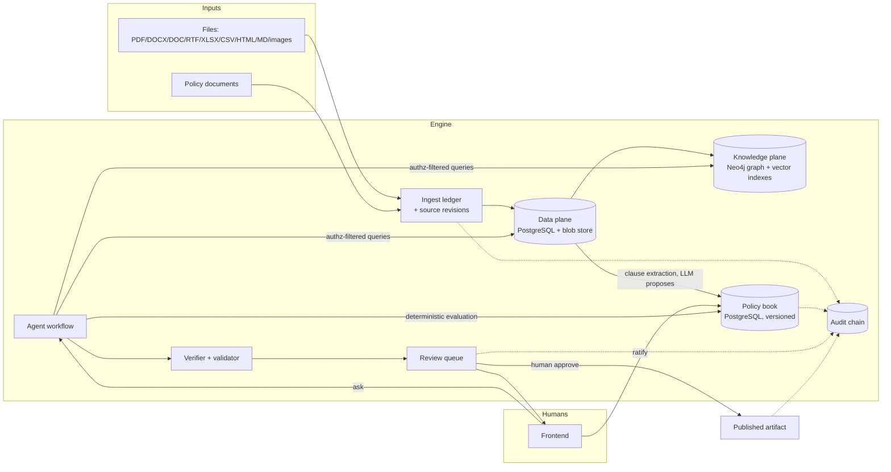
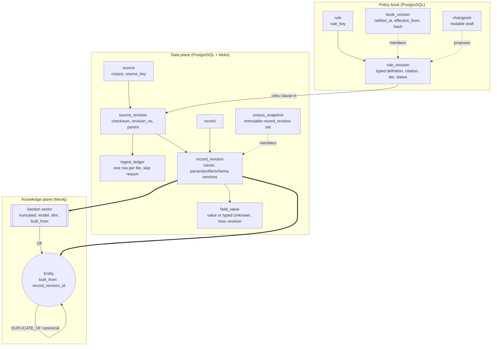
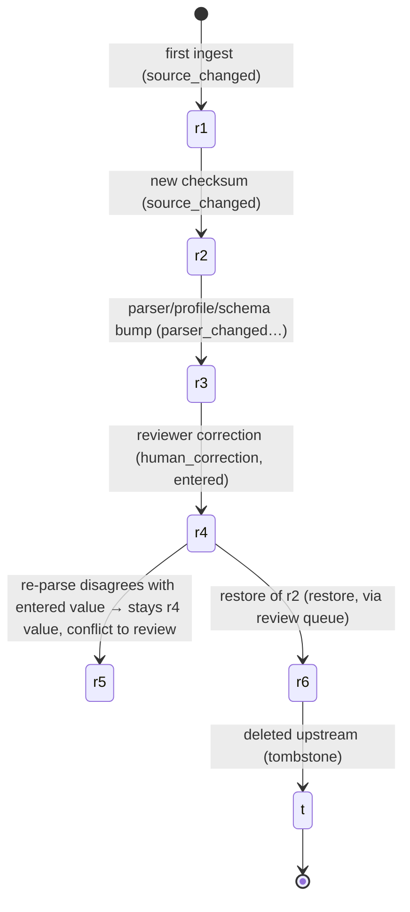
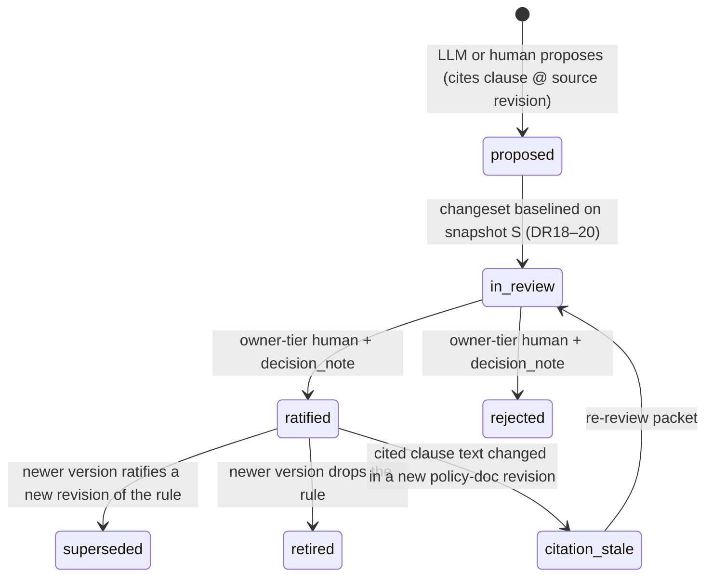
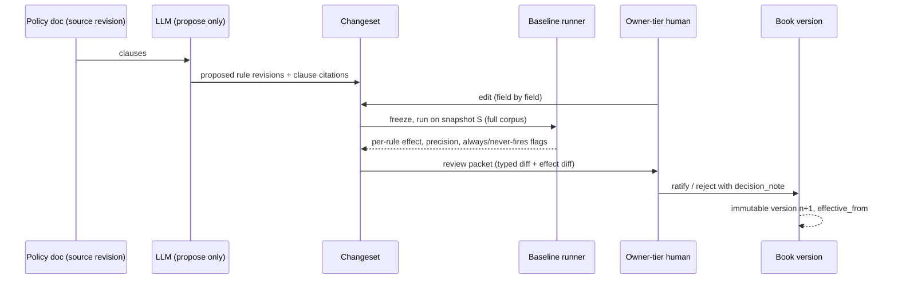
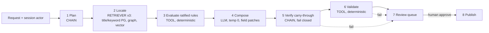
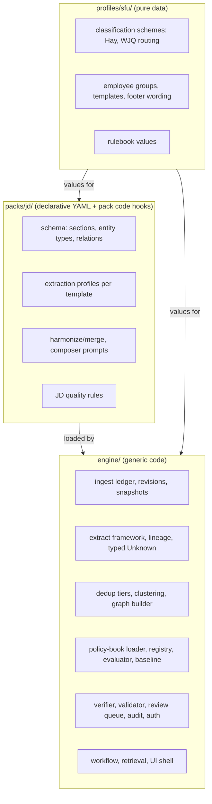

# Architecture

Maintained by the `architect` agent. This page describes the **current state**
and is rewritten whole whenever the design changes. ADRs follow the overview.

**Current state (2026-10-18):** the repository holds the `monitored-harness`
template (tracing helpers, the Copilot role agents, and test and smoke scripts).
The branch `agent/harness-claude-code` adds the Claude Code port (ADR-KE-001):
`CLAUDE.md`, eight `.claude/agents/`, the commit hook in
`.claude/settings.json`, and `scripts/verify.sh`, which runs every gate in the
one-shot `gates` compose service with no network. The engine itself still does
not exist: none of the engine described below has been built. This document is the **proposed
design** for plan approval. Each section is marked *proposed* until the plan
item that builds it is committed. Assumptions `(A<n>)` refer to
[open-questions.md](open-questions.md).

## 1. What the system is

The system is a knowledge engine in a box: an on-premises, offline stack. It
turns an institution's documents into three queryable planes, plus a versioned
**policy book**. It answers through a fixed agentic workflow in which a local LLM
only composes wording. **AI is the interface, not the source of truth.** Every
answer traces to ratified rule revisions and to source record revisions. A
deterministic validator re-judges every AI output, and nothing publishes
without a human.

## 2. Containers (proposed, `platform-skeleton`)

All of these run under docker compose, and every host port comes from `.env`,
defaulting to the 47100–47199 range (A6).

| Service | Image / runtime | Role |
|---|---|---|
| `api` | Python 3.12, FastAPI, uvicorn | HTTP API and server-rendered UI |
| `worker` | same image | ingest, extraction, embedding, baseline and compose jobs |
| `postgres` | PostgreSQL 16 | records, revisions, ledger, policy book, review queue, audit chain |
| `neo4j` | Neo4j 5 community | graph and vector indexes (ADR-KE-002) |
| `valkey` | Valkey 8 | job queue only |
| `phoenix` | Arize Phoenix (local) | traces; inputs and outputs hidden by default |
| `gates` | same image + dev deps | one-shot: `scripts/verify.sh` inside compose, identical in CI |
| model host | external, OpenAI-compatible | Ollama now, vLLM later; host on the egress allowlist (DR30) |

Blob storage holds original files and revision content. It is a volume mounted
into `api` and `worker`, content-addressed by SHA-256 and encrypted per source
(A11).

## 3. The three planes (proposed)

- **Data plane:** original files plus normalized records. Lineage is stored per
  record revision: source revision, page or region, extraction method, parser
  version, model and version, checksum and timestamp. Field values are a typed
  union, `Known(value) | Unknown(reason)`, and each carries `how ∈ {parsed,
  routed, entered, imported}` (DR4–DR6).
- **Knowledge plane:** Neo4j holds both the graph and the vector indexes. The
  graph schema comes from the domain pack. Every node and vector stores
  `built_from` (record revision id) and the versions it was built with (DR8).
  Edges are canonically oriented and MERGEd idempotently (DR10).
- **Policy book:** typed rule revisions grouped into immutable book versions.
  It is evaluated by a pure-Python deterministic evaluator that cannot import an
  LLM client (import-graph test).

## 4. Revision history: corpus and policy (proposed; ADR-KE-007)

Both histories use one pattern: **append-only revision rows, a computed
"current" view, immutable snapshots or versions for anything a decision or
metric depends on, and an audit-chain entry per write.** Mutating a revision is
impossible at the database-role level. The application role has `INSERT` and
`SELECT` only on revision tables. "Current" is a view (the latest non-superseded
revision), never an updated pointer column, so no write can be lost.

### 4.1 Corpus revisions

- **Identity:** `source(corpus, source_key)`, where `source_key` comes from the
  institution profile's external ID, else the path, else the uploader's explicit
  choice (A10). Similarity never decides identity (DR12).
- **Re-ingest:** the same checksum produces no revision (only `seen_at` is
  updated). A new checksum produces `source_revision n+1`, then extraction, then
  `record_revision` with `cause=source_changed`. A parser, profile or schema
  version change re-extracts and writes `cause=parser_changed|profile_changed|
  schema_changed` revisions.
- **Entered values win:** extraction never supersedes a field whose current value
  is `entered`. It records a `field_conflict` row and a review item (§R-REV-C.5).
- **Freshness:** a single SQL plus Cypher predicate,
  `derived.built_from ≠ current_revision(record)`, defines *stale*. The funnel,
  the impact panel and the freshness CLI all call that one predicate (DR32).
- **Snapshots:** `corpus_snapshot` is an immutable membership table. Baselines,
  findings files and metrics reference a snapshot id. Snapshot comparison
  returns the buckets `added | changed | removed | unchanged | unaccounted`,
  and a test asserts they sum to the union of both snapshots (DR33).
- **As-of reads:** queries take `as_of` (snapshot id or timestamp), which
  resolves to a revision set *inside* the query, together with the authorization
  predicate (DR39).

### 4.2 Policy-book revisions

- **Changeset → version:** edits collect in a mutable `changeset`. Submitting
  freezes it, runs the baseline on a named snapshot, and builds the review packet
  (typed diff, effect diff and per-rule precision). Ratifying all its rules
  publishes `book_version n+1` with a content hash, `ratified_at` and
  `effective_from` (A12).
- **Typed diff:** rule definitions are pydantic models (decision table,
  threshold, routing). The diff is structural: cells, operands, targets, tier
  and citation. It is never a text diff of YAML.
- **Effect diff:** for two versions on the same snapshot, the baseline results
  are joined per record, and the diff lists records whose outcome changed.
- **Revert:** a new changeset that re-proposes an older rule revision's
  definition. It goes through the same baseline and ratification. There is no
  pointer rewind.
- **Provenance on outputs:** `draft`, `answer` and `published_artifact` store
  `book_version_id`, `fired_rule_revision_ids[]`, `snapshot_id` or
  `record_revision_ids[]` and `evaluated_at`.

### 4.3 Revision UX

The UX is server-rendered, readable without JavaScript, and shows no similarity
percentages.

| View | Corpus | Policy |
|---|---|---|
| Timeline | Source page → History: revisions with cause badge, actor/version, skip outcome | Book → Versions: status, ratified_at / effective_from, ratifiers, session |
| Compare | Any two revisions: field diff, section word diff, table cell diff, explicit Unknown↔value | Any two versions: rules added/removed/changed with typed diff + effect diff |
| Blame | Per field: value history, `how`, actor, revision | Per rule: revision history, proposer (LLM flagged), decision notes |
| Impact | Derived objects built from this revision, stale count (live query) | Outputs produced by this rule revision (live query) |
| Snapshot | Snapshot list, snapshot-vs-snapshot buckets | Baseline runs per version, keyed by snapshot |
| Change action | Correction or restore → reason + preview diff → review queue | Edit or revert → changeset → baseline → ratification packet |

Diffs are computed server-side by one `revision_diff` module per plane, which
returns a typed diff model. Templates render that model, and tests assert on
the model, not on HTML.

## 5. Policy-book lifecycle (proposed, `policy-book`)

The registry is versioned YAML. The loader refuses to start if a knob lacks a
register entry, or if a `ratified` entry lacks `decided_by`, `decided_on` or
`decision_note` (DR16). `docs/register.md` is generated, and CI fails on drift.

## 6. Agent workflow (proposed, `agent-workflow`)

The whole run is an `agent_span` with one child span per step. The authorization
predicate is part of every retriever query template, and the parameters are
recorded separately from the template. `OPENINFERENCE_HIDE_INPUTS` and
`OPENINFERENCE_HIDE_OUTPUTS` default to `true`.

## 7. Engine / pack / profile split (proposed)

A pack is YAML plus an optional Python module that implements engine-defined
protocols (for example `SectionMerger`). The engine never imports a pack by
name, and a test asserts that engine code contains no profile literals.

## 8. Port verdict table (from `humanaxiom/jd-assistant` @ `2e3e6dc`)

This follows the pattern of the JD repo's ADR-005: one row per module, a verdict,
and a rationale that **bolds** any obligation the port carries. Pure,
deterministic code is ported with its tests. Code coupled to the JD schema or
its stores is rewritten from spec, with the old code and tests kept as the
behavioural reference. Paths are relative to `core/src/` unless noted. Line
counts come from `wc -l` at `2e3e6dc`.

Verdicts: **engine** = generic code; **jd pack** = JD-specific; **SFU profile**
= institution data (pure YAML); **split** = parts go to more than one layer;
**discard** = not carried over.

| # | JD-repo module | LOC | Verdict | Rationale / obligation |
|---|---|---|---|---|
| 1 | `settings.py` | 691 | split | Typed config loader → engine. CAS URL and origins → **SFU profile** |
| 2 | `agents/`, `gates/`, `models/`, `worker/` | ~1,180 | discard | Dev-harness tooling (task runner, gate runner). Replaced by `.claude/agents/` and `scripts/verify.sh` |
| 3 | `memory/` | 137 | discard (pattern → engine) | Harness memory. Its Neo4j vector-index plumbing is reused in the engine's vector store |
| 4 | `api/` shell (main, csrf, deps, errors, readiness, security_headers, service_origin) | 1,230 | engine | Generic hardening. **Drop the harness routes** and add the authz-matrix test (DR39) |
| 5 | `api/db` | 141 | engine | users, roles, sessions. Role names become pack config |
| 6 | `api/services` | 373 | split | audit verify, sessions, users → engine. `cas_service` → **pluggable SSO adapter** (DR42) with SFU config in the profile |
| 7 | `api/routes` | 3,843 | split | auth, admin, front door and forms → engine. review, library and dashboards → **generic engine views over pack data**. compose and compose_ui → jd pack |
| 8 | `api/templates` | 25 files | split | base, login, error, admin and `review_diff` → engine (seed of the revision UX, §4.3). compose, library and role pages → jd pack. Branding and footer → profile |
| 9 | `jd_export/` | 166 | jd pack + profile | The .docx renderer → pack. Template file and mandated wording → profile |
| 10 | `jd_core/models` | 1,137 | jd pack | JD schema contracts. **Rename off the SFU name.** Fields adopt the typed `Unknown` (DR4) |
| 11 | `jd_core/parser` | 1,730 | jd pack + profile | Segmenter → pack. Heading sets, WJQ/CUPE templates and grade patterns → profile. `PARSER_VERSION` becomes a **pack-declared version stamp** (DR8) |
| 12 | `jd_core/quality` | 1,356 | split | Gates and scoring → engine rule evaluator. Validators → pack. Thresholds and boilerplate → profile |
| 13 | `jd_core/rules` (loader 4,365 L + 25 YAML) | 4,977 | split (critical) | Content-hash version stamps, the register 3-way check and trivial exemptions → **engine policy-book loader** (DR16). Rule schemas → pack. Values → profile. Technical YAML (dedup, embeddings, textnorm) → engine defaults. **Rulebook history moves from git into the versioned `book_version` tables (§4.2)** |
| 14 | `jd_core/bank` | 3,762 | split | minhash, shingles, clustering, word_diff, change_log and provenance → engine (`word_diff` backs the revision diffs). merge, similarity, render, embed_text and version_diff → pack. hay_signals and title_family → profile |
| 15 | `jd_core/textnorm.py` | 261 | engine | Generic text normalization |
| 16 | `jd_bank/` helpers | 143 | split | `stable_reason` → engine. `jd_text` → pack. `grade_import` → profile |
| 17 | `jd_bank/db` + alembic 0001–0006 | 404 | engine (rewrite) | Domain-neutral once renamed. **Rewrite to the source / revision / snapshot schema of §4.1.** The old `UNIQUE(storage_ref, sha256)` row-per-change design had no current flag, so changed files double-counted |
| 18 | `jd_bank/ingest` | 1,527 | split | Walk, hash, extract and idempotency → engine ledger. Name scrub → pack. Filename facets → profile |
| 19 | `jd_bank/dedup` (tier 1) | 1,107 | engine | Exact-hash tier (DR9) |
| 20 | `jd_bank/dedup/near` | 1,528 | engine | MinHash/Jaccard with a text-source injection point |
| 21 | `jd_bank/dedup/role` | 1,308 | jd pack | Depends on JD signals |
| 22 | `jd_bank/cluster` | 1,162 | engine + pack hooks | Connected components → engine. Employee-group and level constraints → pack/profile hooks |
| 23 | `jd_bank/embeddings` | 1,590 | engine | Runner, store and reconcile → engine. **Stamp `built_from` record revision** (DR8). `roles.py` → pack |
| 24 | `jd_bank/harmonize` | 921 | jd pack | JD-specific measurement |
| 25 | `jd_bank/canonical` | 1,752 | split | Producer skeleton → engine. Merge policy → pack |
| 26 | `jd_bank/review` | 1,150 | engine | The approval and versioning spine; the core asset. Extend with rule revision provenance (§R-REV-P.6) |
| 27 | `jd_bank/llm` | 413 + 8 j2 | engine (prompts → pack) | OpenAI-compatible client and versioned prompt loader. **Per-pass config** (DR29) |
| 28 | `jd_bank/rewrite`, `jd_bank/quality` | 630 | jd pack | JD prompts. **Rewrite as field patches** (DR23) behind the carry-through verifier (DR24) |
| 29 | `jd_bank/security` | 95 | engine | Egress guard (DR30) |
| 30 | `jd_bank/composer` | 3,000 + 2 YAML | jd pack + profile | Composer → pack. Question sets and form routing → profile. `duplicates.py` and `persist.py` → candidate engine primitives |
| 31 | `jd_bank/library` | 2,112 | split | Library and funnel → engine. **The funnel must query the store live** (`_base.html:76` once served stale numbers). Families and units → profile |
| 32 | `jd_bank/baseline` | 1,487 | jd pack + profile | Runs over a **named corpus snapshot**. Era and group facets → profile |
| 33 | `jd_bank/bank_audit`, `field_audit` | 1,466 | jd pack (+ profile) | Per-form audits |
| 34 | `jd_bank/singletons` | 510 | discard (pattern → pack) | One-off investigation. DR11 is covered by a graph test |
| 35 | `core/scripts` | 546 | discard / profile | One-off backfills. `import_grades` → profile |

The tests come across with the code. At `2e3e6dc` the JD repo has 119 unit, 30
integration and 4 live test files, split by directory, with a `live` marker that
is excluded by default. The port keeps the same layout.

**Gaps the port must close.** The JD repo has no stale detection against a stored
rules or parser version. Its rulebook history exists only in git. It has no
history or diff UI for sources, parses or rules (only drafts get a diff against
the last published version). These gaps are what §4 and ADR-KE-007 address.

## 9. ADRs

The template's existing ADR (OpenInference tracing to Arize Phoenix) stays in
force, and its text is kept below unchanged. The ADRs numbered KE-001 to KE-008
are **proposed**.

### ADR: OpenInference tracing to Arize Phoenix
- Context: `docs/log.md` records what each role did, but not how agent code
  behaved at runtime; custom Python agents exported as plain OpenTelemetry
  spans show up in Phoenix as a flat list.
- Decision: add `harness_telemetry`, a thin layer over the OpenTelemetry SDK
  that sets `openinference.span.kind` and the OpenInference input/output,
  retrieval-document, and token-count attributes, exported over OTLP/HTTP to
  Phoenix. Agents log through `log_event`, which writes the log line and an
  AGENT span with `session.id` = plan-item slug.
- Alternatives considered: `openinference-instrumentation` auto-instrumentors
  (only cover supported frameworks, not hand-written loops); one trace per
  plan item with cross-process context propagation (needs state files to
  carry span context between stateless agent runs — sessions give the same
  grouping for free).
- Consequences: three runtime dependencies; the log line stays the source of
  truth and tracing is best-effort (bounded delay when Phoenix is down).
  Prompts and documents leave the process unless the `OPENINFERENCE_HIDE_*`
  flags are set.
- First tests to write: span kinds and parent/child nesting; error status on
  exceptions; redaction; `log_event` line format and session id.

### ADR-KE-001: Port the harness to Claude Code natively
- **Context:** the role agents are written for Copilot. In the JD repo, Claude
  Code agents were vendored into a subfolder and never installed, while the docs
  said they ran.
- **Decision:** add `.claude/agents/<role>.md`, a `CLAUDE.md` that imports
  `AGENTS.md`, the `block-main-commit` hook in `.claude/settings.json`, and a
  single `scripts/verify.sh [fast|full]`. `.github/agents/` is kept unchanged.
- **Alternatives:** symlinking the Copilot files was rejected because the
  frontmatter is incompatible. A Claude-only harness was rejected because
  Copilot users still rely on it.
- **Consequences:** two sets of agent files must stay in sync, so a unit test
  (`tests/test_harness_port.py`) compares their Constraints sections and their
  handoff/log duty step.
- **Done only with proof:** a dispatch transcript for each role and every
  verify mode run on a clean checkout.
- **As built (`agent/harness-claude-code`):**
  - `scripts/verify.sh` re-runs itself in the one-shot `gates` compose service
    (`docker/gates.Dockerfile`, `network_mode: none` in `docker-compose.yml`).
  - CI's only step is `./scripts/verify.sh full` (`.github/workflows/ci.yml`),
    so nothing runs in CI that verify does not.
  - `.gitattributes` forces LF on `*.sh`. The Windows checkout
    (`core.autocrlf=true`) had CRLF scripts, which fail in containers.
  - `scripts/hooks/block-main-commit.sh` used to print `permissionDecision:
    "allow"` for every non-blocked call. In Claude Code that auto-approves
    every Bash command and bypasses permission prompts. It now never prints
    `allow`. It prints a fixed deny, or it prints nothing so the call goes
    through the normal permission flow. The same script serves the Copilot developer
    agent, so it no longer auto-approves there either.
  - The hook is a simple fail-safe text rule, not a shell lexer: broad on
    main/master (deny `git` plus any history-writing verb), narrow off main
    (deny a single line that pushes to main/master or forces). It uses no awk.
    See the decision record below, which supersedes the round-3 precise
    off-main lexer.
  - Claude Code loads `.claude/agents/` only at session start, so the dispatch
    proof needed a fresh session (evidence:
    `docs/evidence/harness-claude-code/dispatch-*.md`).

#### Decision: commit hook is a simple fail-safe text rule (2026-10-18)
The orchestrator ruled this in round 4. It also answers review N15, which
asked for the hook design to be recorded in this ADR.
- **Context:**
  - Three review rounds of a precise awk shell lexer each produced a
    fail-open regression:
    - B5: compact JSON with no jq.
    - B8: nested syntax.
    - H2: gawk doubles backslashes, which the mawk-only gates cannot see.
  - Each round also produced timing failures (L9, B10): the lexer was
    quadratic under mawk and went past the 10 s hook timeout.
  - Off-main push protection was a medium, non-blocking finding (security
    M1). Branch protection is the real control (Q18).
- **Decision:**
  - Extract the `command` field: jq if it works, else a single sed on the
    first `"command":"…"` value, else the raw input.
  - Normalise: join line continuations, turn JSON `\n` into newlines, delete
    quotes and backslashes, lower-case.
  - On main/master: deny if the text contains the word `git` and any of
    commit, push, merge, cherry-pick, am, rebase or revert.
  - Off main: deny any line containing `git … push` followed on that same
    line by any of:
    - `main`/`master` as a word
    - `--force`/`--force-with-lease`
    - `--mirror`
    - `--all`
    - a single-dash short-flag cluster containing `f`
    - a `+` refspec
  - Use no awk, so there are no dialect differences. Cost is linear.
  - It never prints `allow`.
- **Consequences:**
  - Accepted false positives, which fail safe: a one-line command that
    mentions git, push and main, e.g. `git commit -m "fix git push to main
    docs"` or `echo "git push origin main"`. Heredoc commit bodies stay
    silent unless a single line says it. This reverses the earlier B6
    ruling.
  - Accepted bypasses off main:
    - anything that hides the words (variables, eval, aliases, encodings)
    - `gh` and `update-ref`
    - a push spread across lines without a continuation
- **Alternatives rejected:**
  - Keep extending the lexer: each round added fail-open gaps.
  - A Python or shlex hook: it needs a runtime on the host, and the host has
    only Git Bash.
  - Drop the off-main rule: it would lose cheap coverage of the most likely
    accident.

### ADR-KE-002: Storage split
- **Decision:**
  - Neo4j holds the graph and the vector indexes (no pgvector, no Chroma).
  - PostgreSQL holds records, revisions, snapshots, the policy book, the review
    queue and the audit chain.
  - Valkey is the job queue only.
  - Blobs live on a content-addressed volume.
- **Context:** this follows the JD repo's ADR-002.
- **Consequences:**
  - There are two migration systems: Alembic and versioned Cypher files.
  - A consistency check compares Neo4j `built_from` ids with PostgreSQL
    revision ids.
  - Writes are ordered PostgreSQL first, then Neo4j, using an outbox table, so
    the knowledge plane never references a revision that does not exist.

### ADR-KE-003: Offline inference behind an egress allowlist
- **Decision:**
  - Use one OpenAI-compatible client with a separate config for each pass.
  - The allowlist is checked at startup and on every call.
  - CI installs a socket guard that fails any outbound connection outside the
    compose network.
- **Consequences:** moving the model host off the trusted segment is a
  compliance decision recorded as an ADR amendment, not a config edit.

### ADR-KE-004: Domain packs and institution profiles
- **Decision:**
  - A pack is versioned YAML (entity types, relations, sections, extraction
    profiles, prompts, validation rules) plus optional Python implementing
    engine protocols.
  - A profile is pure data.
  - Every derived object stores the pack version and the profile version.
- **Alternatives:** a plugin entry-point system was rejected as more machinery
  than two packs need.
- **First tests:** a toy pack loads without any engine change, and the engine
  contains no SFU literals.

### ADR-KE-005: Deterministic policy evaluation
- **Decision:** rules are typed pydantic definitions (decision table, threshold,
  routing) evaluated by pure functions.
- **Enforcement:** the `engine.policy.evaluate` package is import-checked so it
  cannot reach any LLM client.
- **Rule lifecycle:** the LLM's only route into the policy book is creating a
  `proposed` rule revision.

### ADR-KE-006: Frontend stack
- **Decision:** server-rendered FastAPI + Jinja + htmx for every view, with one
  Cytoscape.js island for the graph explorer. All assets are vendored and
  checksummed in the offline bundle.
- **Trade-off:**
  - Server rendering reuses the JD repo's working templates and keeps one
    language, one test stack and one authorization path. Every view is
    readable without JavaScript, which suits revision diffs and audit views.
  - What it gives up is a rich client-side graph and diff interactivity.
- **Alternative:** React + TypeScript + Cytoscape.js would give a better graph
  explorer, but adds a Node build chain, a second test stack, an API-only
  authorization surface and a larger offline bundle.
- **Revisit when:** the graph explorer needs more than about 2,000 nodes on
  screen, or a collaborative diff editor is requested.

### ADR-KE-007: Revision history for corpus and policy
- **Context:** the user asked for revision UX and history for both corpus and
  policy. The JD repo gave a changed file a new row with no current flag (it
  double-counted), had no stale detection, and kept rulebook history only in git.
- **Decision:**
  - Append-only revision tables for sources, records, rules and book versions.
  - "Current" is a view, never an updated pointer.
  - Immutable corpus snapshots and book versions are the only things that
    baselines, metrics and outputs reference.
  - The database role is limited to INSERT and SELECT on revision tables.
  - Every revision write is an audit-chain entry.
  - Diffs are typed models computed server-side.
  - Restore and revert create new revisions through review; nothing rewinds.
  - Erasure is done by crypto-shredding per source (A11).
- **Alternatives considered:**
  - PostgreSQL temporal or system-versioned tables: there is no native support
    in PG 16, and extensions complicate the offline bundle.
  - Event sourcing with projections: stronger replay, but it is more machinery
    and the audit chain already gives the ordered event record.
  - Git-backed policy YAML: this is the JD repo's approach. Rejected because
    history is invisible to the UI and cannot carry ratification metadata or
    effect diffs.
- **Consequences:**
  - Storage grows with every revision. Revision content is stored in
    content-addressed blobs, so identical content is stored once.
  - "Current" views need indexes on `(record_id, revision_no DESC)`.
  - Freshness is one predicate shared by the funnel, the CLI and the UI.
- **First tests to write:**
  - `test_source_revision_append_only`
  - `test_unchanged_reingest_no_revision`
  - `test_entered_value_survives_reparse`
  - `test_snapshot_compare_buckets_sum`
  - `test_policy_versions_immutable`
  - `test_policy_diff_typed`
  - `test_revert_is_a_new_changeset`
  - `test_citation_stale_on_policy_doc_revision`
- **Plan placement:** no new plan item is needed.
  - The source and record revision model lands in `ingest-ledger` and
    `data-plane`.
  - `built_from` stamps land in `knowledge-plane`.
  - Policy versions and the changeset lifecycle land in `policy-book`.
  - Output provenance lands in `agent-workflow`.
  - The six history views of §4.3 land in `frontend`, directly after the funnel.

### ADR-KE-008: Authentication, authorization and audit
- **Decision:**
  - SSO goes behind a `IdentityProvider` protocol (CAS first, then SAML and
    OIDC), with a dev provider for CI.
  - Sessions are server-side and revocable.
  - The actor comes only from the session.
  - CSRF protection applies to cookie-authenticated writes.
  - An authorization-matrix test walks the routing table.
  - The audit log is a hash chain maintained by an insert trigger, checked with
    `ke audit verify`.
- **Context:** this follows the JD repo's ADR-008, generalized.
