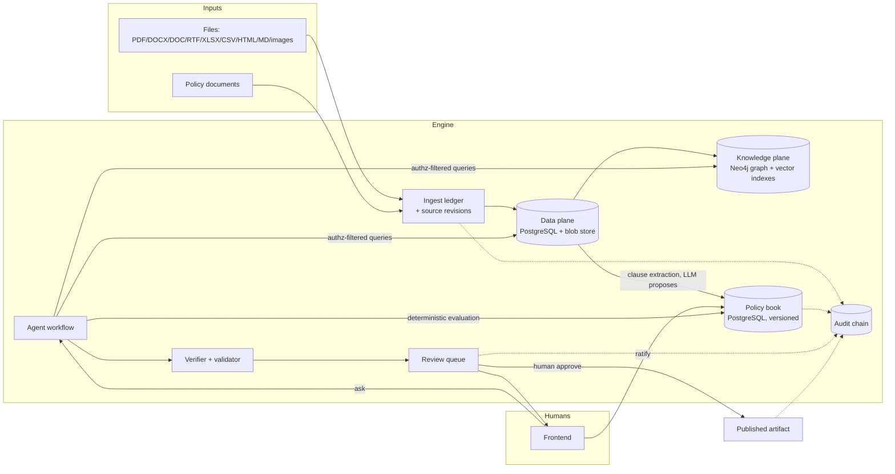
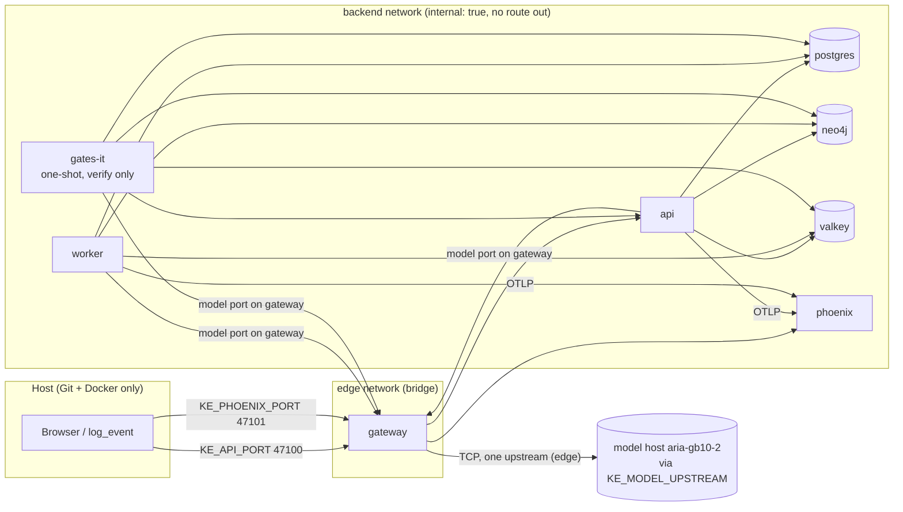
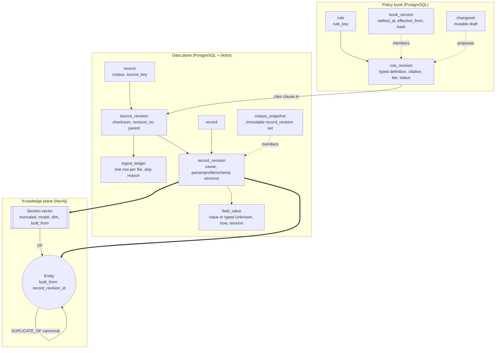
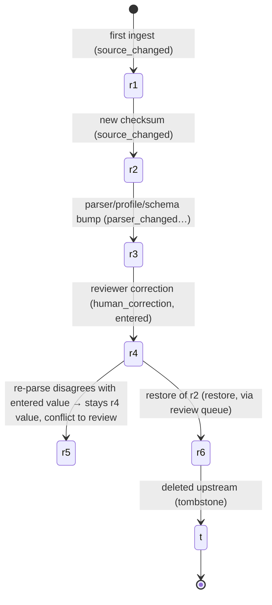
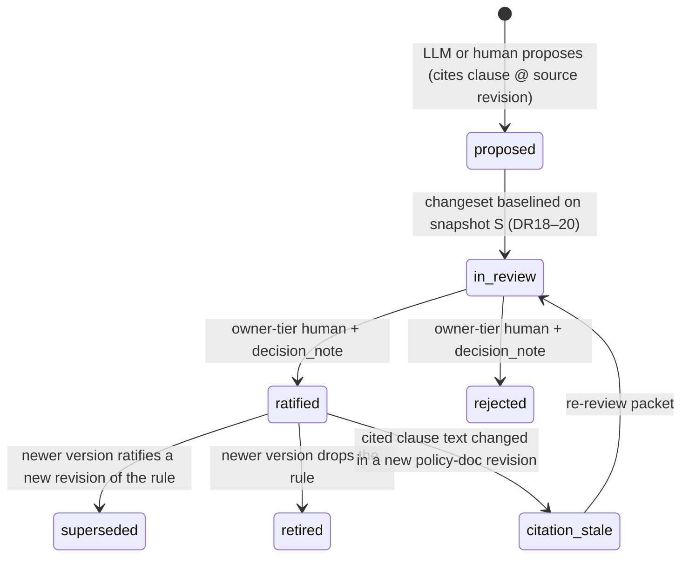
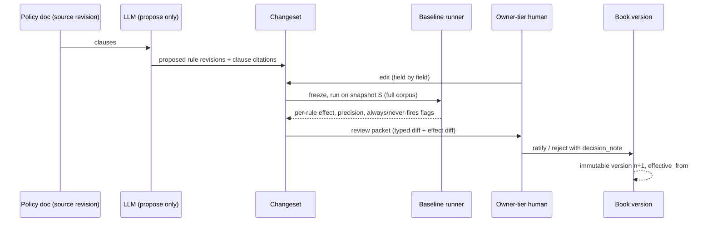
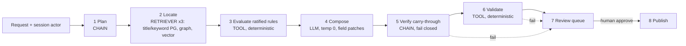
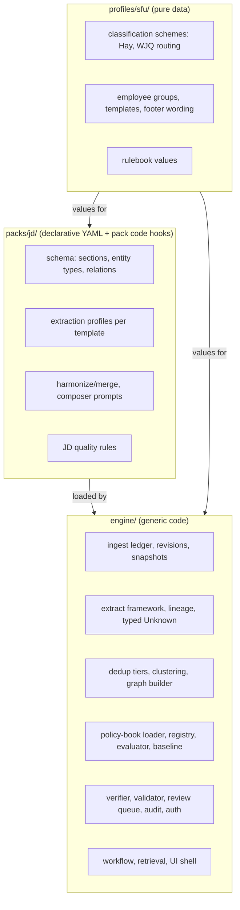

# Architecture

Maintained by the `architect` agent. This page describes the **current state**
and is rewritten whole whenever the design changes. ADRs follow the overview.

**Current state (2026-10-18):** the repository holds the `monitored-harness`
template (tracing helpers, the Copilot role agents, and test and smoke scripts).
The branch `agent/harness-claude-code` adds the Claude Code port (ADR-KE-001):
`CLAUDE.md`, eight `.claude/agents/`, the commit hook in
`.claude/settings.json`, and `scripts/verify.sh`, which runs every gate in the
one-shot `gates` compose service with no network. The engine itself still does
not exist: none of the engine described below has been built. This document is the **proposed
design** for plan approval. Each section is marked *proposed* until the plan
item that builds it is committed. Assumptions `(A<n>)` refer to
[open-questions.md](open-questions.md).

**Next to build (2026-10-18):** `platform-skeleton`, split into
`platform-config` → `platform-stack` → `platform-offline` (§2, ADR-KE-009 to
ADR-KE-012). ADR-KE-009 answers Q19 (formerly PS-Q7): how the gates reach real
stores and a clean Docker daemon. It amends the as-built gates of ADR-KE-001,
and is accepted with the human's Q30 amendment, narrowed by ruling F-A
(model-calling integration tests reach the model host through the gateway
only; no route to the internet). Human rulings folded in: Q30 (as narrowed by
F-A), Q20 (Windows and Linux only),
Q7 (model host `aria-gb10-2`), and the `changeme-` placeholder-secret ruling.

## 1. What the system is

The system is a knowledge engine in a box: an on-premises, offline stack. It
turns an institution's documents into three queryable planes, plus a versioned
**policy book**. It answers through a fixed agentic workflow in which a local LLM
only composes wording. **AI is the interface, not the source of truth.** Every
answer traces to ratified rule revisions and to source record revisions. A
deterministic validator re-judges every AI output, and nothing publishes
without a human.



## 2. Platform (proposed, `platform-skeleton`)

Criteria: `docs/requirements.md` § platform-skeleton (PS-1.x, PS-2.x, PS-3.x).
Decisions: ADR-KE-009 (gates topology), ADR-KE-010 (configuration and egress),
ADR-KE-011 (stack topology and job queue), ADR-KE-012 (offline bundle),
ADR-KE-013 (image scan, platform-supply-chain).
Every image is pinned by digest. **No tag or digest is chosen in this
document.** The developer resolves and records each one at implementation
time, in the sub-item's handoff.

### 2.1 Containers and networks

Everything runs under docker compose. The compose file sets the top-level
`name: knowledge-engine`, so volumes keep their names whatever the checkout
directory is called. **Of the stack services, only `gateway` touches a network
with a route out.** The one-shot `gates-it` verify service sits on `backend`
only, like the app containers (Q30 as narrowed by F-A, ADR-KE-009). There is no
`gates-it` network. Its only way off the machine is the gateway's single
upstream forward to the configured model host.

| Network | `internal` | Members |
|---|---|---|
| `edge` | no | `gateway` |
| `backend` | yes (no route out), and `gateway_mode_ipv4: isolated` (no route to the Docker host; rework 1, M-2) | every stack service, `gates-it` |
| `offline` | yes, and `gateway_mode_ipv4: isolated` (platform-offline) | `dind`, `offline-client` |

Profile-only one-shots outside these networks: `gates` (`network_mode:
none`) and, from **platform-supply-chain** (not this branch, ruling R3), the
scanner pair of ADR-KE-013 (`scan-db` on the default bridge, the only one-shot
with a route out, which fetches the vulnerability database; `scan` with
`network_mode: none`).

**Every network that sets `gateway_mode_ipv4: isolated` also sets
`internal: true`** (`backend`, `offline`, and any inner network inside
`dind`). Engine 29 refuses `isolated` without `--internal` (spike S3), so the
pair is one invariant and a static test checks it.

**`backend` is isolated from the Docker host too (amended, platform-stack
rework 1, security M-2).** `internal: true` removes the route out, but the
bridge still gives the host an address on `backend` (the bridge gateway), so
any backend container could reach a host service bound to `0.0.0.0`, such as
a local model server, a proxy or sshd, and bypass the gateway and the
allowlist. `backend` therefore also sets
```yaml
driver_opts:
  com.docker.network.bridge.gateway_mode_ipv4: isolated
```
and Docker then gives the bridge no host address. This needs **Docker Engine
28 or later**. Older engines ignore the option without an error, so
`launch.sh`/`.ps1` refuse anything but a numeric Engine version ≥ 28 (§2.4
Scripts; rework 2) and `docs/quickstart.md` lists Engine ≥ 28 as a
prerequisite.

**No fixed address on `backend` (rework 2, review R1-B1 option (ii),
security M-4).** `backend` has **no `ipam` block**: no subnet, no
`ip_range`, and no address literal anywhere in compose, config or tests.
Docker picks the subnet from its default pools per project. So parallel
stacks from this compose file are supported again: the live stack, any
number of `ke-verify-*` runs, and stacks in other worktrees each get their
own `<project>_backend` and never hit "Pool overlaps". (Two *live* stacks
still need different published ports; verify publishes none.) The runtime
proof of isolation is the network's own configuration, checked from the
host (§2.2 No route out). `edge` is unchanged:
the gateway needs its route out. `offline` (platform-offline) takes the same
option and `internal: true`, and the offline check asserts both at runtime
(§2.5).

| Service | Image (digest pinned at implementation) | Networks | Restart | Role |
|---|---|---|---|---|
| `gateway` | `ke-gateway`, built `FROM` the official nginx image (unprivileged variant) with the config baked in | `edge`, `backend` | `unless-stopped` | Publishes the only host ports, on `KE_BIND_ADDRESS` (loopback by default; §2.4). Reverse-proxies `api` and `phoenix`, and forwards one TCP port to the model host. Its entrypoint refuses an upstream that is not on the allowlist (§2.4) |
| `api` | `ke-app` (`docker/app.Dockerfile`): Python 3.12, FastAPI, uvicorn | `backend` | `unless-stopped` | HTTP API, server-rendered UI, `/healthz`, `/readyz` |
| `worker` | `ke-app` | `backend` | `unless-stopped` | RQ worker (ADR-KE-011). Only the no-op job for now. In 2a it is a placeholder, `python -m engine.worker`, that runs `startup()` and then idles; 2b runs an RQ `SimpleWorker` on queue `default` after `startup()` (§2.4 Worker) |
| `postgres` | official `postgres`, major 16 | `backend` | `unless-stopped` | records, revisions, ledger, policy book, review queue, audit chain |
| `neo4j` | official `neo4j`, 5.x community | `backend` | `unless-stopped` | graph and vector indexes (ADR-KE-002) |
| `valkey` | `valkey/valkey`, major 8, AOF on | `backend` | `unless-stopped` | job queue only |
| `phoenix` | `arizephoenix/phoenix` (today `version-20.22.0`; digest added) | `backend` | `unless-stopped` | traces for the product and the harness (Q2 ruling) |
| `gates` | `ke-gates` (`docker/gates.Dockerfile`) | `network_mode: none` | none | one-shot, profile `gates`: lint and unit gates (unchanged from ADR-KE-001) |
| `gates-it` | `ke-gates` (same YAML anchor) | `backend` only; no Docker socket | none | one-shot, profile `gates-it`: unit, integration, coverage and mypy against the real stores; model-calling tests reach the model host only through `gateway`, and run only when it is reachable (ADR-KE-009, Q30/F-A) |
| `probe` | — | — | — | **Dropped (platform-offline plan).** Never built. The live smoke runs its in-stack checks with `compose exec`, and the `ci/offline` control runs as a throwaway `docker run` of the api image on `<project>_edge` (§2.5), so no compose service other than `gateway` joins `edge` |
| `dind` | official `docker` image, `dind` variant, digest pinned, Engine ≥ 28, its default (containerd) image store; privileged | `offline` (internal, isolated), network alias `docker` (the TLS server cert's SAN; spike S3) | none | profile `offline`: clean daemon for the offline check (ADR-KE-009, ADR-KE-012) |
| `offline-client` | `ke-gates` (not the `x-gates` anchor: no repo mount); uid 10001 | `offline` (internal, isolated) | none | profile `offline`: installs the bundle into `dind`, launches, smokes, tears down (§2.5) |
| `scan-db`, `scan` | **platform-supply-chain, not this branch.** The scanner image (ADR-KE-013), digest pinned | `scan-db`: default bridge; `scan`: `network_mode: none` | none | profile `scan`: fetch the vulnerability database, then scan the `ke-app` image tar offline |
| model host | external, OpenAI-compatible | — | — | The deployment's model host is `aria-gb10-2` (Q7 ruling). Ollama now, vLLM later. The app reaches it only through `gateway`. Config carries it in `KE_MODEL_UPSTREAM`; no code names it |

`gates`, `gates-it`, `dind` and `offline-client` (and, from
platform-supply-chain, `scan-db` and `scan`) are behind compose profiles
(`gates`, `gates-it`, `offline`; later `scan`; as built, `gates-it` has its
own profile), so `up` never starts them.

**Image tags (platform-offline, review N6).** The three first-party images
are `ke-app:${KE_IMAGE_TAG:-local}`, `ke-gateway:${KE_IMAGE_TAG:-local}` and
`ke-gates:${KE_IMAGE_TAG:-local}`; `.env.example` gains `KE_IMAGE_TAG=local`.
As built they were bare names (implicitly `:latest`), so a verify run in one
worktree retagged the image the live stack or another worktree's verify run
would start next. `verify.sh` (host half, both modes, after the L-11 unset)
exports `KE_IMAGE_TAG=wt-<first 12 hex of the SHA-256 of the checkout's
absolute path>`. So:
- verify never moves `:local`, which only an operator's own `build.sh` sets
  (`install.sh` tags `ke-<x>:bundle-<sha12>` and never touches `:local`,
  §2.5);
- each worktree has one stable tag set, so there is nothing to clean up per
  run and layers stay shared through the build cache;
- two runs in the same worktree build from the same files.
`wt-*` tags are never removed automatically; `docker image prune` is the
operator's call.



`gates-it` is on `backend` only. Its model-calling tests go through
`ModelClient` → `gateway` → `KE_MODEL_UPSTREAM`, the same path as the app, so
the DR30 allowlist and the gateway forward are what the tests exercise. No
other path leaves `backend`.

Stack services (everything without a profile) use **named volumes only, with
no bind mounts**, so the same compose file runs unchanged inside `dind`. Only
the one-shot gate services bind-mount the checkout.

Blob storage holds original files and revision content. It is a volume mounted
into `api` and `worker`, content-addressed by SHA-256 and encrypted per source
(A11). It arrives with `ingest-ledger`.

### 2.2 How `verify.sh` runs the gates (ADR-KE-009, answers Q19)

**Status: accepted with a human amendment (Q30, 2026-10-18), narrowed by
ruling F-A (2026-10-18).** The mechanism is compose services with no Docker
socket, as proposed. `gates-it` sits on the `internal: true` `backend` network
only; there is no separate external network for it. Tests need to reach only
the LLM on `aria-gb10-2`, not the internet, so model-calling integration tests
reach it through the gateway's upstream forward (edge network) and nothing
else. Unit `gates` keeps `network_mode: none`. `platform-stack` is not blocked.

`scripts/verify.sh` keeps its two halves.
- **Host half:** only Docker orchestration, which calls other scripts.
- **Container half:** only calls `scripts/lint.sh` and `scripts/test.sh`.

No gate command is ever written in `verify.sh`
(`test_verify_sh_has_no_inlined_commands` stays as it is).

- **Isolation.** Each run uses its own compose project,
  `ke-verify-<random suffix>`. It reads `--env-file .env.example` only
  (`KE_ENV_FILE=.env.example`). *As built (2a; drift fixed in 2b plan):* there
  is no `config/verify.env`; no verify-only override has been needed, and the
  two model keys below arrive through the process environment, which compose
  ranks above any env file. `docker-compose.verify.yml` resets every `ports:` to an empty list (`!reset`,
  Compose ≥ 2.24), so a verify run publishes nothing. `backend` has no fixed
  subnet (§2.1, rework 2), so each project's networks come from Docker's
  default pools. A verify run therefore never collides with the live stack
  or with a parallel verify run.
- **The real model host, through the gateway, skipped when unreachable (Q30,
  F-A, Q7).** `.env.example` leaves `KE_MODEL_UPSTREAM` and
  `KE_EGRESS_ALLOWLIST` empty (rework 2, R2), so by itself a verify run has no
  upstream. **Model keys in local verify (umbrella ruling, 2026-10-19;
  designed in platform-stack-ready):** the host half of `verify.sh full`
  passes exactly these two keys, from the caller's environment or else the
  operator's gitignored `.env`, into the verify project, and nothing else
  from `.env`:
  - `scripts/env_value.sh <NAME>` prints one value. `NAME` must be
    `KE_MODEL_UPSTREAM` or `KE_EGRESS_ALLOWLIST`; any other name exits 2
    before anything runs, so it can never become a general `.env` reader.
    1. If `NAME` is set in the process environment, even to the empty
       string (`${NAME+x}`), it prints that value. The caller wins.
    2. Else, if `./.env` does not exist, it prints nothing.
    3. Else it runs `docker compose -f docker-compose.yml --env-file .env
       config --format json gateway` with compose's stderr discarded, and
       extracts `services.gateway.environment.<NAME>` line by line, with the
       same narrow pattern as `launch.sh` (§2.4 Bind address, Launch). So
       compose's own dotenv grammar resolves the value (all the L-1 forms),
       and `.env` is **never sourced, `eval`ed or parsed by the script**.
       Only the `gateway` service is rendered, and it carries neither store
       secret, so no secret value enters the captured output. The JSON is
       held in a shell variable, never written to disk.
    4. `config` failing, or a value that does not match the pattern (for
       example one with a JSON escape), exits non-zero with a message that
       names `.env` and `NAME` and never echoes file content.
  - `verify.sh` (host half, `full` only, before `build.sh`) assigns each key
    from `"$(scripts/env_value.sh <NAME>)"`, a plain string assignment with
    no evaluation; under `set -e` a helper failure stops the run before
    anything is built. **Both or neither:** if either value is empty, both
    are set empty and verify prints one line saying the model-calling tests
    will skip and naming the two keys. Then both are exported. The verify
    project's `gateway`, `api`, `worker` and `gates-it` read them from the
    process environment, ahead of `.env.example`.
  - The operator sets, in `.env` or the shell, `KE_MODEL_UPSTREAM=<host>:<port>`
    and `KE_EGRESS_ALLOWLIST=<host>` (the gateway prefix is added by compose
    for the app containers, §2.4 Model wiring).
  - When the keys are empty the model-calling tests skip with the named
    reason `model host not configured: KE_MODEL_UPSTREAM is empty (set it and
    KE_EGRESS_ALLOWLIST in the caller environment or .env)`, which is what CI
    always shows.
  `gates-it` itself
  has no route out; the gateway forward is its only path to the model host.
  Model-calling integration tests:
  - first run one reachability probe per test run: `GET {compose.base_url}/models`
    through `ModelClient`, so it passes the egress guard, with
    `readiness.timeout_s`;
  - run when the probe succeeds;
  - otherwise raise `unittest.SkipTest` with a named reason built from the
    configured value and the fixed reason vocabulary of `/readyz`, e.g.
    `model host unreachable: <KE_MODEL_UPSTREAM> (timeout)`. unittest prints
    it in the verbose output, so the skip is visible in the evidence file.
  - *Where (2b):* the helper is `require_model_host(test)` in
    `tests/integration/model.py`. It reads `KE_MODEL_UPSTREAM` from the
    `gates-it` environment (empty → the "not configured" reason above), then
    calls `ModelClient(settings, "compose").probe(readiness.timeout_s)` once
    per process (cached), and builds the reason with
    `engine.readiness.classify`, the same function `/readyz` uses, so the two
    vocabularies cannot drift.
  On GitHub runners the host is never reachable, so those tests always skip
  in CI. The probe outcome is never a failure, and no other test may skip on
  network grounds.
- **`fast`:** unchanged. `docker compose … --profile gates run --rm --build
  gates scripts/verify.sh fast` → `lint.sh`, `test.sh fast`, with
  `network_mode: none`.
- **`full`:**

```mermaid
sequenceDiagram
  participant H as verify.sh (host)
  participant D as host Docker daemon
  participant G as gates-it (backend only)
  participant W as gateway (backend + edge)
  participant M as model host (KE_MODEL_UPSTREAM)
  participant S as smoke.sh (host)
  participant O as offline_check.sh (host)
  H->>H: trap → teardown.sh --volumes (this project)
  H->>H: env_value.sh KE_MODEL_UPSTREAM / KE_EGRESS_ALLOWLIST (caller env, else .env via compose config; both or neither)
  H->>D: build.sh (ke-app, ke-gateway, ke-gates; store images by digest)
  H->>D: launch.sh (up -d --no-build --wait)
  H->>G: compose run gates-it scripts/verify.sh full
  G->>G: lint.sh; test.sh full (unit + store integration, coverage, mypy)
  G->>W: probe GET /models via ModelClient (DR30 allowlist)
  W->>M: TCP forward, one upstream
  alt reachable
    G->>W: model-calling integration tests
    W->>M: TCP forward
  else unreachable (always on GitHub runners)
    G->>G: skip them: "model host unreachable: <upstream> (<reason>)"
  end
  H->>S: smoke.sh
  S->>D: launch.sh (idempotent), checks, exec api readyz ready
  S->>D: stop postgres, exec api readyz not-ready:postgres, up --wait postgres, exec api readyz ready
  S->>D: ci/offline: control from a throwaway api-image container on edge, then api and worker must get no_route (§2.5)
  Note over H,G: the OTLP check runs in the container half (gates-it), as in 2a
  H->>D: teardown.sh --volumes (stage: frees memory and disk before DinD; the trap repeats it)
  H->>O: offline_check.sh (disk check, bundle.sh, dind, offline-client: install, launch, smoke, teardown; df logged per stage; §2.5)
```

*As built (2b) and planned (platform-offline):* smoke runs with
`KE_SMOKE_OWNS_PROJECT=1` and leaves the teardown to verify's trap (ruling
Q37); the container half also runs `smoke.sh`, which in the gates image is
the OTLP check. platform-offline appends the last two stages above. Each is
one script call; `verify.sh` gains no command of its own (F5,
`test_verify_sh_has_no_inlined_commands`, whose forbidden list gains
`docker save` and `sha256sum`). *platform-supply-chain* later inserts
`scan.sh` (ADR-KE-013) between the teardown and `offline_check.sh`, and adds
the scanner's name to the forbidden list; this branch has no scan stage (R3).

- **Two-sided scripts.** `smoke.sh` has the same two-sided shape as
  `verify.sh`, keyed on `KE_IN_GATES`.
  - On the host it runs the live-stack smoke (PS-2.8).
  - In `gates` it runs today's OTLP check (`smoke_otlp.py`).
  - *Drift fixed (platform-offline plan):* there is no `smoke.sh --live`
    flag. `offline-client` runs on the gates image, which sets
    `KE_IN_GATES=1`, so its service sets `KE_IN_GATES` to the empty string
    and the same `smoke.sh` takes its host half there.
- **Store-down cases.** Because `gates-it` has no Docker socket, it cannot stop
  a container. Integration tests make a store "down" in process, by pointing
  one store's settings at a closed port on a stack host. The real stop and
  start of a container happens in `smoke.sh` on the host.
- **No route out, proven at runtime (amended 2026-10-19, F-A drift fix).**
  `backend` being `internal: true` is the boundary for `gates-it`. The earlier
  `tests/integration` socket-guard fixture is dropped: it could not see libpq
  (psycopg connects in C), and since F-A the network layer already refuses
  every raw connection out. The in-process socket-guard test that went with
  it was superseded in the requirements (PS-2.7). Two tests prove the boundary:
  - **Statically:** `test_gates_it_internal_only_and_no_socket` (fast), and
    `test_backend_network_isolated_from_host` (fast, rework 1): `backend` has
    `internal: true` and the driver option
    `com.docker.network.bridge.gateway_mode_ipv4: isolated`.
  - **At runtime:** `test_gates_it_has_no_route_out` (PS-2.7). Amended in
    rework 1 (review B1, security M-2), because "the connect failed" alone
    also passes when a route exists and nothing answers:
    1. A raw TCP connect from `gates-it` to a TEST-NET-1 address must fail
       **fast and with a no-route errno**: `errno in {ENETUNREACH,
       EHOSTUNREACH}`, not `TimeoutError`, within a tight bound (about 2 s,
       well under the socket timeout). A timeout means packets left, so it
       fails the test.
    2. *(Removed in rework 2, R1-B1 option (ii).)* The in-container probe of
       the `backend` bridge-gateway address is gone, with its derived `.1`
       address. Host isolation is proven by the host-side check below.
    3. The control: `gateway`'s model listen port accepts.
  - **Host isolation, at runtime (rework 2, R1-B1 option (ii); closes
    security M-4).** The host half of `smoke.sh` (so every `verify.sh full`,
    for its own `ke-verify-*` project, and every live smoke) asserts that the
    project's `backend` network carries the option:
    - The project name is the `name:` line of `docker compose <args> config`
      (the same argument list launch uses), so `COMPOSE_PROJECT_NAME` and
      the compose file's top-level `name` both resolve as compose resolves
      them, and the script names no project literal.
    - `docker network inspect <project>_backend --format '{{index .Options
      "com.docker.network.bridge.gateway_mode_ipv4"}}'` must print exactly
      `isolated`. A missing network, an inspect error, an empty value or any
      other value fails the smoke, naming the network and the option.
    - It also checks `.Internal` is `true` on the same inspect.
    - **Why not probe an address from inside:** a connect from a container
      can only show that one address did not answer, never that the host
      has no address on the bridge. Measured in this item:
      - With `isolated`, Docker hands the subnet's `.1` to a container, so a
        `.1` probe can hit a stack service (rework 1 saw an RST from one).
      - Without `isolated` and with an `ip_range`, the host's bridge address
        is the first `ip_range` address, not `.1`, so the probe missed it
        and passed with isolation lost (security M-4, control 3).
      - On Docker Desktop the host side is a VM, and probes of `.1` give the
        same timeouts and errnos with and without `isolated` (review
        rework 1, server 29.5.2), so no errno discriminates.
      The daemon's network configuration is the authoritative source, and
      the host half can read it without a Docker socket in any container.
    - The static `test_backend_network_isolated_from_host` stays. Together
      they cover both "the compose file lost the option" and "the engine
      ignored it".
    - First tests (fast, fake docker): the smoke host half fails when
      inspect prints an empty value, `nat`, or exits non-zero, and passes on
      `isolated`; it inspects `<project>_backend` for the project that
      `config` names (`ke-verify-123` in the fixture). The real run in
      `verify.sh full` is the integration proof; a mutant compose file
      without the option must make it fail (reviewer measures).

  The allowlist layer is proven separately, by
  `test_egress_allowlist_holds_with_network_access`.
- **No runtime installs.** The gates anchor sets `UV_OFFLINE=1` alongside
  `--locked`, so a verify run can never pass locally only because it fetched
  a dependency that CI could not.
- **Container health.** Health of the running containers is proven by
  `launch.sh --wait`, which fails unless every healthcheck passes, and by
  smoke's `check_healthy` before the proxy checks and after the final ready
  (as built; there is no `probe` service).
- **Unprivileged gates, read-only checkout (platform-offline, security
  L-5).** As built, `gates` and `gates-it` run as root with the checkout
  mounted read-write, so test code could write `.git/hooks` or any file.
  The `x-gates` anchor changes for both services. Amended from spike S2
  (`docs/evidence/platform-offline/spikes.md` §S2), which ran the fast suite
  as uid 10001 on a read-only checkout and listed every failing write:
  - **Image (`docker/gates.Dockerfile`).**
    - `ENV UV_CACHE_DIR=/opt/uv-cache` before the build-time `uv sync`, so
      the cache that holds the build backend (hatchling) is image-owned, not
      root's 0700 `/root/.cache/uv`. `uv run --locked` re-installs the
      editable project on every run and needs both the cache and a writable
      venv.
    - `chown -R 10001:10001 /opt/venv /opt/uv-cache` after the last sync
      (security L-1: with group 0 the gates user could also write the
      group-writable PowerShell tree).
    - `git config --system --add safe.directory /work` (that one path, never
      `*`), so git accepts a CI checkout owned by another uid ("dubious
      ownership"). The system file is used because HOME is not writable.
    - The Docker CLI and compose plugin, pinned (Lint, below), because
      `offline-client` needs them (S3 found none in the image).
    - It ends with `USER 10001`.
  - **Compose (`x-gates`).**
    - `user: "10001:10001"`, matching the image ownership; never group 0
      (security L-1).
    - `cap_drop: [ALL]` and `security_opt: [no-new-privileges:true]` on both
      `gates` and `gates-it` (security L-2). The gates need no capability.
    - The checkout is mounted `read_only: true` (long syntax). Nothing else
      in it is writable.
    - `tmpfs: ["/tmp:exec,mode=1777"]` (short syntax, which carries the
      options). `exec` is required: Docker's tmpfs default is `noexec`, and
      the tests that copy and run `scripts/*.sh` from a temp directory then
      fail (S2 found 197 failures).
    - Environment: `MYPY_CACHE_DIR=/tmp/mypy`, `PYTHONDONTWRITEBYTECODE=1`
      and `GIT_OPTIONAL_LOCKS=0` (so the container half's `git diff --quiet`
      never tries to write the index). `UV_OFFLINE=1` stays.
  - **Coverage data goes to `/tmp` through `pyproject.toml`, not the
    environment.** `[tool.coverage.run]` gains `data_file =
    "/tmp/.coverage"`. The env var `COVERAGE_FILE` is **not** used: nested
    coverage runs started by tests inherit it, write statement-only data into
    the same files, and `coverage combine` then fails ("Can't combine
    statement coverage data with branch data"). A nested run reads its own
    temp `pyproject.toml` and is unaffected by `data_file` (S2 item 4).
  - `test.sh` drops its `rm -f .coverage.*` in the checkout. Two guarantees
    keep stale parallel data out of `coverage combine` (corrected, review B2):
    - `[tool.coverage.run]` sets `parallel = true`. In coverage 7.16,
      `coverage erase` removes the `data_file.*` parallel files **only** when
      `parallel` is configured; `-p` on `coverage run` does not change what
      erase does, and without the setting `/tmp/.coverage.*` survives erase.
      A fast test runs the real `coverage erase` with the repo's
      `[tool.coverage.run]` table (`data_file` redirected to a temp dir) and
      asserts that a planted stale parallel file is gone.
    - `/tmp` is a fresh tmpfs in each `docker compose run` container, so no
      parallel file survives from an earlier run. This is the second
      guarantee, not the only one.
  - **`UV_NO_SYNC` is forbidden** in compose, Dockerfiles and scripts. It
    lets the gates pass when `pyproject.toml` has drifted from `uv.lock`
    (S2 item 5), which hides the lock gate. A static test asserts its
    absence.
  A test that writes into the checkout now fails with `EROFS`; that is a
  test defect, fixed in the test. The checkout must be readable by uid
  10001: true for CI checkouts and Docker Desktop mounts; a Linux checkout
  made under `umask 077` fails loudly, and `docs/quickstart.md` says so.
  - **`.env` is masked (PS-3.5).** When `./.env` exists, the host half of
    `verify.sh` adds the overlay `docker-compose.gates-mask.yml`. That
    overlay binds the committed empty file `docker/empty` read-only over
    `/work/.env` for `gates` and `gates-it`. Masking a file that exists
    needs no writable mount point.
    - The overlay holds **only** that mask volume for the two services. It
      carries no `profiles`, `networks`, `network_mode` or other copied keys
      (review B1). Per-service properties are read from
      `docker-compose.yml`, and a test pins the overlay's content.
    - Fast mode **always** exports `COMPOSE_FILE` (the base file, plus the
      mask overlay when `.env` exists) and `COMPOSE_PATH_SEPARATOR`, whether
      or not `.env` exists (security M-1, review N7). A `COMPOSE_FILE` set by
      the caller and an auto-loaded `docker-compose.override.yml` are
      therefore ignored and cannot replace the read-only checkout mount. A
      fake-docker unit test asserts both.
    - When `.env` is absent there is nothing to read, so no overlay is
      added: a mount point inside the read-only checkout cannot be
      created.
    - The choice is one file test in the host half. `env_value.sh` still
      reads `.env` on the host, as before.
    - Other gitignored `.env.*` files are not masked, which is a residual
      for security. For example, smoke's temporary `.env.smoke.*` holds
      nothing.
  - **Scope.** The analyst's PS-3.5 scopes this to `gates-it`. Because the
    anchor is shared, `gates` (fast) gets it too. That costs nothing and
    keeps one anchor. If the orchestrator wants `gates` left alone, the
    anchor splits.
- **Lint (made concrete in rework 1, review B5).** `scripts/lint.sh` runs
  shellcheck over `scripts/**/*.sh` and `docker/**/*.sh`, and PSScriptAnalyzer
  (`Invoke-ScriptAnalyzer`, severity Warning and Error, any finding is
  non-zero) over `scripts/*.ps1`. It runs **inside the gates image only**,
  never on the host. The container half of `verify.sh` calls `scripts/lint.sh`
  and then `scripts/test.sh`, in both modes, so `gates` (fast) and `gates-it`
  (full) both lint. The command lines stay in `lint.sh`
  (`test_verify_sh_has_no_inlined_commands`).
  - Gates image: `shellcheck` from the pinned Debian base's apt; `pwsh` from a
    version-pinned release archive checked by SHA-256; PSScriptAnalyzer at a
    pinned version, fetched at **build** time. With `UV_OFFLINE=1` and
    `network_mode: none`, nothing is fetched at gate time.
  - **PSScriptAnalyzer by hash (platform-supply-chain, PS-3.7, security
    L-8; review N-7; not this branch).** As built it is `Install-Module -RequiredVersion` from a gallery
    set `Trusted`, with no hash or signature check. Instead the Dockerfile
    downloads the package (`.nupkg`) for the pinned version from the
    PowerShell Gallery's package endpoint with `curl`, checks it with
    `sha256sum -c` against `ARG PSSCRIPTANALYZER_SHA256` (the same control
    as the pwsh tarball), and unpacks it with Python's `zipfile` into the
    AllUsers module path for that version, dropping the NuGet packaging
    files. No `Install-Module` and no `Set-PSRepository`. The hash is
    computed at implementation from the downloaded file, cross-checked
    against the hash the gallery publishes for that version, and both are
    recorded in the handoff. `Get-AuthenticodeSignature` was not chosen: it
    does not verify signatures on Linux. `POWERSHELL_TELEMETRY_OPTOUT` and
    `POWERSHELL_UPDATECHECK` move to an `ENV` **before** the first `RUN`
    that starts pwsh (N-7).
  - The gates image also gains the Docker CLI and the compose plugin
    (static release binaries, version pinned and SHA-256 checked, compose
    ≥ 2.24) for `offline-client` (§2.5; platform-offline). The gates
    services never get a socket or a `DOCKER_HOST`; only `offline-client`
    points at `dind`.
  - **Layer order (review N8 applied to the gates image).** As built, the
    gates image copies the code before `uv sync`, so every code change
    reinstalls every dependency. It follows `app.Dockerfile`: copy
    `pyproject.toml` and `uv.lock`, `uv sync --locked --no-install-project`,
    then copy the code and sync again.
  - **Paths never become code (rework 2, security L-7).** `lint.sh` never
    builds PowerShell source from file names. The `-Command` text is one
    fixed single-quoted shell constant with no expansion in it. The `.ps1`
    paths reach it only through the environment: `lint.sh` exports
    `KE_LINT_PS1_FILES`, the paths joined by newlines, and the fixed command
    splits `$env:KE_LINT_PS1_FILES` and calls `Invoke-ScriptAnalyzer -Path`
    on each as a value. A path containing a newline is refused (exit
    non-zero) before pwsh runs.
  - **No wildcard characters in a linted path (2b, security L-10).**
    `Invoke-ScriptAnalyzer -Path` treats its value as a PowerShell wildcard
    pattern and has no `-LiteralPath`, so `scripts/a[1].ps1` matches no file
    and is silently not analysed, while `*` or `?` can match other files.
    `lint.sh` refuses any `.ps1` path containing `[`, `]`, `*` or `?`, in the
    same loop and the same way as the newline: exit non-zero before pwsh
    runs, with a message naming the rule (the path itself is not echoed, for
    the same reason as L-7). Escaping (`[WildcardPattern]::Escape`) was not
    chosen: it is one more piece of PowerShell source to get right, and no
    script here needs those characters. First test (fast): a temp tree with
    `scripts/x[1].ps1`, then one each with `*` and `?` (legal on Linux),
    makes `lint.sh` exit non-zero, and a stub `pwsh` first on `PATH` records
    that it was never called; a plain name still reaches the stub. (`pwsh -Command` joins trailing arguments
    into the command text, so arguments are not used; a separate `-File`
    analyzer script was not chosen, because it would be one more `.ps1` to
    keep lint-covered.) First tests (fast): a static test that the
    `-Command` argument in `lint.sh` is a literal with no `$`-expansion by
    the shell; a behavioural test that a `.ps1` named with the U+2019 payload
    from L-7 (and the U+0027 form) is linted and leaves no marker file.
  - Inline `# shellcheck disable=` comments name the rule and give a reason;
    a blanket disable is a review finding.
  - First test: `test_lint_sh_runs_shellcheck_and_psscriptanalyzer` (fast,
    static: `lint.sh` names both tools over those globs, and `verify.sh`'s
    container half calls `lint.sh` before `test.sh`). The proof that lint can
    go red is a recorded run with a planted shellcheck finding and a planted
    PSScriptAnalyzer finding (DR38), saved under `docs/evidence/`.
- **The host half is tested with a fake docker (rework 1, review B6).** A
  fast test copies `scripts/verify.sh` into a temp tree whose
  `scripts/{build,launch,teardown,smoke}.sh` are stubs that log their name
  and arguments and exit with a code the test sets, and puts a fake `docker`
  first on `PATH` that logs its arguments and `COMPOSE_FILE` and
  `COMPOSE_PROJECT_NAME`. `verify.sh` needs no new seam, because it already
  `cd`s to its own parent. The test asserts:
  - the order build, launch, `docker compose … run … gates-it scripts/verify.sh full`,
    smoke;
  - a non-zero exit when each stage fails, and no later stage runs;
  - `teardown.sh --volumes` runs on success, on each failure, and on SIGINT
    and SIGTERM;
  - `COMPOSE_FILE` includes `docker-compose.verify.yml`;
  - the project name matches `ke-verify-<digits>` and differs between two
    runs;
  - no `ports`/`-p`/`--publish` argument reaches docker.
- **A failed teardown is reported (rework 1, review N7).** The `EXIT` trap
  prints a warning naming the project when `teardown.sh` fails, instead of
  hiding it behind `|| true`. The exit code of the run is unchanged, because
  the gates have already passed or failed. The B6 test covers the warning.

### 2.3 platform-config (ADR-KE-010)

**Package.** First-party code lives in one new package, `engine/`, next to
`harness_telemetry/`. `pyproject.toml` is changed as follows:
- project `knowledge-engine`
- `requires-python = ">=3.12,<3.13"` (Q11 ruling)
- wheel packages `engine` and `harness_telemetry`
- a `dev` dependency group with coverage, mypy and type stubs

```
engine/
  __init__.py
  config/      settings.py (Settings + sub-models), loader.py (sources, ConfigError)
  egress.py    EgressPolicy, EgressDenied, GuardedTransport (httpx), is_local_endpoint()
  startup.py   startup() → Settings; StartupRefused(setting, reason); warnings
  telemetry.py configure_tracing(settings) – export only to a local collector
  llm/client.py ModelClient: per-pass, guarded httpx client (OpenAI-compatible)
config/defaults.yaml   every non-secret key's default (repo root, copied into images)
```

**Settings.** One `pydantic-settings` `Settings` object. The sources are, in
order of precedence:
1. init arguments (tests);
2. environment variables;
3. `config/defaults.yaml`, located through `KE_CONFIG_FILE`, defaulting to
   `config/defaults.yaml` relative to the working directory. A missing file is
   a `ConfigError` that names the path.

Environment variables:
- **Naming:** `KE_` prefix, with `__` for nesting, e.g.
  `KE_STORES__POSTGRES__PORT`.
- **`KE_` names only (F2 ruling):** the requirement names map to `KE_ENV`,
  `KE_EGRESS_ALLOWLIST`, `KE_MODEL_UPSTREAM` and `KE_MODELS__<PASS>__BASE_URL`.
  Unprefixed names (`ENV`, `EGRESS_ALLOWLIST`, `MODEL_BASE_URL`) are ignored,
  with no aliases (`test_config_ignores_unprefixed_names`).
- **Standard tool names stay:** variables other tools already read keep their
  own names: `PHOENIX_COLLECTOR_ENDPOINT`, `HARNESS_TRACING`,
  `OPENINFERENCE_HIDE_INPUTS`, `OPENINFERENCE_HIDE_OUTPUTS`. For the engine,
  `Settings` is their **only** reader (they fill `telemetry.*`); no engine
  code path lets `harness_telemetry` read them again (B1, rework 1).
- **Lists:** comma-separated in the environment.

`defaults.yaml` layout. The values shown are the A7 defaults:

```yaml
env: prod                    # dev | ci | prod; fail-closed default
auth: {enabled: true}
egress_allowlist: []         # hosts; exact, case-folded, no wildcards
stack:
  service_names: [gateway, api, worker, postgres, neo4j, valkey, phoenix]  # drift-tested against compose
api: {listen_port: 8080}
stores:
  postgres: {host: postgres, port: 5432, database: engine, user: engine}
  neo4j:    {host: neo4j, port: 7687, user: neo4j}
  valkey:   {host: valkey, port: 6379}
models:                      # one block per pass (DR29); no inheritance between passes
  model_upstream: null       # gateway's upstream host:port, checked against the allowlist
  compose: {base_url: null, model: qwen2.5:14b-instruct, fallback_model: llama3.1:8b, timeout_s: 120}
  rewrite: {base_url: null, model: qwen2.5:14b-instruct, fallback_model: llama3.1:8b, timeout_s: 120}
  audit:   {base_url: null, model: qwen2.5:14b-instruct, fallback_model: llama3.1:8b, timeout_s: 120}
  embed:   {base_url: null, model: nomic-embed-text, dim: 768, timeout_s: 60}
telemetry: {tracing: "off", collector_endpoint: "http://phoenix:6006", hide_inputs: true, hide_outputs: true}  # B7b: off by default; .env.example sets HARNESS_TRACING=otlp
readiness: {timeout_s: 2}
```

The numbers above are the images' own defaults and A7's values, and are listed
here for the layout only. They live **only** in this file.

**Secrets (F3 ruling).** Passwords are `SecretStr` with **no** YAML default, an
accepted exception to PS-1.1. They come from the environment only. A missing
secret is a `ConfigError` that names the key
(`test_config_missing_secret_names_key`). Every secret placeholder in
`.env.example` is `changeme-<key>` (for example
`KE_STORES__POSTGRES__PASSWORD=changeme-postgres-password`), and any secret
whose value starts with `changeme` is refused outside `dev` (placeholder-secret
ruling, PS-1.9, startup refusal 5 below). `.env.example` is **not** copied into
any image; the check needs only the prefix.

**Errors.** A bad type (PS-1.1) raises `ConfigError`. Its message names the
environment variable or YAML key, never the value.

**Egress guard (DR30, PS-1.3/1.4).**
- **Startup.** For every pass whose `base_url` is set, the host must be in
  `egress_allowlist`; the same applies to the host of `models.model_upstream`.
  Any configured host with an empty allowlist also fails. The error names the
  host.
- **Runtime.** `ModelClient` builds its `httpx.Client` with
  `transport=GuardedTransport(policy, httpx.HTTPTransport())` and
  `trust_env=False`, so proxy environment variables cannot reroute it.
  - `GuardedTransport.handle_request` checks `request.url.host` **before**
    calling the inner transport. A denied host therefore opens no socket.
  - Every redirect hop also passes through the transport.
  - If a later item adopts the `openai` SDK, it is given the same client
    (`http_client=`).
- **Network layer.** The network topology in §2.1 is the second layer. A
  Python audit hook is not used, because libpq does not go through Python
  sockets.

**No-hardcoded scan (PS-1.2, PS-2.2).** `engine/…` holds no scanner. The scan
is a pure function, `find_hardcoded(files, declared_values, exemptions)`, in
`tests/hardcoded_scan.py`.
- **Two rules:**
  1. Every host, port and model value declared in `config/defaults.yaml` and
     `.env.example` must not appear as a literal in the scanned files.
  2. Any `scheme://host[:port]` string literal, or any integer port assigned to
     a `*port*` name, in Python source is flagged.
- **Scanned:** `engine/`, `harness_telemetry/`, `scripts/`, `docker/`,
  `docker-compose*.yml`, `.github/`.
- **Allowed locations:** `config/defaults.yaml`, `.env.example`,
  `config/verify.env` (F4 ruling: an accepted literal exemption under PS-1.2;
  as built the file does not exist, because no verify-only override has
  been needed),
  `tests/`, `docs/`, and compose `${VAR:-default}` defaults. **In compose
  files only** (`docker-compose*.yml`), the scanner treats the `default` of a
  `${VAR:-default}` as a declared value, not a literal (B4, B7a ruling). The
  same text in any other file is scanned as usual. Drift tests tie every such
  compose default to its source: host ports to `.env.example`,
  container-internal listen ports to `defaults.yaml`.
- **Mutation test:** a planted literal must be flagged (DR38).

**`harness_telemetry` default collector (orchestrator input, 2026-10-18).**
`DEFAULT_COLLECTOR` stays a literal (`http://localhost:47101`), because the
harness is a standalone template package with no config system, and
`log_event` runs on the host. It is the scanner's **single** exemption: path,
symbol and reason are recorded in the exemption list in the test file. A drift
test, `test_harness_default_collector_matches_env_example`, asserts that its
port equals `KE_PHOENIX_PORT` in `.env.example`, so PS-2.2 holds.
- **Rejected alternative:** reading `.env.example` at import time depends on
  the working directory and ties a template package to this repo's layout.

**Orchestrator rulings for the scan (2026-10-18, answering tester risks (a)
and (c)).**
1. **Phoenix's literal ports move to `.env` in platform-config**, not
   platform-stack. `.env.example` gains `KE_PHOENIX_PORT=47101` (the A6
   value). Until `gateway` exists (platform-stack), the harness `phoenix`
   service publishes it directly. **Amended by ruling B7a (rework 1,
   2026-10-19):** the publish is
   `"127.0.0.1:${KE_PHOENIX_PORT:-47101}:${PHOENIX_PORT:-6006}"`.
   - Bound to loopback, because Phoenix has no auth and must not be reachable
     from the LAN (security M2).
   - `:-`, not `:?`: `verify.sh` and CI run compose with no `.env`, and `:?`
     fails there.
   - The defaults cannot drift: one drift test,
     `test_compose_phoenix_defaults_match_config`, asserts that the host
     default (47101) equals `KE_PHOENIX_PORT` in `.env.example`, and that the
     container default (6006, in both `ports` and the `PHOENIX_PORT`
     environment entry) equals the port of `telemetry.collector_endpoint` in
     `defaults.yaml`.

   Phoenix's gRPC port 4317
   is **not published**. Consequences in this item: `DEFAULT_COLLECTOR` and the
   `harness_telemetry/tracing.py` docstring move to `http://localhost:47101`;
   the compose header comment stops naming 6006/4317; README's Phoenix URL
   changes (documenter). platform-stack later moves the publish onto `gateway`
   with the same variable.
2. **Loopback addresses and compose service names are not hardcoded hosts.**
   `localhost`, 127.0.0.0/8 and `::1`, and any name in `stack.service_names`
   (the compose services; drift-tested), are never flagged as hosts by either
   rule. This matches the Q3 meaning of "local". Ports are still checked on
   their own: `f"http://127.0.0.1:{port}"` is clean (loopback host, port from a
   variable), while `http://127.0.0.1:6006` is flagged for the port.

**Startup refusals (PS-1.5).** `startup.check(settings)` raises
`StartupRefused(setting, reason)` on the first of the following:
1. `auth.enabled=false` while `env≠dev`;
2. tracing `otlp` to a non-local collector. "Local" (Q3 ruling) means
   `localhost`, 127.0.0.0/8, `::1`, or a name in `stack.service_names`;
3. `hide_inputs` or `hide_outputs` not true while `env≠dev`;
4. the egress startup check;
5. a secret whose value starts with `changeme` while `env≠dev`
   (placeholder-secret ruling, PS-1.9). The check iterates over every
   `SecretStr` field of `Settings`, so a new secret is covered without a list
   to maintain. It reads no file. The refusal names the key, never the value.

6. (platform-stack, §2.4, port ruling 2026-10-19) `bind_address`
   (`KE_BIND_ADDRESS`) not loopback while `env≠dev`, until auth-audit.

In `dev`, cases 1, 3 and 6 log a warning instead (Q4 ruling); case 5 is allowed.

**Tracing does not leak before the checks pass (amended, rework 1: B1, B7b,
L6).**
- **Defaults.** `telemetry.tracing` is `off` in `defaults.yaml` (B7b).
  `.env.example` sets `HARNESS_TRACING=otlp`, so a stack started from the
  template traces to its local Phoenix; the collector endpoint stays the
  `defaults.yaml` value.
- **The exporter comes from `Settings` alone (B1).** One pure function,
  `telemetry.choose_exporter(settings) -> SpanExporter | None`, decides:

  | `telemetry.tracing` | Exporter |
  |---|---|
  | `otlp` | `OTLPSpanExporter(<collector_endpoint>/v1/traces, timeout=5)`, only if `is_local_endpoint(collector_endpoint, stack.service_names)`; otherwise none |
  | `console` | `ConsoleSpanExporter()` |
  | `off` | none |

  `configure_tracing(settings)` builds the engine's own `TracerProvider`
  (resource: OpenInference project name `knowledge-engine`, which also fixes
  N8), adds the exporter (batched for OTLP, simple for console) and installs
  it. It never calls `harness_telemetry.setup_tracing`, whose env reading
  (`HARNESS_TRACING`, `PHOENIX_COLLECTOR_ENDPOINT`) is how B1 leaked.
  `configure_tracing` takes `settings` as a required argument; it no longer
  builds its own (N9).
- **An already-installed provider is verified, not trusted (B1, N10).** The
  OTel global provider can be set only once, so it cannot be replaced; it is
  refused instead. If an SDK `TracerProvider` is already installed in any
  mode, every exporter attached to it must be positively identified as local:
  `ConsoleSpanExporter`, `InMemorySpanExporter`, or `OTLPSpanExporter` whose
  endpoint passes `is_local_endpoint`. Anything else, including an exporter
  that cannot be identified, raises `StartupRefused("telemetry.tracing", …)`.
  The check fails closed. It needs the SDK's private processor attributes,
  so a fast test builds each accepted shape and one unknown shape. An OTel
  upgrade that moves those attributes then fails that test, rather than
  silently accepting.
  **Superseded by the M5 amendment to ADR-KE-010 (2026-10-19) when that
  lands:** only a provider built by `engine.telemetry.build_provider` is
  accepted, and the exporter-shape inspection is deleted.
- **Order in `startup()` (L6).**
  1. `settings = Settings()` (a `ConfigError` propagates).
  2. `check(settings)` runs as a pre-flight with no exporter installed.
  3. Only if it passes: `configure_tracing(settings)`. It first writes the
     resolved hide flags to `OPENINFERENCE_HIDE_INPUTS`/`_OUTPUTS` (the
     values `Settings` read from those same names, so an operator's setting
     is kept, not overridden), then verifies or installs the provider. The
     hide flags are therefore in force before any span can be exported.
  4. The traced block (`engine.startup` → `engine.config.load` →
     `engine.startup.refusals`) runs with the same `settings` object and
     records the spans.

  On a refusal, step 3 is skipped. Step 4 still runs, so the refusal is
  recorded and re-raised, but in production no exporter exists and the spans
  go nowhere. Tests see them through the in-memory provider from
  `tests/support.py`, which passes the installed-provider check.
- **Rejected alternatives:** reusing `setup_tracing(PROJECT_NAME,
  exporter=…)` (it returns any existing provider unchecked and uses a
  synchronous processor for every exporter); a new harness API for the hide
  flags (more surface than the env write, which carries the value `Settings`
  already resolved).

**Spans (PS-1.7).** All are `harness_telemetry` spans:

| Span | Kind | Notes |
|---|---|---|
| `engine.startup` | CHAIN | root; attribute `ke.env`; ERROR on refusal |
| `engine.config.load` | CHAIN | key names overridden from the environment, never values |
| `engine.startup.refusals` | CHAIN | `ke.refused_setting` on refusal |
| `engine.egress.startup_check` | CHAIN | host names checked |
| `model.<pass>` | LLM | wraps every `ModelClient` call; model name; `EgressDenied` marks it ERROR |

N12 (rework 1): every `ModelClient` call method, including any added in
platform-config, opens `llm_span(f"model.{pass}")` around the HTTP request,
and comes with a test that asserts the span (kind LLM, model name, ERROR on
`EgressDenied`) through the in-memory exporter. A call method without its
span is a review finding.

**Quality gates (PS-1.6, Q5 ruling).**
- **Coverage:** `[tool.coverage]` in `pyproject.toml` sets `branch = true`,
  `source = ["engine", "harness_telemetry"]` and `fail_under = 80`.
- **mypy:** `[tool.mypy]` sets `strict = true` with the pydantic plugin, and
  `files = ["engine", "harness_telemetry"]`.
- **Out of scope:** `scripts/*.py` and tests (orchestrator ruling,
  2026-10-18).
- **`test.sh`:**
  - Unit tests run under `coverage run -p`.
  - In `full`, integration tests also run under `coverage run -p` (inside
    `gates-it`).
  - Then `coverage combine`, `coverage report` and `mypy`. Both modes enforce
    the threshold on what that mode ran.
- The tests stay on `unittest`, and every `uv run` keeps `--locked`.

### 2.4 platform-stack (ADR-KE-011)

**Ports (A6, Q2 ruling).**
- **Published:** only `gateway` publishes host ports.
  - `KE_API_PORT=47100`: API and UI.
  - `KE_PHOENIX_PORT=47101`: Phoenix UI and OTLP/HTTP, for both the product and
    the harness's `log_event`.
- **Reserved:** 47102–47199 is reserved, and every new published port takes the
  next free number.
- **Not published:** Phoenix's gRPC port 4317 is dropped, because nothing uses
  it. Stores publish nothing; use `docker compose exec` for psql, cypher-shell
  or valkey-cli.
- **Compose (amended 2026-10-19, port ruling from platform-config B7a;
  amended again in platform-stack rework 1, review N1: long syntax).** Every
  published port uses compose's **long syntax**, with these three keys
  (plus `protocol: tcp`):
  ```yaml
  ports:
    - target: ${KE_GATEWAY_API_LISTEN:-<n>}
      host_ip: ${KE_BIND_ADDRESS:-127.0.0.1}
      published: ${KE_API_PORT:-47100}
    - target: ${KE_GATEWAY_PHOENIX_LISTEN:-<n>}
      host_ip: ${KE_BIND_ADDRESS:-127.0.0.1}
      published: ${KE_PHOENIX_PORT:-47101}
  ```
  It means the same as the short string
  `"${KE_BIND_ADDRESS:-127.0.0.1}:${KE_<X>_PORT:-<default>}:<container port>"`
  that this section first prescribed. The long form is preferred because each
  part is a separate key that a test can check, and an address is never
  split on `:`. Rules: `host_ip` is exactly `${KE_BIND_ADDRESS:-127.0.0.1}`;
  `published` is `${KE_<X>_PORT:-<default>}` with `<default>` in
  47100–47199; `target` is a `${KE_GATEWAY_<X>_LISTEN:-<n>}` variable, never
  a literal (review N3: the hardcoded scan treats `*_LISTEN` values as ports).
  Only `gateway` has `ports:`.

  `:-` rather than `:?`, because `verify.sh` and CI run compose without a
  `.env`. The container ports are the gateway's unprivileged listen ports,
  `KE_GATEWAY_API_LISTEN`, `KE_GATEWAY_PHOENIX_LISTEN` and
  `KE_GATEWAY_MODEL_LISTEN` (the last is never published). The API's own
  listen port is `KE_API_LISTEN`, which compose passes to `api`, `gateway`
  and `gates-it` as `KE_API__LISTEN_PORT` (the `Settings` name); its compose
  default equals `api.listen_port` in `defaults.yaml`. These are compose
  variables, and the gateway's nginx templates read the same variables (the
  official image's envsubst templates), so there is one source per port. The
  developer picked them outside 47100–47199 and recorded them in the
  handoff. Every `${VAR:-default}` default in compose equals that
  variable's value in `.env.example` (`test_compose_defaults_match_env_example`,
  which generalizes platform-config's phoenix drift test). The `phoenix`
  service itself publishes nothing once the gateway exists; its
  platform-config line `127.0.0.1:${KE_PHOENIX_PORT:-47101}:…` moves to the
  gateway.
- **Bind address.** `KE_BIND_ADDRESS` is an IPv4 literal, `127.0.0.1` by
  default. IPv6 binding is out of scope (the long syntax would carry it, but
  nothing validates it yet). Binding anything other than loopback
  (127.0.0.0/8) exposes unauthenticated services to the LAN. That is a
  deliberate operator choice in `.env`, and **outside `dev` it is refused
  until auth-audit lands**. An empty or unset `KE_ENV` is **not** `dev` in
  all three places (fail closed). Three places enforce it (PS-2.14, Q33a),
  because the engine does not own the socket the gateway binds:
  - **Engine:** startup refusal 6 (§2.3 list). `Settings.bind_address`
    (env `KE_BIND_ADDRESS`, default `127.0.0.1` in `defaults.yaml`) is
    validated as an IPv4 address at load, so a bad value is a `ConfigError`
    naming the variable. `check()` raises
    `StartupRefused("KE_BIND_ADDRESS", …)` when it is not loopback while
    `env≠dev`. Compose passes `KE_BIND_ADDRESS` and `KE_ENV` into `api` and
    `worker`.
  - **Gateway:** the gateway image adds one POSIX `sh` script to
    `/docker-entrypoint.d/` (`docker/gateway/10-ke-bind-check.sh`). Under the
    same rule it exits non-zero, so nginx never starts and nothing is
    published. Compose passes the same two variables into `gateway`. This is
    the check that actually stops the publish: the gateway must start without
    `api` (see Images), so the engine's refusal alone would leave Phoenix on
    the LAN. `lint.sh`'s shellcheck glob gains `docker/**/*.sh`.
  - **Launch (amended, rework 1: review B3, security L-1).** `launch.sh` and
    `launch.ps1` check **the values compose will actually use**, not their
    own reading of the env file. They build one compose argument list
    (`--env-file "$KE_ENV_FILE"` when set, plus whatever `COMPOSE_FILE` and
    `COMPOSE_PROJECT_NAME` say) and use it for both
    `docker compose … config --format json gateway` and `up`, so the check
    and the launch cannot read different inputs. From the JSON they read
    `services.gateway.environment.KE_ENV` and every
    `services.gateway.ports[].host_ip` (and `published`, for the printed
    URLs). There is **no `.env.example` fallback** any more (it said
    `KE_ENV=dev` and made launch fail open). Rules, all fail closed:
    - `KE_ENV` missing, empty, or anything but exactly `dev` → not dev.
    - A port entry with no `host_ip` binds every interface → treated as
      `0.0.0.0`.
    - A `host_ip` that is not an IPv4 literal → refused in every env (as
      today).
    - No port entries at all (the verify overlay resets `ports:`) →
      nothing is published, so there is nothing to check.
    - `docker compose config` failing → launch fails.

    PowerShell parses with `ConvertFrom-Json`. Bash has no JSON parser among
    the prerequisites (Git and Docker only), so it extracts the keys line by
    line from compose's indented JSON. It joins lines but **never strips
    whitespace inside values** (`" dev"` must stay not-dev). A value with
    a JSON escape does not match the pattern, which counts as missing, so the
    result is still refused. This resolves all the L-1 dotenv forms
    (`export KEY=…`, `KEY = …`, `KEY: …`), because compose has already
    parsed them.
  - In `dev` all three log or print a warning naming `KE_BIND_ADDRESS` and start.
  - When auth-audit lands, it narrows the condition to "auth disabled", in
    all three places.
  - Residual: someone who edits the compose file by hand can bypass all of
    them. That is accepted, the same trust level as editing the code.
- **Gateway upstream check (rework 1, security M-3 and L-3; extends DR30 to
  the gateway).** The engine's egress startup check refuses an upstream that
  is not on the allowlist, but only in `api` and `worker`. The gateway itself
  forwarded to any `KE_MODEL_UPSTREAM` for every `backend` container, and the
  value went through envsubst into nginx config unchecked, so a crafted value
  could add a server block. A second POSIX `sh` script,
  `docker/gateway/11-ke-upstream-check.sh`, runs from `/docker-entrypoint.d/`
  after the bind check and **before** the image's `20-envsubst-on-templates.sh`.
  On any failure it exits non-zero, so no template is rendered and nginx never
  starts. Like the bind check, it names the variable and never echoes the
  value.
  - `KE_MODEL_UPSTREAM` empty or unset: allowed. The forward has no upstream,
    and its connections fail, as in CI.
  - Otherwise the whole value must be a strict `host:port`, matched as one
    line (a value containing a newline is refused first, because `grep`
    matches per line):
    - host: an IPv4 dotted quad, or DNS labels `[A-Za-z0-9]` or
      `[A-Za-z0-9][A-Za-z0-9-]*[A-Za-z0-9]`, each at most 63 characters,
      joined by single dots, with no trailing dot;
    - port: decimal `1`–`65535`, no leading zero, no sign;
    - nothing else (no whitespace, quote, `;`, `{`, `}`, `$`, `/`, scheme or
      brackets).
  - The host, case-folded, must equal an entry of `KE_EGRESS_ALLOWLIST`.
    Entries are comma-separated, trimmed, case-folded, with a trailing dot
    removed, exactly as the engine's `normalise_host` does. No wildcards. An
    empty allowlist with a non-empty upstream is refused.
  - **Every other value the templates substitute is checked too (L-3;
    rework 1 left it partly open, security re-audit R3/R3b; required in
    rework 2):** `KE_GATEWAY_API_LISTEN`, `KE_GATEWAY_PHOENIX_LISTEN`,
    `KE_GATEWAY_MODEL_LISTEN`, `KE_API__LISTEN_PORT` and `PHOENIX_PORT` must
    each be a decimal integer `1`–`65535`, with the same port grammar as the
    upstream (no leading zero, no sign, no whitespace, one line). Unset or
    empty is refused too, because the template would render an empty
    `listen`. The upstream keeps its rules above. Each failure exits
    non-zero before `20-envsubst-on-templates.sh`, names the variable and
    never echoes the value. *As built (2a):* this is a third script,
    `docker/gateway/12-ke-port-check.sh`, so the entrypoint order is
    `10-ke-bind-check.sh` → `11-ke-upstream-check.sh` →
    `12-ke-port-check.sh` → the image's `20-envsubst-on-templates.sh`, each
    copied mode 0755 by `docker/gateway.Dockerfile`.
  - **Drift test (fast):** the set of `${…}` names in
    `docker/gateway/templates/*` must equal the set the entrypoint checks
    validate (the five ports plus `KE_MODEL_UPSTREAM`), read from one list in
    the script, so a new template variable cannot skip the check. If the
    image's envsubst filter (`NGINX_ENVSUBST_FILTER`) is set, the test reads
    it too.
  - **First tests (fast), per port variable:** a payload such as
    `80; } location /x { proxy_pass http://1.1.1.1:80; } server { listen 81`,
    `0`, `65536`, `080`, `-1`, `80 `, a newline, empty and unset → exit
    non-zero, output without the value; `1` and `65535` → pass.
  - Compose passes `KE_MODEL_UPSTREAM` and `KE_EGRESS_ALLOWLIST` into
    `gateway` from the same variables the engine reads, so the two checks
    cannot disagree.
  - The proposed first test is `test_gateway_upstream_check_refuses_off_allowlist`
    (fast). It runs the script under `sh` with: empty (passes); allowlisted
    `host:port` (passes); the same host in a different case (passes); a host
    not on the allowlist, as in the M-3 repro (`one.one.one.one:80` with
    allowlist `gateway`); an empty allowlist; the L-3 injection payload; a
    newline; a missing port, port `0`, `65536`, a leading zero; a scheme; a
    trailing dot; and a non-integer listen port. Each failure exits non-zero
    and its output does not contain the value. A Dockerfile test asserts the
    script is copied mode 0755 with a name that sorts before `20-`.

**`.env.example`** holds:
- the published ports, and `KE_BIND_ADDRESS=127.0.0.1` with a comment that
  any other value is refused outside `dev` until auth-audit;
- the gateway listen ports (`KE_GATEWAY_API_LISTEN`,
  `KE_GATEWAY_PHOENIX_LISTEN`, `KE_GATEWAY_MODEL_LISTEN`), which are not
  published, and the API listen port `KE_API_LISTEN` (rework 1, review N3;
  it replaced `KE_API__LISTEN_PORT` in `.env.example`, because the port-range
  test matches `KE_*_PORT`);
- `KE_MODEL_UPSTREAM=` **empty** (amended, rework 2, review R2). A comment
  above it says the value is the model host as `host:port`, set per
  deployment in `.env`, and that this deployment's host is `aria-gb10-2`
  (Q7 ruling). An empty upstream is valid: the gateway starts and the model
  forward has no upstream (as in CI). The comment is the only committed
  config text that names the host; the hardcoded scan (§2.3, rule 1) fails
  if any scanned code repeats it;
- `KE_EGRESS_ALLOWLIST=` **empty**, set by the operator in `.env` together
  with the upstream (for example `gateway,<upstream host>`). With an empty
  upstream nothing needs allowing; a non-empty upstream with an empty
  allowlist is refused by the gateway and the engine;
- `KE_ENV=dev`;
- `KE_AUTH__ENABLED=false`, because auth arrives in auth-audit;
- the secret placeholders, each `changeme-<key>` (placeholder-secret ruling).

**Model wiring (amended in the 2b plan; replaces "the per-pass `base_url`
defaults in `defaults.yaml` carry it", which 2a did not build:
`defaults.yaml` has `base_url: null` for every pass).** `api` and `worker`
dial `http://gateway:<KE_GATEWAY_MODEL_LISTEN>/v1`. That port is reachable on
`backend` only and never published. One source per port, so compose, not
`defaults.yaml`, sets it:
- The `x-app` environment (so `api` and `worker`) and `gates-it` set
  `KE_MODELS__{COMPOSE,REWRITE,AUDIT,EMBED}__BASE_URL:
  http://gateway:${KE_GATEWAY_MODEL_LISTEN:-8102}/v1`, from one YAML anchor
  (`x-model-env`) merged into both, so they cannot differ.
  `defaults.yaml` keeps `null`, so a process outside compose has no model
  host unless configured.
- The app containers' allowlist is `KE_EGRESS_ALLOWLIST:
  gateway,${KE_EGRESS_ALLOWLIST:-}`. `gateway` is the stack's own forward,
  which the base URLs above name, so it belongs to the topology and is
  written where the topology is. The operator lists only the model host. The
  engine already drops empty entries, so an empty operator value gives
  `[gateway]`, and startup refusal (`check_egress`) passes with the base URLs
  set. Without this prefix, setting the base URLs would make every
  `api`/`worker` start refuse with the empty `.env.example` allowlist.
- The `gateway` service keeps `KE_EGRESS_ALLOWLIST: ${KE_EGRESS_ALLOWLIST:-}`
  unchanged (`test_gateway_gets_the_egress_allowlist`). The upstream host is
  in both lists or in neither, so the engine and gateway checks still agree
  on it. `gateway` in the app's list never reaches the gateway check.
- `gates-it` gets the same app-form allowlist, `KE_MODEL_UPSTREAM`, and the
  two store passwords (`KE_STORES__POSTGRES__PASSWORD`,
  `KE_STORES__NEO4J__PASSWORD`), because the in-process `/readyz` tests
  connect to the real stores. `gates-it` runs only through `verify.sh full`
  with `--env-file .env.example`, so those are the `changeme-` placeholders
  of the throwaway verify project, never an operator's secrets (only the two
  model keys are taken from `.env`).
- `.env.example` is unchanged (both model keys empty). Its comment above
  `KE_EGRESS_ALLOWLIST` says to list the model host only.

**`/healthz` (PS-2.4).** Returns `200 {"status":"ok"}` from process state only,
with no I/O. It is untraced, because it is liveness and is called every few
seconds. The compose healthcheck of `api` uses it. *As built (2a):* the
`gateway` healthcheck uses the gateway's own `/_gateway/healthz` route, not
`api`'s, because the gateway must be healthy without `api` (Images below).

**`/readyz` (PS-2.5, Q6 ruling).** The response looks like this:
```json
{"ready": true,
 "checks": {"postgres": {"ok": true, "reason": null},
            "neo4j": {...}, "valkey": {...},
            "model_host": {"ok": false, "reason": "refused", "required": false}}}
```
- `ready` = postgres ∧ neo4j ∧ valkey. The status code is 200 if ready,
  otherwise 503. `model_host` always carries `"required": false` (PS-Q6) and
  never changes `ready` or the status code.
- **Module (2b design).** `engine/readiness.py` holds the probes, `classify`,
  `check_all(settings) -> dict` and a small CLI (Smoke below). `engine/api.py`
  adds `GET /readyz`, a plain `def` route (FastAPI runs it in its threadpool),
  which calls `check_all` with the settings from a FastAPI dependency
  `get_settings(request)` that returns `request.app.state.settings`.
  `main()` stores the `Settings` that `startup()` returned there before
  `uvicorn.run`. Tests override the dependency
  (`app.dependency_overrides[get_settings]`) and drive the route with
  FastAPI's `TestClient`, so the in-process integration tests and the fast
  tests use the real route with no module-global mutation.
- **Probes,** run in order postgres, neo4j, valkey, model host, each bounded
  by `readiness.timeout_s` (call it `t`). Each store probe has two steps, so
  network failures are classified the same way for every driver and no
  driver message is ever parsed:
  1. A raw TCP dial, `socket.create_connection((host, port), t)`, closed at
     once. This is what gives `refused`, `timeout` and `unreachable`.
  2. The protocol check through the driver, with its own timeout set to `t`:
     - postgres: `psycopg.connect(host, port, dbname, user, password,
       connect_timeout=max(2, ceil(t)))` (libpq treats values under 2 as 2),
       then `SELECT 1`;
     - neo4j: `neo4j.GraphDatabase.driver("bolt://<host>:<port>", auth=…,
       connection_timeout=t, connection_acquisition_timeout=t)`, then a
       session `RETURN 1`, `.consume()`, and the driver closed;
     - valkey: `redis.Redis(host, port, socket_connect_timeout=t,
       socket_timeout=t).ping()`, then closed.
  3. Model host: if `models.compose.base_url` is `null`, the result is
     `not_configured` with no I/O. Otherwise `ModelClient(settings,
     "compose").probe(t)`, a new method that sends `GET {base_url}/models`
     through the client's guarded httpx client with `timeout=t` (overriding
     the pass's 120 s) and calls `raise_for_status()`. It goes through
     `GuardedTransport`, so an off-list host is `egress_denied` before any
     socket opens (DR30). `probe` is not an LLM call (no prompt, no tokens),
     so it opens no `llm_span`; its TOOL span is the `readyz.model_host` one.
     The same `probe` backs the integration skip helper (§2.2).
  Worst case for one call is about `2t` per store plus `t` for the model,
  `7t` (14 s at the default 2 s); a store that refuses answers at once.
- **Reasons:** one fixed vocabulary, produced only by
  `engine.readiness.classify(exc) -> str`:
  `timeout | refused | unreachable | auth_failed | egress_denied |
  not_configured | error:<ExceptionClass>`.
  - `ConnectionRefusedError`, or an `httpx.ConnectError` caused by one →
    `refused`;
  - `TimeoutError` (`socket.timeout`), `httpx.TimeoutException`,
    `psycopg.errors.ConnectionTimeout` → `timeout`;
  - `socket.gaierror` or any other `OSError` from the dial →
    `unreachable`;
  - an exception whose psycopg `sqlstate` starts with `28` (invalid
    authorization), `neo4j.exceptions.AuthError`,
    `redis.exceptions.AuthenticationError`, or an `httpx.HTTPStatusError`
    with status 401 or 403 → `auth_failed`;
  - `engine.egress.EgressDenied` → `egress_denied`;
  - anything else → `error:` plus `type(exc).__name__`, the class name only.
  The body never contains `str(exc)`, a DSN, a host credential or message
  text, and nor does any span attribute or log line: a probe catches its
  exception and records only the reason, so no `record_exception` runs on
  these spans. Host names and ports are not in the body either.
- **Spans** (OpenInference kinds via `harness_telemetry`):
  - `api.readyz` — CHAIN, the parent, one per request; attribute
    `ke.readyz.ready` (bool).
  - `readyz.postgres`, `readyz.neo4j`, `readyz.valkey`, `readyz.model_host`
    — TOOL, one child each; attributes `ke.readyz.ok`, `ke.readyz.reason`
    (vocabulary or absent) and, on `model_host`, `ke.readyz.required=false`.
    A failed check sets the span status to ERROR with the reason as the
    description (vocabulary only).
  - No span input or output values are set, so the hide flags have nothing
    to hide here.

**Worker (PS-2.6).**
- The worker is RQ on Valkey, started as `python -m engine.worker`, and listens
  on one queue, `default`.
- `engine.worker.jobs.noop(token)` runs `INCR ke:noop:<token>` and returns.
- RQ records the job as `finished`.
- Each job runs in a `job.<name>` CHAIN span carrying the job id.
- The integration test enqueues to the real `worker` container from
  `gates-it`. It then asserts that the status is `finished` and the counter
  is 1.
- **Concrete shape (2b plan).**
  - `engine/worker.py` stays a module (the compose `command`, `python -m
    engine.worker`, and the 2a test that asserts `engine/worker.py` exists
    both stay valid) and holds `main()` and `run(settings)`. Jobs live in a
    new `engine/jobs.py`, so the job path is **`engine.jobs.noop`** (this
    replaces `engine.worker.jobs.noop` above).
  - `main()` is `settings = startup(); run(settings)`. `startup()` still
    runs first, so every refusal holds (PS-2.14 (1)).
  - `run(settings)` builds `redis.Redis(host=stores.valkey.host,
    port=stores.valkey.port)` and calls
    `rq.SimpleWorker(["default"], connection=conn).work(with_scheduler=False)`.
    The queue name is a module constant, `QUEUE = "default"`.
  - **`SimpleWorker`, not RQ's default forking `Worker`:** the forking worker
    runs each job in a child that ends with `os._exit`, so the batch span
    processor that `startup()` installed never flushes the child's spans,
    and the forked child would also inherit the parent's exporter threads.
    `SimpleWorker` runs jobs in the worker process, so `job.*` spans export
    like any other. Cost: a job that crashes the interpreter takes the
    worker down (`unless-stopped` restarts it), and there is no per-job
    memory isolation. Revisit when a real job needs isolation.
  - **Tracing:** a decorator `traced_job` in `engine/jobs.py` wraps
    each job in `chain_span(f"job.{fn.__name__}")` with attributes
    `ke.job.id` and `ke.job.queue` from `rq.get_current_job()` (absent when
    called outside RQ). `noop` is `@traced_job`. Every function in
    `jobs.__all__` must be traced, which a fast test checks by calling each
    with a stub job and counting spans.
  - `noop(token: str) -> int` returns
    `int(get_current_job().connection.incr(f"ke:noop:{token}"))`, using the
    job's own connection, so it opens no second client. No TTL: the key
    lives only in throwaway verify projects.
  - Compose: `worker` gains `depends_on: valkey: {condition:
    service_healthy}` (as `api` has). If Valkey goes away later, `work()`
    raises, the process exits non-zero and `unless-stopped` restarts it
    until Valkey is back. The healthcheck stays `python -c "import engine"`
    for now; a heartbeat-based check belongs to the DR41 runbook item.
  - **Entrypoint test seam moves (flag for the tester):** the 2a tests
    `test_worker_main_idles_after_a_passing_startup` and
    `test_worker_main_refused_setting_exits_before_idling` patch
    `signal.pause`/`time.sleep`, which the worker no longer calls. They
    patch `engine.worker.run` instead. The assertions are unchanged:
    `startup()` runs first, a refusal propagates before `run`, and a
    passing startup reaches `run` with the `Settings` it returned. The
    subprocess test (`test_worker_module_refuses_as_a_process`) needs no
    change.
- **2a placeholder (developer decision, accepted by review only with B2).**
  Until 2b brings RQ, `worker` runs `python -m engine.worker`, whose `main()`
  calls `engine.startup.startup()` and then idles (`signal.pause()`). So
  refusal 6 and every other refusal hold in `worker` as PS-2.14 (1) requires.
  A refusal exits non-zero; the container then restarts and never becomes
  healthy, so `launch.sh --wait` fails. 2b replaces the idle with the RQ
  loop in the same module, so the compose `command` does not change.
- **Entrypoints are unit-tested (review B2).** `engine.api.main()` and
  `engine.worker.main()` lose `pragma: no cover`. A fast test patches
  `uvicorn.run` (api) and `signal.pause` (worker), and asserts that
  `startup()` runs first and its `Settings` give the listen port, and that a
  `StartupRefused` (for example a non-loopback `KE_BIND_ADDRESS` with
  `KE_ENV=prod`) propagates before `run`/`pause` is called.

**Images.**
- `docker/app.Dockerfile` reuses the pinned `python:3.12-slim-bookworm` and
  `uv` bases, runs `uv sync --locked --no-dev`, runs as a non-root user, and
  copies `engine/` and `config/`. It does **not** copy `.env.example`
  (placeholder-secret ruling; the refusal checks the `changeme` prefix).
  - *Layer order (2b, review carry-in N11; 2b adds the store drivers, so the
    dependency layer grows):* copy `pyproject.toml` and `uv.lock`, run `uv
    sync --locked --no-dev --no-install-project`, then copy
    `harness_telemetry/`, `engine/` and `config/` and run `uv sync --locked
    --no-dev --no-editable`. A code change then rebuilds only the last two
    layers. Reviewer judges; no new test.
- `docker/gateway.Dockerfile` is the pinned nginx image plus templates. Its
  upstreams resolve per connection, so the gateway **starts and serves the
  other routes when any upstream is absent**: CI has no model host, and the
  harness may run `phoenix` without `api`.

**Scripts (PS-2.9).** Each script is a bash file for Linux plus a PowerShell
twin for Windows. macOS is not supported (Q20 ruling). They contain only
`docker compose` calls, plus the read-only `docker version` (launch),
`docker network inspect` (smoke host half), and, from 2b, the read-only
label-filtered `docker ps -a`, `docker network ls` and `docker volume ls`
(teardown leftover check, L-9). `smoke.sh`, `verify.sh` and
`env_value.sh` are bash only; Windows runs them from Git Bash, as today.

| Script | Does |
|---|---|
| `build.sh` / `.ps1` | `compose build` (ke-app, ke-gateway, ke-gates), then `compose pull` of the digest-pinned images |
| `launch.sh` / `.ps1` | Copies `.env.example` to `.env` if it is missing (and says so). Checks Compose ≥ 2.24 and Docker Engine ≥ 28 (`docker version --format '{{.Server.Version}}'`; rework 1, M-2; Engine rule below), refusing below either. Reads the resolved `KE_ENV` and gateway `host_ip`s from `compose config --format json gateway` and applies the bind-address rule (Bind address above). Runs `compose up -d --no-build --wait` with the same arguments. Prints the URLs from the resolved `host_ip` and `published` values |
| `teardown.sh` / `.ps1` | `compose <args> down`, and `--volumes` only when asked. No `--profile` and no `--remove-orphans` (rework 2, Windows proof F3; rule below). From 2b, then checks for leftovers with the project label and exits non-zero if any (L-9, rule below) |
| `smoke.sh` | the two-sided live smoke (§2.2), including the host-side `docker network inspect` isolation check (rework 2). From 2b, the host half launches, checks `/readyz`, stops and restarts a real store, and tears down (Smoke below) |
| `env_value.sh` (bash only, 2b) | prints `KE_MODEL_UPSTREAM` or `KE_EGRESS_ALLOWLIST` from the caller env, else from `.env` through `compose config` (§2.2 Model keys in local verify) |

**Smoke, host half (PS-2.8, 2b).** `smoke.sh` keeps every 2a check and
adds launch, readiness, a real store stop and start, and teardown. All the
commands stay in `smoke.sh` (and the HTTP client in `engine.readiness`), so
`verify.sh` is unchanged apart from the two model keys and still calls
`scripts/smoke.sh` as its last step (`test_verify_sh_has_no_inlined_commands`
holds). Order:
1. The 2a "resolves without `.env`" check (no stack needed).
2. `trap` on EXIT → `scripts/teardown.sh` (no `--volumes`; under `verify.sh`
   the verify trap runs `teardown.sh --volumes` afterwards, and `down` on a
   project with no containers still removes its volumes). A failed teardown
   makes smoke fail, naming the project. PS-2.8 says smoke tears the stack
   down, so `smoke.sh` run by hand against the operator's live project
   takes that project down too; its header says so (flagged, ruling S1 in
   the plan evidence).
3. `scripts/launch.sh` (PS-2.8 "launches through the launch script").
   Under `verify.sh` the project is already up, and `up -d --no-build
   --wait` is a no-op that returns once healthy.
4. The 2a checks: `backend` isolated and internal, every stack service
   healthy, `gateway` → `api` and `phoenix` `/healthz`.
5. `compose exec -T api python -m engine.readiness --wait-for ready
   --within 60`.
6. `compose stop postgres`. Postgres is the store to stop because, today,
   only `/readyz` uses it at runtime. Stopping `valkey` would also crash
   the worker into a restart loop, which makes the "every service healthy"
   check depend on timing. `unless-stopped` does not restart a container
   that was stopped by hand.
7. `compose exec -T api python -m engine.readiness --wait-for
   not-ready:postgres --within 30`.
8. `compose up -d --no-build --wait postgres`, which starts it and returns
   only when its healthcheck passes.
9. `compose exec -T api python -m engine.readiness --wait-for ready
   --within 60`.

`python -m engine.readiness` (the CLI in `engine/readiness.py`) runs inside
the `api` container and is a client of the real route. It loads `Settings`
(no `startup()`, no tracing), polls
`GET http://127.0.0.1:<api.listen_port>/readyz` once a second through an
opener with no proxy handler until the condition holds or `--within`
seconds pass. `ready` means a 200 with `ready: true`.
`not-ready:<dep>` means a 503 whose `checks.<dep>.ok` is false. It exits 0
when the condition holds. Otherwise it exits 1 and prints, to stderr, the
last status and body (the body carries only the vocabulary). A
`<dep>` outside the four names is a usage error, exit 2. It runs in `api`
because the verify project publishes nothing, and `api` already has Python
and the settings; the gateway's busybox `wget` cannot read a 503's body.

First tests (fast):
- `engine.readiness` CLI: the CLI against a stub opener covers each
  condition met, never met (exit 1 within `--within`, stderr has the status
  and no exception text), and a bad dependency name (exit 2).
- Smoke host half, against a fake docker (extending `tests/fake_docker.py`
  with per-call exit codes for `compose exec`): the order above, with `stop
  postgres` strictly between a ready and a not-ready readiness `exec`, and
  `up -d --no-build --wait postgres` before the final ready `exec`. When
  any step fails, smoke exits non-zero and `teardown.sh` still runs.
  `teardown.sh` runs on success too.

The real run inside `verify.sh full` is the integration proof. The
reviewer measures one mutant: a `/readyz` that ignores postgres must make
step 7 time out and smoke fail.

**Engine version rule (rework 2, review R1-B2, security L-6).** The
`isolated` option is silently ignored below Engine 28, so this check is the
only M-2 control on such hosts, and it fails closed:
- `docker version --format '{{.Server.Version}}'` must exit 0, and its
  output, with only the trailing newline removed, must match the whole of
  `^[0-9]+\.[0-9]+\.[0-9]+$`. Empty output, a daemon error, a leading or
  trailing space, `garbage`, or a suffixed build such as `28.0.1-rc.1` are
  refused. Suffixed builds are refused on purpose (fail closed); an operator
  on one sees a message naming the Engine check.
- The major part is compared as an integer, `≥ 28`. No `sort -V` and no
  string comparison (`100.0.0` passes, `27.99.99` is refused).
- Refusal exits non-zero before `compose config` or `up`, and the message
  names the requirement and the version read (it is not secret).
- Both scripts implement the same rule; PowerShell anchors with `\A…\z`.
- `tests/fake_docker.py` answers `version --format …` with
  `FAKE_DOCKER_ENGINE` (default `28.0.0`), and exits non-zero when
  `FAKE_DOCKER_ENGINE_FAIL` is set. Cases for sh and ps1, each asserting no
  `compose up`: `27.5.1`, `27.99.99`, empty, `garbage`, ` 27.1.1`,
  `28.0.1-rc.1` and a non-zero exit refused; `28.0.0`, `29.5.2` and
  `100.0.0` accepted.

**Teardown scope (rework 2, Windows proof F3).** `teardown.sh`/`.ps1` stop
and remove only **their own project's default-profile services**: the same
compose argument list as launch (`KE_ENV_FILE`, `COMPOSE_FILE`,
`COMPOSE_PROJECT_NAME`), then `down`, plus `--volumes` when asked.
- `--profile '*'` is dropped: it pulled in `gates-it`, `probe` and the
  offline services, so a teardown of the default project removed one-shot
  containers that another run had started under the same project label.
- `--remove-orphans` is dropped too: which containers compose counts as
  orphans for profile-disabled services has varied between Compose
  releases, and the ruling is "only default-profile services". A container
  of a renamed or deleted service is removed by hand.
- One-shot services already run with `compose run --rm`. If one is left
  behind (for example a verify run killed mid-`run`), `down` cannot remove
  the network it holds and exits non-zero; `verify.sh`'s N7 warning names the
  project. That is accepted: it fails loudly, never silently removes
  another run's container.
- First tests (fast, fake docker, sh and ps1): the `down` call carries no
  `--profile` and no `--remove-orphans`, carries the project and env-file
  arguments, and carries `--volumes` only with `--volumes`/`-Volumes`.

**Teardown leftovers (2b, security L-9; reconciled with F3).** L-9: after
`down`, the project's profile and one-off containers (and the `backend`
network they hold) can remain while teardown exits 0, and `verify.sh`'s N7
warning never fires. F3: teardown must never remove a container outside
its own project's default-profile services, because another run may own
it under the same label. The two meet in one rule: **detect, report, exit
non-zero, and never remove.**
- Before `down`, teardown resolves the project name exactly as smoke does
  (the `name:` line of `docker compose <args> config`). Empty or failing
  → exit non-zero, naming the check, without running `down`.
- After `down` (whose own non-zero exit still fails teardown first), it
  lists, read-only, anything still labelled
  `com.docker.compose.project=<project>`:
  - containers: `docker ps -a --filter label=… --format '{{.Names}}'`;
  - networks: `docker network ls --filter label=… --format '{{.Name}}'`;
  - volumes, **only with `--volumes`**:
    `docker volume ls --filter label=… --format '{{.Name}}'`. Without it,
    kept volumes are the point.
- If any list is non-empty, or any listing command fails, teardown exits
  non-zero. Its message names the project and the leftover names (resource
  names are not secret), and gives the commands to remove them by hand
  (`docker rm -f …`, `docker network rm …`, `docker volume rm …`). It runs
  none of them.
- This satisfies F3 (nothing is removed beyond `down`'s scope) and L-9 (a
  leftover is never a silent 0). A one-shot still running under the same
  project, such as a `verify.sh fast` `gates` container under the default
  project, makes teardown report it and fail. That is accurate, because
  the project is not fully down, and a re-run after it exits passes.
- `verify.sh`'s project is unique per run, so automatic removal there
  would be safe. It is not done anyway: one rule for every caller, and
  N7's message already names the project. N7's hand command changes from
  `docker compose -p <project> down --volumes` (which cannot remove
  profile containers) to "see the teardown output above".
- `tests/fake_docker.py` answers the three listing commands from
  `FAKE_DOCKER_LEFTOVER_CONTAINERS`, `FAKE_DOCKER_LEFTOVER_NETWORKS` and
  `FAKE_DOCKER_LEFTOVER_VOLUMES` (newline-separated, empty by default),
  and logs the filter it was given.
- First tests (fast, fake docker, sh and ps1):
  - a leftover container → non-zero, the message names the project and the
    container, and no `rm` call is logged;
  - a leftover network → non-zero;
  - a leftover volume → non-zero with `--volumes`/`-Volumes`, and ignored
    without it;
  - nothing left → 0;
  - the filter label carries the project that `config` names
    (`ke-verify-123` in the fixture);
  - a failing listing command → non-zero;
  - the `down` assertions above still hold.

All scripts honor `KE_ENV_FILE` and `COMPOSE_PROJECT_NAME`. `docs/quickstart.md`
names only these scripts and the prerequisites: Git, and **Docker Engine ≥ 28**
(for the isolated `backend` bridge, §2.1; amended in rework 1, M-2) with
Compose ≥ 2.24. It has two paths only, Windows (PowerShell) and Linux (bash),
and no macOS path (Q20 ruling).

**Script lint and tests (rework 1).** `scripts/lint.sh` (§2.2) lints every
script here. Fast tests drive `launch.sh`, and `launch.ps1` under the gates
image's `pwsh`, with a fake `docker` on `PATH` that answers `version` and
`compose version` and returns fixture `config --format json` output. The
cases: `KE_ENV` missing, empty, `" dev"`, `DEV` or `prod` with `host_ip`
`0.0.0.0` → exit non-zero and no `up`; `dev` with `0.0.0.0` → a warning, then
`up`; a port with no `host_ip` → treated as `0.0.0.0`; no ports → `up`;
`config` failing → exit non-zero; the Engine version cases (Engine version
rule above; rework 2, R1-B2). One case in the
host half of `smoke.sh` (full) runs the **real** `docker compose config`
with an env file holding `KE_ENV=prod` and `export KE_BIND_ADDRESS=0.0.0.0`,
and asserts that `launch.sh` refuses, which proves that the fixture shape
matches real compose.

**Developer decisions accepted in review (2a, 2026-10-19).**
- **Worker placeholder:** accepted only because it calls `startup()` (B2;
  Worker above).
- **Postgres user and database are the literal `engine`** in compose: accepted
  for 2a. They duplicate `stores.postgres.{user,database}` in
  `defaults.yaml`. Before readyz connects in 2b, either a drift test ties the
  two, or compose takes the user from a variable with an `.env.example` entry
  (review N4, deferred).
- **Compose warns when there is no `.env`** about unset `KE_ENV` and the two
  store secrets: accepted, because each fails closed. Unset `KE_ENV` is not
  dev in the engine, the gateway and launch. The secrets have no default
  (F3), and postgres and neo4j refuse to start on an empty one. The PS-2.2
  smoke `test_compose_resolves_without_env_file` (host half of `smoke.sh`,
  restored to 2a by review B4) asserts that `docker compose config` succeeds
  despite the warnings from a temp copy with no `.env`, and that every
  `host_ip` is `127.0.0.1`.
- **`KE_API_LISTEN`** in place of `KE_API__LISTEN_PORT`, and **the long port
  syntax**: accepted (N1, N3; Ports above).

### 2.5 platform-offline (ADR-KE-012; the scan, ADR-KE-013, is platform-supply-chain)

**Checked against what was built (2026-10-19, platform-offline plan).** The
as-built stack at 4b19971 differs from the earlier draft of this section as
follows, and the design below accounts for each difference:
- The bundle carried `ke-gates` and `dind` "so verification can run on the
  box". Dropped: the bundle is the product, so it holds the **stack images
  only**. `verify.sh full` builds, so it cannot run offline anyway, and the
  gates image (pwsh, shellcheck, dev dependencies) is large.
- There is no `smoke.sh --live`. `offline-client` empties `KE_IN_GATES`
  instead (§2.2).
- `ci/offline` probed an external `KE_OFFLINE_PROBE_TARGET`, which needs
  the internet for its control. The control would then be inconclusive on
  locked-down networks and always inside `dind`. It is replaced by the
  gateway's own `edge` address (below).
- The first-party images were bare names (review N6). They are now
  per-worktree tags (§2.1 Image tags).
- `gates-it` has its own profile. There is no `probe` service, and none is
  added.
- `.dockerignore` has no `dist/` entry, so a bundle written under the
  checkout would enter every build context. `dist/` is added to both
  `.dockerignore` and `.gitignore`.

**Arch: one bundle per arch, built natively (amended 2026-10-19; human
rulings Q49, "build it for both", native arm64 on `aria-gb10`; Q50 in
scope).**
- **Two arches, both first-class.** linux/amd64 and linux/arm64. The arm64
  bundle serves both the GB10s (Linux arm64) and an Apple-silicon Mac,
  whose Docker Desktop daemon runs a linux/arm64 VM. Model serving with MLX
  on the Mac is a separate later item (Q52), not designed here.
- **The arch is the target daemon's.** `bundle.sh` bundles for the daemon
  it talks to, which is the active `DOCKER_CONTEXT` or `DOCKER_HOST`. It
  takes no `--platform` anywhere, so spike S1's digest problem never
  arises, and it still never builds or pulls. Against the local daemon it
  gives an amd64 bundle. With `DOCKER_CONTEXT=aria-gb10` (a context over
  SSH: `docker context create aria-gb10 --docker host=ssh://<alias>`), the
  operator first runs `scripts/build.sh` with the same context, which
  builds and pulls natively on the GB10, and then `bundle.sh` gives an
  arm64 bundle. `save` streams each tar to the client, so `--out`, the
  disk check, `git_sha` and the manifest stay on the machine running the
  script. The notices generator's `docker run` runs on the target daemon,
  on its own arch.
- **Normalisation, one rule everywhere.** `bundle.sh`, `install.sh` and
  `install.ps1` read `docker info --format '{{.Architecture}}'` and map
  `x86_64|amd64` → `amd64` and `aarch64|arm64` → `arm64`. Any other value
  refuses, naming the value. They use the daemon's arch, not `uname -m`,
  because with a remote context or Docker Desktop the two differ.
- **`--arch` is an assertion only.** `bundle.sh [--arch amd64|arm64]`:
  given a value that differs from the daemon's arch, it refuses and names
  both, before any `save`. It never selects anything. It guards against a
  wrong `DOCKER_CONTEXT` in a release script.
- **Every image has the arch.** The existing per-image `docker image
  inspect` check (precondition 1) compares `{{.Os}}/{{.Architecture}}`
  with `linux/<daemon arch>` instead of the fixed `linux/amd64`. Any
  mismatch, whether one image or all of them, refuses and names the image
  and what it found.
- **Recorded.** The `bundle.json` header has `"arch": "<arch>"` in place of
  `"platform": "linux/amd64"`. The `--out` basename must end in `-<arch>`
  (usage error otherwise), so the directory, the `--tar` archive and the
  `<out>.manifest.sha256` release record all carry it. The `as` tags are
  unchanged: each arch's images live on their own daemon.
- **Install.** After step 4 (`docker info` answers), step 5 reads the
  header's `arch` and compares it with the normalised daemon arch. A
  mismatch refuses, naming both, before `compose config` or any `load`.
- **Proof.** `ci/deployable-offline` bundles for the local daemon, so on
  `ubuntu-24.04` it proves amd64. arm64 is proven by a recorded run on
  `aria-gb10` itself: build and bundle through the context, then the
  trust-anchor check, install, launch, smoke and teardown there (Q51,
  resolved). The orchestrator's build probe is
  `docs/evidence/platform-offline/buildx-arm64-gb10.txt`. The Mac gets a
  recorded manual install, launch and teardown when it arrives (Q53).
- **Alternatives, not chosen.**
  - *Cross-build with buildx and QEMU emulation* (`buildx build
    --platform`, `pull --platform`, `save --platform`). Rejected as the
    default: the dev host's Docker Desktop has no arm64 emulation
    registered (exec format error); on Linux, binfmt needs a privileged,
    host-wide install; emulated builds are slow; and on the classic image
    store a foreign `pull --platform` rebinds the host's own `ref@digest`.
    *Optional, documented, not required:* someone with no arm64 machine
    but with binfmt registered can run a `docker:dind` container with
    `--platform linux/arm64` and point a context at it. That daemon
    reports `aarch64`, so `build.sh` and `bundle.sh` run against it
    unchanged and still pass no `--platform`. It is slow, and no gate
    covers it.
  - *An `ubuntu-24.04-arm` CI runner* running `verify.sh full`. It would
    prove arm64 in CI with no new script, but repo access to ARM runners is
    unconfirmed. It is a later option, not required.

**Bundle (PS-3.1): `scripts/bundle.sh [--arch amd64|arm64] --out <dir>
[--tar]`.** Bash only (ruling R1 below): bundling runs on the build host
(CI, or Git Bash on Windows, which `verify.sh` already needs) after
`build.sh` against the same daemon. It never builds or pulls, and it makes
no network call except to the target daemon itself (a remote context,
Arch above).
1. **Preconditions.**
   - `--out` must not exist, or must be an empty directory, and
     `<out>.manifest.sha256` must not exist (step 6).
   - The services and their images come from `docker compose -f
     docker-compose.yml --env-file .env.example` with no profile, which
     gives the stack services only (api and worker share `ke-app`). The
     script runs `config --services` (sorted with `LC_ALL=C`) and then
     `config --format json` **once**. It checks the exit status and refuses
     an empty model. For each service it reads the image with `jq -er --arg
     s "$svc" '.services[$s].image'`; the name is bound as a JSON string, so
     it is a key lookup and never program text. It does not use `config
     --images <svc>`: on Compose 5.x that form also prints the images of the
     service's `depends_on` services, so `worker` resolved to more than one
     image and the bundle died (D1, `recorded-runs.md`). A null or missing
     image, or more than one line, refuses. `jq` is checked first, before any
     `docker` call, and the script refuses without it.
   - Every reference must match a strict pattern
     (`[a-z0-9._/-]+(:[A-Za-z0-9._-]+)?(@sha256:[0-9a-f]{64})?`), because
     references go into JSON and file names.
   - Each image must be present on the target daemon: `docker image
     inspect <ref>`, with the digest for vendor references, so **the digest
     pin is enforced here, on the build host**. It must be
     `linux/<daemon arch>` (amended 2026-10-19, was `linux/amd64` per Q20),
     read from the same inspect (Arch, above).
   - **Disk (R6).** The filesystem holding `--out` must have at least
     10 GiB free (`df -Pk`); otherwise exit non-zero with "need 10 GiB free on
     <path>, found <n> GiB" (rounded down) before any `save`. 10 GiB is a default from spike
     S4 (0.96 GB tar, 3.3 GB inner store, about 9 GB all resident), revised
     from the first CI run's `df` log.
   - No image-store check: bundling uses only `docker tag` and `docker save
     <tag>`, which work on the classic and containerd stores alike (spike
     S1; the CI build host's store is unmeasured).
   - Any failure exits non-zero and names the image.
2. **Images (store-independent; ruling R2).** One tar per image. Each image
   gets a bundle tag `as`, then `docker tag <ref> <as>` (adds a tag, moves
   none of the compose references) and `docker save -o images/<name>.tar
   <as>`. **No `--platform`**: that flag rewrites the manifest and changes
   the digest (S1); per-arch bundles keep this, because the arch comes from
   the daemon. `<name>` is the last path segment of the repository (for
   example `postgres`, `phoenix`, `ke-app`), and a collision fails.
   - First-party: `as` = `ke-<x>:bundle-<sha12>` (`<sha12>` from `git_sha`).
   - Vendor: `as` = `ke-vendor/<name>:<digest12>` (the first 12 hex of the
     pinned digest).
   - The `as` tags stay on the build host; they are cheap and reused by the
     next bundle of the same images.
3. **`app/`.** This is what `install` copies to the operator's directory:
   - `docker-compose.yml`, unchanged;
   - `.env.example` and `config/`;
   - `scripts/{launch,teardown,smoke}.sh`, `scripts/{launch,teardown}.ps1`
     and `scripts/net_isolated.sh` (below);
   - `docs/quickstart.md`.
   Nothing else goes in: no `verify`, `test`, `lint`, `build` or
   `env_value` script, and no `docker/` directory. `up --no-build` never
   needs the build files. If compose turns out to refuse a missing build
   context, ship `docker/` rather than edit the compose file.
   `assets/` is added when `frontend` creates it.
4. **Bundle root.**
   - `install.sh` and `install.ps1`, copied from `scripts/`;
   - `NOTICE.md`, `licenses/` and the generated `THIRD_PARTY_NOTICES.md`
     (Licence notices, below).
5. **`bundle.json`** is written with `printf`, one image per line, so that
   the bash installer can read it with a fixed pattern and needs no `jq`
   ("Git and Docker only" hosts):
   ```
   {"format": 1, "git_sha": "<40 hex>", "dirty": <bool>, "created": "<UTC ISO-8601>", "arch": "<amd64|arm64>", "images": [
   {"file": "images/postgres.tar", "ref": "postgres:<tag>@sha256:<64 hex>", "as": "ke-vendor/postgres:<digest12>", "services": "postgres"},
   {"file": "images/ke-app.tar", "ref": "ke-app:<build tag>", "as": "ke-app:bundle-<sha12>", "services": "api worker"}
   ]}
   ```
   - `file`, `ref` and `as` are the R2 ruling's record: `ref` is the
     compose reference the image was checked against, `as` the tag it
     travels and installs under.
   - `services` (space-separated compose service names, `[a-z0-9_-]+`) is
     what install needs to write the compose override; it comes from the
     same `compose config` that gave the image list.
   - `dirty` records an uncommitted tree. It does not refuse one, because
     agents run `verify` on dirty trees. A dirty bundle reuses
     `bundle-<sha12>`, so installing it moves that tag on the target; this
     is accepted (dirty bundles are for verify, not for release).
   - `arch` is the normalised arch of the daemon the bundle was made on;
     every image was checked against it.
6. **`MANIFEST.sha256`.** It is in `sha256sum` text format and lists every
   regular file except itself, with relative paths, sorted with `LC_ALL=C`.
   `bundle.sh` prints the manifest's own SHA-256 for an out-of-band check.
   It also writes that value to **`<out>.manifest.sha256`, beside the
   bundle and not inside it** (security M-3). The file holds one
   `sha256sum`-format line, `<64 hex>  <basename of out>/MANIFEST.sha256`,
   so `sha256sum -c` run from the parent directory checks it. It is the
   release record that the operator gets through a separate channel. It is
   not in the manifest and not in the `--tar` archive. If it already
   exists, `bundle.sh` refuses before any write (precondition 1, like a
   non-empty `--out`).
   With `--tar` it also writes `<dir>.tar` and prints that file's SHA-256.
   The verify run does not pass `--tar` (disk; R6).

**Install (PS-3.1, PS-3.2): `install.sh [--expect-manifest <sha256>]
<target>`, `install.ps1 -Target <dir> [-ExpectManifest <sha256>]`.** The
installer runs from the bundle root, on its own directory. Until the
manifest check (step 3) passes, no `docker` command runs.
*Amended 2026-10-19 (unit-2 rework round 1): staging (security M-1, L-2,
L-3, L-6), trust anchor (M-3), exact-case and Windows-safe paths (M-2,
I-1), service coverage (review B2).* *Amended again 2026-10-19 (unit-2
rework round 2): entry hardening, parent rule, claimed target, Windows ACL
at creation, staging pinned by cwd, publish by renames into the claim
(security H-1, M-4, L-8, L-9, L-10; review RB1, RB2, P1–P7; I-3).*
*Amended again 2026-10-19 (unit-2 rework round 4): the parent rule
refuses instead of warning (step 1); staging is pinned only after it is
proven to be this run's empty directory (step 2); publish chmods `.` from
inside the target (step 9); the Windows write mask is built from integers
(security H-2, M-5, M-6, L-15; review RB6, N6, N7).*

**`install.sh` portability (Q50, in scope 2026-10-19).** `install.sh` runs
on Linux and on macOS, where `/bin/bash` is 3.2 and the tools are BSD.
- **bash 3.2 only.** No associative arrays, `mapfile`/`readarray`, case
  expansions (`${x,,}`, `${x^^}`), namerefs, `|&`, `&>>` or `coproc`.
  Lowercasing is `tr '[:upper:]' '[:lower:]'`. Sets are newline lists,
  sorted with `LC_ALL=C sort`: duplicates by `uniq -d`, case-only
  collisions by `uniq -d` on the lowercased list, and set equality by
  comparing the two sorted lists. Lists hold only names that already
  matched the safe path pattern, so a newline cannot appear in one.
  Membership tests over a list run as **one** `awk` pass over the whole
  list, never one `awk` run per entry (review P7).
- **POSIX/BSD tool forms only.** Walk with `find ... -print0` read by
  `while IFS= read -r -d ''` (bash 3.2 has both); classify with `-type`,
  never `-printf`. Any name failing the safe pattern refuses at once
  (printed with `printf %q`), so it never reaches a sorted list. Sizes
  come from `wc -c <`, not `stat`. Disk is `df -Pk`. The staging directory
  is `mktemp -d "<parent>/.ke-install.XXXXXXXX"` (0700 on both).
- **Copy (amended 2026-10-19, round 2; security I-3, review P2).** Before
  the copy, the walked source names are lowercased and checked with
  `uniq -d`; a hit refuses as "paths differ only by case", naming the
  path, so the rule is named on every filesystem. The copy is then
  `cp -R -P -- <bundle>/. ./` into the fresh, empty staging (cwd, step 2),
  with no `-n`: BSD `-n` skips silently and GNU 9.x warns or exits 1 on
  it. An overwrite on a case-insensitive volume cannot pass, because the
  pre-check refused it and the hash check runs on staging anyway. This
  replaces the earlier `set -C` plus `cat` text, which was never built.
- **One hash helper.** `sha256_file` uses `sha256sum` if it is on `PATH`,
  otherwise `shasum -a 256`, and prints only the hex. Every hash in the
  installer goes through it. The manifest check compares the helper's
  output with each listed hash, not `sha256sum -c`.
- **Publish without `mv -T`** (step 9 below: a claimed target, entries
  renamed into it).
- **Enforced by** a static forbid-list test and a shimmed-PATH behavioural
  test (PS-3.1). Real macOS proof is a recorded install, launch and
  teardown on the Mac.
- **Q53 extended (orchestrator, round 2, 2026-10-19).** `launch.sh` and
  `teardown.sh` are under the same bash 3.2/BSD rule, because the Mac
  operator runs them after install. In `launch.sh`, the two `mapfile`
  reads become `while IFS= read -r` loops over a here-string, and
  `at_least` (`sort -V`) becomes a pure-bash compare of dot-separated
  numeric fields (`10#` arithmetic, missing fields count as 0).
  `teardown.sh` already passes. The static forbid list covers all three
  scripts. `smoke.sh`, `net_isolated.sh` and `verify.sh` stay Linux and
  dev only; the Mac proof claims install, launch and teardown, not smoke.
- **Forbid list additions (review P5).** `[[ -v`, `${x@` (any `@`
  operator), negative subscripts (`${a[-1]}`), `$EPOCHSECONDS`,
  `$EPOCHREALTIME`, `printf '%(...)T'` and a bare `local -`. An array that
  can be empty is expanded as `${a[@]+"${a[@]}"}` (bash < 4.4 with
  `set -u`); this form is reviewed, not statically checked.
- `install.ps1` is unchanged by this; pwsh on a Mac is not a supported
  path.

**Entry hardening, both installers (unit-2 rework round 2, 2026-10-19;
security M-4, L-9, L-10, review RB1, RB2b).** These run before step 1.
- **`install.sh` is parsed whole before it runs (M-4).** bash reads a
  script lazily, so a writer of the bundle directory could append code
  after the operator checked the file. Everything is inside functions,
  and the file ends with the single line `main "$@"; exit`. At top level
  there are only comments, the shebang, `set` lines, function definitions
  and assignments with no command substitution. bash therefore has parsed
  `main` and every helper before any of them runs, and `exit` stops it
  from reading further.
- **PATH (L-9).** The first thing `main` does, using builtins only, is to
  split `PATH` on `:` and refuse any entry that is empty or does not start
  with `/` ("refused (rule: PATH must hold absolute directories only)"),
  before any external command, `mktemp` included. POSIX treats an empty
  entry as the cwd, and the cwd is the bundle root. `install.ps1` refuses
  any non-empty entry that is not fully qualified
  (`[IO.Path]::IsPathFullyQualified`); on Windows it drops empty entries
  from its own process's `PATH` instead of refusing, because a trailing
  `;` is common there and PowerShell never searches the cwd for native
  commands. On Linux pwsh an empty entry refuses, as in bash.
- **PowerShell version.** `install.ps1` starts with `#Requires -Version
  7.3`: `CreateDirectory(path, UnixFileMode)` is .NET 7, and Windows
  PowerShell 5.1 fails at `Add-Type` otherwise. The script keeps to syntax
  that 5.1 can parse, so 5.1 reports the `#Requires` message and not a
  parse error. The documented call is `pwsh -NoProfile -File
  .\install.ps1 ...`, which also keeps the signal handlers out of the
  operator's session. **ConstrainedLanguage mode (AppLocker or WDAC script
  enforcement without a trusted signature) is not supported:** `Add-Type`
  is refused there before staging exists, so nothing is created and pwsh
  exits non-zero (security judged this fail-safe).
- **Interrupts (L-10, RB1).**
  - bash: `trap cleanup EXIT`, plus `INT` → exit 130, `TERM` → 143, `HUP` →
    129 (review P1) and `QUIT` → 131. bash runs the trap when the current
    foreground command returns, so the install stops at the next step.
  - pwsh: `KeInterrupt` registers SIGINT, SIGTERM, SIGHUP and SIGQUIT
    (`PosixSignalRegistration`, `Cancel = true`, sets `Fired`; SIGQUIT is
    what .NET raises for Ctrl+Break, review P4). `Install()` resets
    `Fired` to false; `Dispose()` disposes every registration and runs in
    the outer `finally`. The script calls one helper,
    `Assert-NotInterrupted`, which throws "install: interrupted" when
    `Fired` is set: after every `docker` call, at each step boundary, on
    each iteration of the copy and hash loops, and immediately before
    publish. An interrupted install exits 1 with that message, leaves no
    target (other than a pre-existing empty one, restored) and no staging.
    It leaves through the script's own `exit 1`, never
    `[Environment]::Exit`, so an in-process run (`& .\install.ps1` in an
    open session) returns to the session with `$LASTEXITCODE` 1, a second
    run there works, and after it returns the session dies on SIGTERM again
    (handlers disposed). `[Environment]::Exit(1)` stays only for the case
    where pwsh itself stopped the pipeline (SIGINT), which otherwise
    reports 0.
  - A `SIGKILL` cannot be handled. It can leave staging and an empty,
    0700, claimed target. Both are private and hold no secret; the target
    is empty until publish, so a re-run accepts it.

**Path comparison, both installers.** Every path and name comparison is
ordinal and case-sensitive: `LC_ALL=C`, `[[ == ]]` and `LC_ALL=C sort`
lists in bash (no associative arrays, Q50); `-ceq`, `-cmatch` and `[hashtable]::new([StringComparer]::Ordinal)`
(or `HashSet[string]` with the same comparer) in PowerShell, never `@{}`,
`-eq` or `-match`. Paths are compared after `\` is turned into `/`.

1. **Arguments.**
   - `--expect-manifest` / `-ExpectManifest`, if given, must be 64 hex
     characters. It is lowercased for the comparison. Any other value is a
     usage error, and nothing else runs.
   - **Target.** Its parent must exist and be a directory that is not a
     link or reparse point. The target must not exist, or must be an empty
     directory. Upgrading in place is out of scope. A re-install goes to a
     new directory, and the operator copies `.env` across.
   - **Parent owned or writable by others: refused (round 4, 2026-10-19;
     orchestrator ruling on security H-2, M-5, M-6, L-15 and review RB6;
     supersedes the round-2 "warn, not refuse").** Both installers, on
     every platform, refuse a target parent that is **owned by**, or
     **writable by**, any principal other than the operator, root (POSIX)
     or, on Windows, `SYSTEM` (S-1-5-18) and `Administrators`
     (S-1-5-32-544). The check runs right after the argument checks,
     before the claim, staging or any `docker` command, so a refusal
     leaves nothing behind. **It fails closed:** any error reading the
     owner, the mode or the ACL, or output the installer cannot parse, is
     a refusal. Messages:
     - `install: refused (rule: the target's parent must be owned and
       writable only by you): <parent> (<what was found>)`, where *what was
       found* is `owned by uid <n>` / `owned by <SID>`, `writable by group
       or others (mode <mode string>)`, or `writable by <SID> (<rights in
       hex>)` for an ACE (the tester's regexes match "owned by" and
       "writable by group|others");
     - `install: refused (rule: the target's parent must be owned and
       writable only by you): could not check <parent> (<reason>)` on a
       read error.
     Exit status 1 (a refusal, not a usage error).
     *Why refuse:* every round-2/3 race (H-1's swap, L-11, H-2's emptied
     victim, M-5's chmod through a link, L-15) needs one precondition: an
     account other than the operator that can rename or create entries in
     the parent. Refusing that parent removes the attacker, instead of
     closing one window at a time (ADR-KE-012, round 4). The defences in
     steps 2 and 9 stay as defence in depth.
     What is checked (the parent itself, as named; its ancestors are out
     of scope, see ADR-KE-012 Consequences):
     - **POSIX, bash.** One `ls -ldn -- <parent>` (already used; BSD and
       GNU print the same fields). Refuse when the listing fails or does
       not parse; when the owner (field 3) is neither `id -u` nor `0`
       (an `id -u` failure is a read error); or when the mode string has
       `w` in the group or other position. **The sticky bit no longer
       exempts** a world-writable parent: others can still create names in
       it, which is the precondition this rule removes. On Linux a POSIX
       ACL that grants a named user or group write shows as `w` in the
       group position (the ACL mask), so it is caught. **macOS only**
       (`uname -s` is `Darwin`): an extended ACL is invisible in the mode
       bits, so when the mode string ends in `+` the installer also reads
       `ls -lde -- <parent>` and refuses if any entry is an `allow` entry
       (a home directory's `group:everyone deny delete` is a deny entry
       and passes). This branch is proven by the recorded Mac run only.
     - **POSIX, pwsh off Windows (L-15).** The mode from
       `[IO.File]::GetUnixFileMode` (refuse on `GroupWrite` or
       `OtherWrite`, sticky or not), and the owner from `ls -ldn --
       <parent>` field 3 (`Get-OwnerUid`, the same read as bash) compared
       with `id -u` (`Get-OperatorUid`) and `0` (pwsh off Windows is Linux
       only; `UnixStat` is not used because the floor is pwsh 7.3). Any
       non-zero exit, unparsable or non-integer output or exception
       refuses.
     - **Windows.** From `Get-Acl` in SID form: refuse if the **owner**
       SID is not the current user, `SYSTEM` or `Administrators`, or if an
       **Allow** ACE that is not inherit-only gives a SID other than those
       three any right in the write mask. Deny ACEs are ignored (they
       can only remove rights, so ignoring them errs towards refusal).
       **Two placeholder SIDs are also allowed in an ACE (review N15;
       never as the owner):** *OWNER RIGHTS* (S-1-3-4) applies only to the
       object's owner, and the owner check above already limits that owner
       to the operator, SYSTEM or Administrators. *CREATOR OWNER*
       (S-1-3-0) is never in a token: it is substituted at inheritance, and
       Windows rewrites a non-inherit-only CREATOR OWNER ACE to the owner's
       SID when it is set, so such an ACE on the parent grants nobody else
       anything (an inherit-only one is skipped anyway). Every other
       well-known SID, *CREATOR GROUP* (S-1-3-1) included, is refused when
       it holds a write right (Windows probes: review-u2-r4, security
       W6b).
       *TrustedInstaller* (S-1-5-80-956008885-3418522649-1831038044-1853292631-2271478464)
       is no longer exempt: the ruling names only SYSTEM and Administrators;
       it owns `C:\Program Files` and `C:\Windows`, which are not install
       parents (flagged to the orchestrator; adding it back is a one-SID
       change).
     - **Windows write mask, built from integers (M-6).** The mask is a
       `[long]` OR of literal constants, never a cast of an undefined
       `FileSystemRights` value (`[FileSystemRights]0x40000000` throws):
       WriteData/CreateFiles `0x2`, AppendData/CreateDirectories `0x4`,
       WriteExtendedAttributes `0x10`, DeleteSubdirectoriesAndFiles
       `0x40`, WriteAttributes `0x100`, Delete `0x10000`,
       ChangePermissions (WRITE_DAC) `0x40000`, TakeOwnership (WRITE_OWNER)
       `0x80000`, GenericAll `0x10000000`, GenericWrite `0x40000000`. An
       ACE matches when `([long]$ace.FileSystemRights -band $mask) -ne 0`.
       The `catch` around the whole check refuses with the read-error
       message; it never returns silently.
     Examples: `C:\` grants Authenticated Users AppendData, so a target
     `C:\knowledge-engine` is **refused**;
     `$env:USERPROFILE\knowledge-engine` installs. `$HOME/knowledge-engine`
     installs (home is the operator's, 0700/0750/0755). `/opt/ke/<name>`
     installs as root when `/opt/ke` is root-owned 0755. `/tmp/<name>`
     (1777) is **refused** on Linux; on macOS `/tmp` is a link and was
     already refused.
   - **Claim the target (security L-8; round 2).** Right after these checks,
     the installer claims the target. An existing empty target is first
     removed with `rmdir` (recorded, so a refusal can restore it). Then:
     - bash: `mkdir -m 0700 -- <target>`. `mkdir` is exclusive and fails on
       any existing entry, a symlink included (it never follows a final
       symlink), on POSIX and BSD alike;
     - pwsh on Windows: created with its protected ACL in one call (step 2,
       the same helper as staging), then the owner and ACL are verified;
     - pwsh off Windows: `CreateDirectory(path, UnixFileMode 0700)` right
       after an absence check, then verified to be a directory, not a link,
       mode 0700 and empty (`CreateDirectory` is not exclusive).
     - **Claim marker.** Inside the claimed target the installer creates
       one empty file `.ke-claim.<random>` (`mktemp` in bash; a random name
       created with `FileMode.CreateNew` in pwsh). It identifies the claim
       at publish and in cleanup: a target that was removed and replaced
       (by a directory or a link) lacks it. On Windows, pwsh keeps that file
       open with `FileShare.None` until publish, so the OS refuses to rename
       or delete the target meanwhile.
     From here until publish, only the operator can write into the target.
     This also closes the step-1-to-step-9 check-then-use gap.
2. **Staging (M-1).** The installer verifies, loads and publishes only a
   private copy of the bundle, never the bundle directory itself.
   - It creates `<parent of target>/.ke-install.<random>` exclusively, with
     mode 0700. In bash this is `mktemp -d`. In pwsh on Linux it is
     `CreateDirectory` with `UnixFileMode` 0700, created in one call. Staging
     sits beside the claimed target, in the same parent, so that it is on
     the same filesystem, which makes step 9 a set of renames.
   - **Windows: protected ACL at creation (security H-1 fix 1; round 2).**
     Staging (and the claimed target) is never created with an inherited
     ACL that is fixed afterwards. One helper builds a `DirectorySecurity`
     with owner = the current user's SID, `SetAccessRuleProtection($true,
     $false)` and a single Allow ACE, current user FullControl,
     ContainerInherit and ObjectInherit, then calls
     `[System.IO.FileSystemAclExtensions]::Create([IO.DirectoryInfo]<path>,
     $sec)`. That call does nothing if the directory exists, so the helper
     first checks the name is absent and afterwards verifies, from
     `Get-Acl` in SID form: the owner is the current user, the DACL is
     protected, and the explicit ACEs are exactly that one ACE with no
     inherited ACE. Anything else refuses, naming the path and what was
     found. This replaces `CreateDirectory` followed by `Set-Acl`, whose
     window let Authenticated Users open a handle with DELETE.
   - **Pinned after creation (security H-1 fix 2; round 2).** The installer
     makes staging its working directory and from then on names nothing in
     staging by an absolute path. A rename of staging by name cannot then
     redirect a later read.
     - **Pin only what this run created (round 4; security H-2, review
       RB6, N7).** "Pinned" is what allows cleanup to empty the working
       directory from inside (I-7), so it must prove "the staging this run
       just created", not just "a private directory".
       - bash: staging is `mktemp -d "<parent>/.ke-install.XXXXXXXX"`,
         which creates it 0700. **Nothing chmods staging by name**
         (the round-3 `chmod 0700 -- "$staging"` is removed: it followed a
         swapped-in link). Step 1 records `parent_real="$(cd -- <parent>
         && pwd -P)"`. Then `cd -- "$staging"`, and before `pinned=1` all
         of these must hold, else `die` with `pinned` still 0 (so cleanup
         never empties the directory `cd` reached):
         1. `[ "$(pwd -P)" = "$parent_real/${staging##*/}" ]`;
         2. the directory is empty: `[ -z "$(ls -A .)" ]` (a fresh
            `mktemp -d` always is; nobody else can write into an
            operator-owned 0700 directory, so an empty one cannot hold the
            operator's data);
         3. `[ -O . ]`;
         4. the mode string of `ls -ld .` is exactly `drwx------`.
         Only then `pinned=1`. If a mode fix is ever wanted it is `chmod
         0700 .`, after these checks, never by name.
       - pwsh: `$script:Pinned` is set **only after** `Set-Location`,
         `[Environment]::CurrentDirectory`, `Assert-PrivateDirectory '.'`
         and an emptiness check (`Get-ChildItem -Force -LiteralPath .` is
         empty; N7) have all passed, and, off Windows, `Initialize-Staging`
         has checked that the owner of `.` is the operator (`ls -ldn .`
         field 3 = `id -u`, L-15). Off Windows `Assert-PrivateDirectory`
         itself checks only "a directory, not a link, mode 0700"; the owner
         check lives in `Initialize-Staging` (review N14). *Note, not a
         requirement:* the claimed target (step 1) also goes through
         `Assert-PrivateDirectory`, so off Windows it is not owner-checked.
         Moving the owner check into `Assert-PrivateDirectory` would cover
         the claim too, as defence in depth; under the parent rule only the
         operator or root can create the name, so nothing depends on it.
         Cleanup
         empties the pin only when `$script:Pinned` is true **and**
         `Get-EntryKind <pin>` is `'dir'`. It **never enumerates or
         empties a reparse point** (junction, symlink, mount point): a
         reparse point is removed as a link (`[IO.Directory]::Delete(<pin>,
         $false)`), never with `-Recurse`. The name prefix
         `.ke-install.` is no longer what gates the emptying.
     - bash: `cd -- <staging>` straight after `mktemp -d` and the checks above; the copy writes
       to `./`, and every later reference is relative (`./MANIFEST.sha256`,
       `./<file>` for `docker load -i`, `--project-directory ./app -f
       ./app/docker-compose.yml --env-file ./app/.env.example` for compose,
       `./app/docker-compose.override.yml`). The cwd follows the inode on
       Linux and macOS. The target is reached by its absolute path and
       re-identified by its claim marker at publish (step 9); a swap there
       can make the install refuse, or (in the instant between check and
       rename) receive verified, secret-free files, but never change what
       was verified. Security judged that residue acceptable (L-8).
     - pwsh: `Set-Location -LiteralPath <staging>` and
       `[Environment]::CurrentDirectory = <staging>` (native `docker` starts
       in it). Every later path is relative (`.\images\x.tar`, `.\app`). On
       Windows, a process's current directory is opened without
       FILE_SHARE_DELETE, so the OS refuses to rename staging. The `finally`
       sets the location back to the caller's before removing staging.
   - **Disk (L-6).** Before copying, the parent's filesystem must have at
     least the summed size of the bundle's regular files free. Otherwise
     install refuses with "need <n> GiB free on <parent>, found <m> GiB".
     The need is rounded up, the free space down.
   - **Copy.** The copy walks the bundle root without following any link.
     It copies regular files and directories only. Any other entry (a
     symlink, a junction or reparse point, a fifo, a device) refuses and
     names the path. Each file is created exclusively (no clobber), so two
     source names that collide on a case-insensitive staging filesystem
     refuse as "paths differ only by case". Each byte is read once, into
     staging. Hardlinks and later writes to the bundle directory therefore
     cannot reach what is verified (closes L-3).
   - **Cleanup.** Staging is removed on every exit: success, refusal,
     error or interrupt (`trap ... EXIT` with INT, TERM, HUP and QUIT in
     bash, `try/finally` in pwsh; Entry hardening above). A refusal leaves
     no target behind, other than an empty target that already existed:
     unless publish completed, cleanup removes the target **only if it is
     still the claim** (a directory, not a link, holding the claim marker),
     so it never deletes or writes through something planted there, and it
     re-creates the empty directory if one was there before (round 2).
     While pinned (and only then, round 4) cleanup first empties the
     working directory from inside (I-7). **Then it removes staging by its
     absolute path, never recursively (round 5; security M-7):** bash
     `rmdir -- "$staging"` (errors ignored), pwsh
     `[IO.Directory]::Delete(<staging>, $false)` in a `try`. The real
     staging is empty by then (a pinned one was just emptied from inside;
     an unpinned one was never filled), so this removes it. If something
     else holds the name (staging renamed away and another directory
     renamed in, or a link), the removal fails and leaves it intact, or
     removes only the link; it never deletes contents or follows a link.
     The renamed-away private copy (0700, emptied) is left where the
     renamer put it. The round-4 `rm -rf -- <staging>` / `Remove-Item
     -Recurse` is gone: by name it deleted whatever directory had been
     renamed in, including an operator folder swapped in by an ancestor
     writer (security A10). With the parent rule no other account can
     rename staging at all, so these paths are defence in depth (ancestors:
     ADR-KE-012).
3. **Manifest, on staging.** `MANIFEST.sha256` is checked to be a regular
   file, not a link, and at most 1 MiB before it is read (L-4).
   - **Expected hash (M-3).** The installer computes the SHA-256 of the
     staged `MANIFEST.sha256` first. If `--expect-manifest` was given and
     the values differ, it refuses and prints both values, with no
     `docker` call.
   - **Lines.** Every line matches `^[0-9a-f]{64}  <path>$`.
     - Each path segment is `[A-Za-z0-9._-]+`, so it holds no `:`, space
       or backslash.
     - No segment is `.` or `..`, and no segment ends in `.`.
     - **Windows reserved names (I-1).** No segment's stem (the text before
       its first `.`) equals `CON`, `PRN`, `AUX`, `NUL`, `COM1`–`COM9` or
       `LPT1`–`LPT9`, in any case. For example, `nul.txt` and `Com1` are
       refused.
     - A path has no leading `/`.
     - Duplicate paths are refused. **Two paths that are equal after
       lowercasing are refused** as "paths differ only by case" (M-2).
       This applies to the manifest, and the same rule keeps an unlisted
       case variant of a listed file out of the file set below.
   - **File set.** The set of regular files under the staging root, except
     `MANIFEST.sha256`, equals the listed set exactly, compared ordinally.
     Any missing file is refused, and so is any unlisted one, including a
     case variant of a listed name.
   - **Hashes.** Every hash matches: the `sha256_file` helper compared
     with the listed hash in bash (Q50; formerly `sha256sum -c`),
     `Get-FileHash -Algorithm SHA256` in PowerShell.
   - **Messages.** A message names the rule and the bundle-relative path.
     Listed paths are safe to print because of the pattern above. An
     unlisted name is printed escaped (`printf %q`, or the PowerShell
     equivalent), never raw.
   - **Accepted hash printed.** Once the checks pass, the installer prints
     `manifest sha256: <64 hex>`, followed by either "(matches
     --expect-manifest)" or "(not checked: compare it with the value from
     your release record)".
4. **Daemon.** `docker info` must answer; otherwise install refuses. **No
   image-store check** (R2): install works on the classic and containerd
   stores alike, so the store type is not an operator prerequisite.
5. **`bundle.json`** (staged). Every line must match the fixed pattern, and
   every `ref`, `as` and service name must match its strict pattern (they
   are written into a YAML file later). Every `images/*.tar` must appear in
   it, and the reverse. A mismatch refuses, before any `load`.
   - **Arch (2026-10-19).** The header's `arch` (`amd64` or `arm64`) must
     equal the daemon's normalised `Architecture` (Arch, above).
     Otherwise install refuses with both values (for example "bundle is
     arm64, daemon is amd64"), before step 6 and any `load`.
6. **Service coverage (review B2).** The installer runs `docker compose
   --project-directory ./app -f ./app/docker-compose.yml
   --env-file ./app/.env.example config --services`, from staging (step 2), on the copied
   app, with `COMPOSE_PROFILES` and `COMPOSE_FILE` unset. It uses the
   output **only to check service coverage**: every listed service must
   appear in exactly one entry's `services`. Otherwise install exits
   non-zero naming the service.
   - A non-zero exit, empty output, or a line that does not match
     `[a-z0-9_-]+` refuses. A non-zero exit is a refusal, never a warning.
     In bash, the exit status is checked explicitly; a process substitution
     must not hide it (review N6).
   - The output is not used to write the override, which takes its service
     names from `bundle.json` alone (step 8). `config` neither pulls nor
     calls the network.
7. **Load and tag** (store-independent, spike S1), per image, **from
   staging**:
   - `docker load -i ./<file>` (relative to staging, step 2); its output must hold exactly one
     `Loaded image: <name>` or `Loaded image ID: sha256:<hex>` line (a
     classic or an unnamed containerd load prints the second). Zero or
     several refuse. A `Loaded image:` name must equal the entry's `as`
     (L-5).
   - `docker tag <that name or id> <as>`, then `docker image inspect <as>`
     must succeed.
   - **Image IDs are never compared** with the build host or with
     `bundle.json`: the loaded ID differs by store (S1). Integrity rests on
     the manifest hashes of the staged tars; the digest pin was enforced on
     the build host.
   - Nothing is untagged or removed, and `:local` is never touched.
8. **Override.** It writes `./app/docker-compose.override.yml` (in staging)
   with `printf`, explicitly mode 0644 (I-2), one block per service in
   `services`:
   `services: <svc>: {image: "<as>", pull_policy: never}`. Nothing else.
   - Compose loads `docker-compose.override.yml` automatically whenever no
     `-f` or `COMPOSE_FILE` is given, which is how `launch`, `teardown` and
     `smoke` (sh and ps1) call it, so **no script changes** and the shipped
     `docker-compose.yml` stays the tested file. `offline-client` must not
     set `COMPOSE_FILE`. (`verify.sh` sets `COMPOSE_FILE`, so a stray
     override in a checkout never reaches verify.)
   - No digest reference remains for the installed stack, so nothing is
     ever pulled. With `pull_policy: never`, a missing image fails at `up`
     with "No such image", without a network attempt (S1 verified fail
     closed either way).
   - **Modes (F6).** After the override is written, still inside the pinned
     staging, the installer sets the modes of the staged `app/` tree with
     relative paths (`app`, `app/scripts`) and following no link: directories
     and everything under `app/scripts/` get 0755, every other file gets
     0644. The result does not depend on the modes the bundle had on the
     build host (a Windows or NTFS carry, or a build host `umask 002`) or on
     the operator's umask. `install.ps1` does the same off Windows. It runs
     before publish (step 9), so the renamed entries keep these modes.
9. **Publish into the claimed target (L-2, L-6, L-8; replaced 2026-10-19,
   round 2).** The target was claimed in step 1 as the operator's empty
   0700 directory, so no one else can add anything to it. The installer:
   1. checks that the target is still a directory, not a link, and holds
      exactly its claim marker; otherwise it refuses ("the target was
      replaced during install") and writes nothing there (a directory or
      link planted after the claim lacks the marker);
   2. renames each top-level entry of the staged `app/` into it:
      `mv -- ./app/<e> <target>/<e>` in bash (cwd is staging),
      `[IO.Directory]::Move` / `[IO.File]::Move` with relative sources in
      pwsh. The entries are the first path segments of the verified
      manifest paths under `app/`, plus `docker-compose.override.yml`; each
      already matched the safe-name pattern, so no glob is used and dot
      files (`.env.example`) are included. The destination is absent in a
      directory only the operator can write, so each `mv` is a rename and
      never moves *into* something;
   3. checks `./app` is now empty;
   4. **last, by working directory, never by name (round 4; security
      M-5).** The round-3 "re-check the target is a real directory, then
      `chmod 0755 <target>`" left a fork+exec window in which a link could
      be swapped in and `chmod` followed it. Instead:
      - bash: (a) `pinned=0`, so cleanup can no longer empty a directory
        from inside; (b) `cd -- "$target"`; (c) require `[ "$(pwd -P)" =
        "$parent_real/${target##*/}" ]`, `[ -f "./$claim_marker" ] && [ !
        -L "./$claim_marker" ]` and `[ -O . ]` (the random marker in a 0700
        directory cannot be in any swapped-in directory); (d) `rm --
        "./$claim_marker"`; (e) `chmod 0755 .`; (f) `[ "$target" -ef . ]`,
        else `die "the target was replaced during install"` (the name no
        longer leads to the directory that was published); (g) `cd /`.
        Staging was emptied from inside before (a) (I-7); cleanup then
        removes it with `rmdir` (step 2).
      - pwsh (shipped code, review N14): staging is emptied from inside
        while pinned, then `$script:Pinned = $false`; `Set-Location
        -LiteralPath <target>` and `[Environment]::CurrentDirectory`;
        `Get-EntryKind .` is `'dir'` and `Get-EntryKind <marker>` is
        `'file'`; then by name, `Get-EntryKind <target>` is `'dir'` and
        `<target>/<marker>` is `'file'`; `[IO.File]::Delete(<target>/<marker>)`.
        **Off Windows only:** `Get-EntryKind <target>` is `'dir'`, then
        `[IO.File]::SetUnixFileMode(<target>, 0755)` **by name**. On every
        platform `Get-EntryKind <target>` must still be `'dir'` afterwards.
        The location is set back in `finally`. There is no owner-of-`.`
        check here. *Why by name is acceptable:* .NET resolves `'.'`
        through `Path.GetFullPath` against the `getcwd()` string, so
        `SetUnixFileMode('.')` (and `Get-EntryKind '.'`) would act by path
        as well; only a native `chmod 0755 .` from inside acts on the
        directory itself. Under the parent rule only the operator or root
        can swap the name in the guard-to-chmod window, which is
        in-process (review-u2-r4 Q, security L-18 note). The round-3b
        re-check by name therefore stays for pwsh.
      - pwsh on Windows: the claim marker's handle is closed and the
        marker deleted; no mode change. The target keeps its protected
        current-user ACL, which is what the moved staging directory carried
        before round 2.
      In bash, the `[ -d "$target" ] && [ ! -L "$target" ]` re-check
      before `chmod 0755 <target>` (round 3b) is replaced by (c)–(f).
   This replaces the post-checked `mv -- <staging>/app <target>` (no
   `mv -T` on BSD) and the pwsh `Directory.Move` of the whole app, and with
   them the residual window security judged in L-8. The target appears
   complete, override included, or not at all (cleanup, step 2), and
   nothing is written through a link planted in the meantime. The installer
   prints the accepted manifest hash again and the next step, with the
   platform's separator (`bash scripts/launch.sh` from `install.sh`, review
   N6, so the file mode does not matter; `scripts\launch.ps1` on Windows;
   review P3). Staging, already emptied from inside, is removed
   non-recursively (step 2).

*Integrity, not authenticity; the trust anchor (M-3).* The installers ship
inside the bundle they check, so a tampered installer can skip its own
check. The guarantee holds only when the operator, before running
anything from the bundle, uses their own tools to:
1. compare the SHA-256 of `MANIFEST.sha256` with the value from
   `<out>.manifest.sha256`, obtained through a channel separate from the
   bundle (`sha256sum MANIFEST.sha256` / `Get-FileHash`);
2. check `install.sh` or `install.ps1` against its manifest line
   (`sha256sum -c --strict MANIFEST.sha256`, or `Get-FileHash` on the
   installer);
3. then run the installer with `--expect-manifest <value>` /
   `-ExpectManifest <value>`, which repeats check 1 on the staged copy.
`docs/quickstart.md` gives this procedure (documenter; PS-3.2 *Docs*).
Signing stays deferred (ADR-KE-012).

*Trust-anchor additions (round 2, security quickstart gaps a–e, review
RB2, P6).* The quickstart also tells the operator:
- (b, M-4) if the bundle is on removable media, a share, or anywhere
  another account can write, first copy it to a directory only they can
  write, and run checks 1–3 on that copy;
- (c) on a Mac, check 2 is `shasum -a 256 -c MANIFEST.sha256`, because
  `sha256sum` may be absent; `Get-FileHash` prints uppercase hex, which
  `-ExpectManifest` accepts;
- (d, L-9, RB2c) run `bash ./install.sh ...`, never `./install.sh` (the
  exec bit does not survive FAT/zip carriage), with a `PATH` of absolute
  directories only (for example `PATH=/usr/bin:/bin:/usr/sbin:/sbin`);
- (a, e, RB2d; round 4) the target's parent must be owned and writable
  only by the operator (or root/Administrators); **the installer refuses
  otherwise** (step 1), and it must have free space for the whole bundle; the examples use a directory
  under the operator's home (`$HOME/knowledge-engine`,
  `$env:USERPROFILE\knowledge-engine`), never `C:\` or `/opt` as a
  non-root user, and on macOS never `/tmp` (a symlink, so refused);
- (RB2b) Windows: `pwsh -NoProfile -File .\install.ps1 ...`, PowerShell
  7.3 or later; Windows PowerShell 5.1 and ConstrainedLanguage mode are
  not supported;
- (P6) Finder's `.DS_Store` and AppleDouble `._*` files, and OneDrive
  placeholder files (reparse points), are refused as unlisted or as links:
  do not browse the bundle in Finder, carry it on exFAT/FAT, or keep it in
  a OneDrive folder;
- (P6) `bundle.sh` needs a Linux build host with bash 4 and GNU tools,
  and `jq` (D1, step 1 of Bundle). The target needs no `jq`: the installers
  read `bundle.json` with a fixed pattern.

`install.ps1` needs pwsh 7.3+ (Entry hardening, above); `launch.ps1`'s
PowerShell baseline is unchanged. Fast tests run install.ps1 under pwsh 7
in the gates image with a fake `docker`. A recorded run on the Windows
host proves it on Docker Desktop (Q31/Q34), including the ACL helper and
the parent rule, which no fast test can reach (round 4 adds Windows-host
tests of the parent refusal and of a junction swapped in for staging;
they skip in the gates image; §2.6 5d).

*Exec bits (review RB2c; round 2).* `core.filemode=false` on the Windows
dev host means a plain `git add` records a new script as 100644. The
developer adds `scripts/bundle.sh` and `scripts/install.sh` with `git add
--chmod=+x`, and a fast test asserts that `bundle.sh`, `install.sh`,
`launch.sh` and `teardown.sh` are 100755 in `git ls-files -s`. Docs still
call the scripts with `bash`, so a lost bit never blocks the operator.
*Piped checks (security I-5).* A `... | { ...; }` group in `install.sh`
ends `} || exit 1`, so a `die` in its subshell does not rest on errexit and
pipefail alone.

**`ci/offline` (PS-3.3): in the host half of `smoke.sh`**, after the
readiness checks. It therefore runs in every `verify.sh full`, in every
live smoke and inside `dind`.
- **Target.** The target is the gateway's IPv4 address on
  `<project>_edge`, read with `docker inspect` of `compose ps -q gateway`.
  The port is the gateway's API listen port, read from the resolved compose
  config. A value that is not an IPv4 address fails the check.
  - It is an address off `backend` that is live and routable.
  - It needs no internet, so the result is the same in CI, locally, on a
    locked-down network and inside `dind`.
  - The internet is one more off-`backend` destination behind the same
    missing route. The TEST-NET-1 integration test (§2.2) still covers an
    off-host address.
- **Control first.** `docker run --rm --network <project>_edge --entrypoint
  python <api image> -m engine.netprobe <ip> <port> --within 5` must print
  `connected`. Otherwise the gate fails with `ci/offline inconclusive`. It
  never passes.
  - `<api image>` is the api service's image from `compose config`.
  - The container is not a compose service, so `edge` still has only
    `gateway` (PS-2.10). `--rm` leaves nothing for teardown's leftover
    check.
- **Assertion.** `compose exec -T api python -m engine.netprobe <ip> <port>
  --within 2` must print `no_route`, and so must the same command in
  `worker`.
  - `connected`, `timeout`, `refused` or anything else fails, naming the
    service. A timeout means packets left (§2.2).
- **`engine/netprobe.py`.**
  - It makes one TCP connect with a timeout.
  - It prints one word, and its exit code is 0 only for `connected`:
    - `ENETUNREACH` or `EHOSTUNREACH` → `no_route`;
    - `ECONNREFUSED` → `refused`;
    - a timeout → `timeout`;
    - any other error → `error:<name>`;
    - success → `connected`.
  - It lives in `engine` so that coverage and mypy cover it and it ships in
    the api image.
  - It runs no `startup()` and opens no span, because it is not an agent
    step. It takes no input except its arguments.
- **`scripts/net_isolated.sh <network>`.** This is the "internal and
  `gateway_mode_ipv4=isolated`" check, moved out of `smoke.sh` into one
  script that `smoke.sh` and `offline_check.sh` both call. One `docker
  network inspect --format '{{json .}}'` is parsed once, which also closes
  review R2-N8.

**`ci/deployable-offline` (PS-3.2): `scripts/offline_check.sh`.** The
script is two-sided, keyed on `KE_OFFLINE_CLIENT=1`.
- **Compose additions (profile `offline`).**
  - Network `offline`: `internal: true` and `gateway_mode_ipv4: isolated`.
  - `dind`:
    - the official `docker:<ver>-dind` image, digest pinned, Engine ≥ 28
      (`launch.sh` refuses older);
    - its default image store, which for the pinned Engine 29 is containerd
      (S1). The bundle does not depend on it: install is store-independent,
      so this is a property of the CI dind only, never an operator
      prerequisite;
    - `privileged: true`, on `offline` only, with `DOCKER_TLS_CERTDIR=/certs`;
    - **network alias `docker`** on `offline`. The generated server cert's
      SANs are the container id, `docker` and `localhost` only, so
      `tcp://dind:2376` fails TLS (S3). `DOCKER_TLS_SAN` was not chosen: the
      alias needs no extra variable;
    - a named volume `offline-certs:/certs`; `/var/lib/docker` stays the
      image's anonymous volume, so every run starts empty and `down -v`
      removes it;
    - a healthcheck of `docker info`, no ports and no restart policy.
  - `offline-client`:
    - `ke-gates:${KE_IMAGE_TAG:-local}`, on `offline` only, `user: "10001"`
      (S3: the client key is 0644 and readable by that uid);
    - environment `DOCKER_HOST=tcp://docker:2376`, `DOCKER_TLS_VERIFY=1`,
      `DOCKER_CERT_PATH=/certs/client`, `KE_IN_GATES=""` and
      `KE_OFFLINE_CLIENT=1`; no `COMPOSE_FILE`;
    - mounts: `${KE_OFFLINE_BUNDLE:?}:/bundle:ro`,
      `./scripts/offline_check.sh:/opt/ke/offline_check.sh:ro`, and **only
      the `client` subpath of the certs volume, read-only** (long syntax:
      `type: volume`, `source: offline-certs`, `target: /certs/client`,
      `read_only: true`, `volume: {subpath: client}`). `ca/` holds the CA
      private key and is **never** mounted. `offline_check.sh` refuses a
      compose that cannot apply `volume.subpath` (the minimum version is
      measured at implementation and named in the message);
    - `tmpfs` on `/install` and `/tmp` (`/tmp` with `exec,mode=1777`, as
      L-5);
    - **no checkout mount**, so the run tests the bundle and not the tree.
  - Inner networks: the stack's `backend` inside `dind` is `internal` and
    `isolated` from the same compose file; S3 confirmed the option is
    honoured there.
- **Host half.**
  1. Project `ke-offline-<random>`. The `EXIT` trap removes the bundle
     directory and runs `teardown.sh --volumes --profile offline`. Teardown
     accepts exactly that one profile, and only for this caller; it keeps
     F3 otherwise, and its label check reports leftovers.
  2. **Disk (R6).** At least 10 GiB free on the filesystem holding `dist/`,
     and on the daemon's `DockerRootDir` when that path exists on the host
     (on Docker Desktop it is inside the VM and is reported as not
     measurable, not as a failure). Below that, exit non-zero with the
     path, the figure found and "need 10 GiB free" before anything is
     saved.
  3. `bundle.sh --out dist/<project>-<arch>` (the local daemon's normalised arch; no `--arch`).
  4. `compose --profile offline up -d --wait dind`.
  5. `net_isolated.sh <project>_offline`.
  6. `compose --profile offline run --rm offline-client`.
  - **`df` log (R6).** `offline_check.sh` prints one `offline: df <stage>`
    block (`df -Pk` of the same paths) before step 2, after steps 3, 4 and
    6, and after the trap's teardown. The first CI run's log is saved as
    evidence and replaces the 10 GiB default with a measured figure.
- **Client half** (inside `offline-client`):
  1. `docker image ls -q` must be empty, or the check fails with "daemon
     not clean". Then `docker pull` of the first vendor reference in
     `bundle.json`, bounded by `timeout`, must fail. If the pull succeeds,
     the gate fails as *inconclusive*, because the daemon has egress (PS-3.2
     analyst addition). Any failure counts, including DNS: the authoritative
     proof is still the network inspect in host step 4.
  2. `mkdir -m 0755 /install/op`, then `bash /bundle/install.sh
     /install/op/ke`. *(Round 4.)* `/install` is a root-owned 1777 tmpfs,
     which the parent rule now refuses (sticky is no longer exempt), so
     the client first makes an operator-owned 0755 parent, as the
     quickstart tells an operator to.
  3. In `/install/op/ke`, `scripts/launch.sh`. It creates `.env` from
     `.env.example`, which is the operator path.
  4. `KE_SMOKE_OWNS_PROJECT=1 scripts/smoke.sh`: the full PS-2.8 smoke,
     store stop and start included, plus `ci/offline` inside `dind`.
  5. `scripts/teardown.sh --volumes`.
  6. **No pull happened.** The set of `repository:tag` names in `dind`
     (`docker image ls --format`, dangling entries excluded) equals the set
     of `as` values in `bundle.json`. Names, not IDs, are compared (IDs
     differ by store). A missing image would also have failed at `up`
     (`pull_policy: never`, and `dind` has no route out).
- *F5 ruling:* the check runs in every local `full`. A daemon that cannot
  run privileged containers, or a host below the disk floor, is a blocker
  and never a skip. Revisit if `full` exceeds about 15 minutes locally
  (time estimate below).

**Image scan: platform-supply-chain, not this branch (ruling R3).**
ADR-KE-013's `scripts/scan.sh` becomes a stage of the host half of
`verify.sh full` when that item lands; this branch's stage order has no scan.

**Licence notices (security 2b audit, PS-3.8, A43).**
- `ke-app` keeps each package's `*.dist-info/licenses/`. uv installs them,
  and nothing may delete them. A static test asserts that `app.Dockerfile`
  removes nothing under the venv.
- **Generated at bundle time (PS-3.8), not committed:**
  `THIRD_PARTY_NOTICES.md` at the bundle root.
  - `bundle.sh` runs `docker run --rm --network none --entrypoint python
    <ke-app image> -m engine.notices`.
  - `engine/notices.py` uses `importlib.metadata` to list every installed
    distribution: name, version, licence (`License-Expression`, else
    `License`, else the licence classifiers), and the in-image paths of its
    licence files.
  - It exits non-zero if any distribution whose licence names LGPL or GPL
    has no licence file in the image. Every `full` therefore proves that
    psycopg's LGPL text is in `ke-app`. This is the mechanism behind the
    analyst's `test_app_image_keeps_psycopg_licence`; the tester decides
    whether a separate test still adds anything.
  - Unit tests run it against stubbed metadata.
- **Committed `NOTICE.md`** (repository root, hand-maintained) holds what
  cannot be generated:
  - the psycopg / psycopg-binary statement: `LGPL-3.0-only`, used
    unmodified and imported dynamically so it can be replaced, and the
    source as the sdist URL and sha256 from `uv.lock` (a drift test ties
    the version and URL to `uv.lock`);
  - a table of the bundled vendor images with their licences, which
    security confirms at the pinned digests (A43: Neo4j Community GPL-3.0,
    Phoenix's licence to the human). A drift test checks that every vendor
    repository in compose appears in the table.
- `licenses/LGPL-3.0.txt` and `licenses/GPL-3.0.txt` are committed verbatim.
- `app.Dockerfile` copies `NOTICE.md` and `licenses/` to `/app/`. The
  bundle carries them and `THIRD_PARTY_NOTICES.md` at its root.
- Any obligation work beyond listing (for example a GPL source offer for
  the Neo4j image) is ruling R4.

**Time cost (estimate, re-based on spike S4; measured at implementation,
PS-3.4).**

| Stage added to `full` | CI estimate | Basis |
|---|---|---|
| stack teardown before DinD | 10 s | today's teardown |
| disk check and `df` logging | < 1 s | |
| `bundle.sh` (save about 1 GB, hash it) | 15–40 s | S4: six saves 10.8 s, 0.96 GB, Docker Desktop |
| `dind` up, empty-store check | 10–20 s | |
| install: hash check plus `docker load` into `dind` | 20–60 s | S4: load 15.3 s into an empty dind |
| launch inside `dind` (cold neo4j) | 40–80 s | 2b launch with no cache |
| smoke inside `dind` (stop and start included) | 30–45 s | 2b smoke was about 25 s |
| teardowns, `down -v`, removing the bundle | 15–25 s | |
| **Total added** | **about 2.5–4.5 min** | |

- **CI.** Today the job takes 389 s (`verify` 362 s) against
  `timeout-minutes: 10`. The projection is about 9–11 min, which can exceed
  the limit, so ruling R5 (20 min first, then measured + 50%) stands.
- **Local.** Today `full` takes about 146 s, so the projection is about 5–7
  min, under F5's ~15 min.
- **Disk.** S4: bundle tar about 1.0 GB, `dind`'s store 3.3 GB after load,
  gates image 1.35 GB, host copies of the stack images about 3.3 GB: about
  9 GB resident, plus build cache. Hence the 10 GiB floor (R6), checked by
  `bundle.sh` and `offline_check.sh`, with `df` logged per stage. CI runner
  figures are unmeasured until the first run.
- **Memory.** It stays near today's peak, because the verify stack is torn
  down before `dind` starts.

**Spikes S1–S4 (done, 2026-10-19).** Evidence:
`docs/evidence/platform-offline/spikes.md`. Results folded into this
section:
- **S1 → R2.** `save --platform` changes the digest; the classic store never
  resolves `ref@digest` after a load; containerd resolves it only when the
  image is named. Per-image tar, load, tag the loaded name or ID, and a
  compose override work on both stores, with no pull. Hence the
  store-independent bundle and install above.
- **S2 → L-5.** The writable set for uid 10001 on a read-only checkout:
  image-owned `/opt/venv` and uv cache, `/tmp` tmpfs with `exec`,
  `MYPY_CACHE_DIR`, `data_file` in pyproject; no `UV_NO_SYNC` (§2.2).
- **S3.** Client key readable by 10001; server SAN lacks `dind` (alias
  `docker`); `isolated` needs `internal` and is honoured inside `dind`.
- **S4 → R6.** Sizes and times above.
- Still unmeasured: the CI runner's image-store type (irrelevant now, R2),
  free disk and timings; the first CI run's `df` log and duration close
  them (R5, R6).

**CI timeout (PS-3.4).** `.github/workflows/ci.yml` keeps its single step.
The current value is 10 min: 389 s × 1.5, from
`docs/evidence/platform-stack-ready/ci-timeout.md`.
`test_ci_job_has_timeout` stays as it is. platform-offline measures its
own first green run and sets `ceil(d × 1.5 / 60)` with the same comment and
evidence form (R5 covers the order).

**Rulings (all decided 2026-10-19; handoff "rulings on architect R1–R7"
and "rulings from spikes (R2, R6)").**
- **R1.** No `bundle.ps1`: bundling is bash on the build host; install has
  bash and PowerShell.
- **R2.** Store-independent bundle and install (above). The containerd
  store is not an operator prerequisite; only the CI `dind` uses it, as its
  default.
- **R3.** The scan (ADR-KE-013) moves to platform-supply-chain: `ke-app`
  only, fresh database. This branch has no scan stage.
- **R4.** Neo4j GPL-3.0 listed with a source URL in the notices; Phoenix
  per the human's Q43 ruling.
- **R5.** The CI timeout goes to 20 min in the commit that wires in the
  offline stages, then measured + 50%.
- **R6.** `bundle.sh` and `offline_check.sh` fail early below 10 GiB free;
  the first CI run logs `df` per offline stage; 10 GiB is a default until
  measured. `verify.sh` never prunes the operator's images. If CI runs out
  anyway, a larger runner or a CI-only cleanup step (which would need a
  CLAUDE.md row) goes back to the orchestrator.
- **R7.** The bundle holds stack images only; L-5 applies to both gate
  services (shared anchor); the psycopg licence test is covered by the
  bundle-time notices generator. PS-3.7 (L-8, N-7) is platform-supply-chain.

### 2.6 First failing tests

Suggested first test per sub-item, followed by the order of the rest.

- **platform-config.** First: `test_config_defaults_and_env_override`.
  Then:
  1. `test_config_rejects_bad_type`, where the message names the key, not the
     value.
  2. `test_config_ignores_unprefixed_names` (F2) and
     `test_config_missing_secret_names_key` (F3).
  3. `test_egress_guard_startup`.
  4. `test_egress_guard_runtime`, with a socket spy recording zero connects,
     plus `test_egress_guard_mutant_goes_red`.
  5. `test_startup_refuses_unsafe`, one subTest per case, plus the dev
     warnings; then `test_startup_refuses_placeholder_secrets` (PS-1.9: any
     `SecretStr` starting with `changeme`, outside `dev`; allowed in `dev`)
     and `test_env_example_secrets_use_changeme_prefix` (every secret key in
     `.env.example` has a `changeme-` value, so the two cannot drift).
  6. `test_startup_is_traced`, using the in-memory exporter, which also proves
     nothing is exported to a non-local collector.
  7. `test_no_hardcoded_ports` and `test_no_hardcoded_hosts_or_models`:
     scanner on fixtures first, then the repository.
  8. `test_harness_default_collector_matches_env_example`.
  9. `test_test_sh_enforces_coverage_and_mypy`, plus recorded RED runs.
  10. `test_python_pinned_to_312`.
- **platform-stack** (rewritten 2026-10-19 in implementation order, with the
  names aligned to PS-2.x; the names marked *proposed* need the analyst to
  adopt them). The compose tests parse the YAML of every compose file.
  - **Rework 1 (2026-10-19), first:** the new M-1/L-2 subtests of
    `test_provider_not_built_by_engine_is_refused` and
    `test_configure_tracing_refuses_when_install_is_ignored` (ADR-KE-010);
    `test_backend_network_isolated_from_host`;
    `test_gateway_upstream_check_refuses_off_allowlist` and the template
    variable drift test (§2.4); the launch fake-docker cases on resolved
    config (§2.4 Scripts); the api/worker entrypoint tests (§2.4 Worker);
    `test_lint_sh_runs_shellcheck_and_psscriptanalyzer` and the `verify.sh`
    host-half fake-docker test (§2.2); then the amended
    `test_gates_it_has_no_route_out` (integration).
  - **Fast first** (`verify.sh fast`, `gates`):
    0. *If M5 lands here (recommended; ADR-KE-010 M5 amendment):*
       `test_provider_not_built_by_engine_is_refused`.
    1. `test_compose_services_have_restart_policy` (PS-2.3): every service
       without a profile has `unless-stopped`; `gates`, `gates-it`, `probe`,
       `dind` and `offline-client` have none.
    2. `test_compose_images_pinned_by_digest` (PS-2.1).
    3. `test_published_ports_use_bind_address` (port ruling; long syntax
       since rework 1, N1). Every `ports:` entry of every service is a
       long-syntax mapping with `host_ip: ${KE_BIND_ADDRESS:-127.0.0.1}`,
       `published: ${KE_<X>_PORT:-<n>}` and `target` a `${…_LISTEN:-<n>}`
       variable, and only `gateway` has any.
    4. `test_env_example_ports_in_range_and_unique` (PS-2.2), plus
       `test_compose_defaults_match_env_example`, which generalizes
       platform-config's phoenix drift test.
    5. `test_startup_refuses_non_loopback_bind_address`
       (refusal 6). Subtests: `0.0.0.0` and a LAN address are refused in
       `prod`/`ci` and the refusal names `KE_BIND_ADDRESS`; in `dev` there is
       a warning; `127.0.0.1` and `127.0.0.2` pass; a non-IPv4 value is a
       `ConfigError`. Then `test_gateway_bind_check_refuses_non_loopback`,
       which runs `docker/gateway/10-ke-bind-check.sh` under `sh` with the same
       cases and checks the exit codes.
    6. `test_only_gateway_on_edge_network` (PS-2.10).
    7. `test_gates_it_internal_only_and_no_socket` (PS-2.7): every network
       `gates-it` joins is `internal: true`, it mounts no socket, and `gates`
       keeps `network_mode: none`.
    8. `test_no_docker_socket_mounted` (PS-2.11), then
       `test_stack_services_have_no_bind_mounts` (PS-2.12).
    9. `test_harness_default_collector_matches_env_example` and
       `test_docs_name_current_phoenix_port` (PS-2.2).
    10. `test_model_tests_skip_with_named_reason` (PS-2.7): the skip helper,
        given a failed probe, raises `SkipTest` naming `KE_MODEL_UPSTREAM` and
        a vocabulary reason; given success, it does not skip. Then
        `test_no_model_calls_in_unit_suite`.
    11. `test_env_example_not_in_app_image` (PS-1.9): parse
        `docker/app.Dockerfile` and its `.dockerignore`.
    12. `test_quickstart_names_existing_scripts` (PS-2.9) and
        `test_claude_md_lists_verify_only_checks` (PS-2.13).
  - **Then integration** (`verify.sh full`, in `gates-it`):
    1. `test_gates_it_has_no_route_out` (F-A, PS-2.7, §2.2). A raw TCP
       connect to a TEST-NET-1 address fails fast with `ENETUNREACH` or
       `EHOSTUNREACH`, never a timeout (rework 1, B1); a connect to the
       `backend` bridge gateway does not reach the host (rework 1, M-2); and
       `gateway`'s model listen port accepts. It goes first because every
       later test assumes this topology. The earlier in-process socket-guard
       test is superseded (PS-2.7), and its guard fixture is dropped.
    2. `test_egress_allowlist_holds_with_network_access` (PS-2.7, DR38
       mutant recorded).
    3. `test_healthz` (PS-2.4; integration per the criterion).
    4. `test_readyz_reports_each_dependency`, `test_readyz_fails_when_store_down`,
       `test_readyz_ready_without_model_host` (PS-2.5).
    5. `test_worker_consumes_noop_job` (PS-2.6).
    6. Model-calling, skipping by name when the host is unreachable:
       `test_readyz_reports_reachable_model_host`.
  - **Then smoke and gates:** `test_stack_services_healthy` and the store
    stop/start in `scripts/smoke.sh` (PS-2.1, PS-2.5, PS-2.8); shellcheck and
    PSScriptAnalyzer (PS-2.9); the recorded Windows run (Q31).
  - That the *app* containers have no route out stays proven by `ci/offline`
    (platform-offline).
- **platform-stack-ready (2b; written in the 2b plan, in TDD order).** Names
  that the analyst has not adopted are marked *proposed*.
  - **Fast** (`verify.sh fast`):
    1. `test_readyz_reason_vocabulary` (*proposed*): `engine.readiness.classify`
       maps each exception family in §2.4 `/readyz` Reasons to its word.
       Messages, and a psycopg error carrying a marker password, never
       appear in the result.
    2. `test_readyz_is_traced` (PS-2.5): with stubbed probes and the
       in-memory exporter, one `GET /readyz` through `TestClient` gives one
       `api.readyz` CHAIN with four `readyz.<dep>` TOOL children, and the
       failing child has ERROR status and a vocabulary reason.
    3. `test_readyz_ready_excludes_model_host` (*proposed*): with stubbed
       probes, stores ok and model failing → 200, `ready: true`,
       `required: false`; one store failing → 503. With `base_url` null the
       model is `not_configured`, and no probe is called.
    4. `test_store_probe_classifies_closed_port` (*proposed*): a store
       probe against a closed loopback port in `gates` (which has `lo`
       under `network_mode: none`) returns `refused` well within
       `readiness.timeout_s`.
    5. `test_worker_job_is_traced` (PS-2.6): `engine.jobs.noop` called with
       a stub `get_current_job` (id and a fake connection with `incr`)
       gives one `job.noop` CHAIN span with `ke.job.id`; every function in
       `engine.jobs.__all__` is traced.
    6. The worker entrypoint tests retargeted to `engine.worker.run` (§2.4
       Worker), then `test_compose_worker_waits_for_valkey` (*proposed*).
    7. `test_compose_model_wiring` (*proposed*): `api`, `worker` and
       `gates-it` set the four `KE_MODELS__*__BASE_URL` to
       `http://gateway:${KE_GATEWAY_MODEL_LISTEN:-8102}/v1` and the
       allowlist to `gateway,${KE_EGRESS_ALLOWLIST:-}`, while `gateway`
       keeps `${KE_EGRESS_ALLOWLIST:-}`. Then
       `test_compose_postgres_identity_matches_defaults` (PS-2.5, N4).
    8. `env_value.sh` cases (*proposed* `EnvValueScriptTest`, fake docker):
       - another name → exit 2 and no docker call;
       - set in the env, even empty → printed, with no docker call;
       - no `.env` → empty;
       - `.env` holding a bare `touch <marker>` line and a secret marker → the
         value is read through `compose -f docker-compose.yml --env-file .env
         config --format json gateway`, no marker file appears, and the
         secret is not in the output;
       - `config` failing → non-zero, with no file content in the message.
       Then the `verify.sh` B6 harness (its temp tree gains an
       `env_value.sh` stub, a fixture change for the tester): both keys
       reach the `gates-it` run's environment; one empty → both empty plus
       the note; a helper failure → non-zero before `build.sh`.
    9. `test_model_tests_skip_with_named_reason` and
       `test_no_model_calls_in_unit_suite` (PS-2.7).
    10. Teardown leftover cases, sh and ps1 (§2.4 Teardown leftovers, L-9).
    11. Lint wildcard refusal (§2.2 Lint, L-10).
    12. The `engine.readiness` CLI cases and the smoke host-half fake-docker
        order test (§2.4 Smoke).
    13. `test_ci_job_has_timeout` (PS-3.4), `test_claude_md_lists_verify_only_checks`
        (PS-2.13), then PS-2.18's `test_startup_loads_settings_once` and
        `test_installed_provider_refusal_is_logged`.
  - **Integration** (`verify.sh full`, in `gates-it`, after the three 2a
    tests):
    1. `test_readyz_reports_each_dependency`: `GET http://api:<port>/readyz`
       against the real stack gives 200, four checks, and the stores ok.
    2. `test_readyz_fails_when_store_down`: in process, through
       `TestClient` with `KE_STORES__POSTGRES__PORT=1` and the *postgres*
       password set to a marker, gives 503, `postgres.reason ==
       "refused"`, no marker in the body, and an answer within `t` plus the
       stated margin. The other stores keep their real passwords: a wrong
       neo4j password counts toward neo4j's failed-auth lock and could make
       the next test's neo4j check fail.
    3. `test_readyz_ready_without_model_host`: in process, with the real
       stores and `KE_MODELS__COMPOSE__BASE_URL=http://gateway:1/v1`
       (allowlisted, closed port), gives 200 and `model_host.ok == false`.
    4. `test_worker_consumes_noop_job`: enqueue `engine.jobs.noop` by
       dotted path on `default` from `gates-it`, then wait (bounded) for
       `finished` and a counter of 1.
    5. `test_readyz_reports_reachable_model_host` (model-calling, through
       `require_model_host`).
  - **Smoke:** the store stop and start in `smoke.sh` (PS-2.8), measured by
    the real `verify.sh full`.
- **platform-offline** (rewritten in the platform-offline plan, in TDD
  order; re-ordered after spikes S1–S4 and the R2/R3/R6 rulings). Names
  marked *proposed* need the analyst to adopt them. Every fake-docker test
  reuses `tests/fake_docker.py`. PS-3.6 (scan) and PS-3.7 (L-8, N-7) tests
  belong to platform-supply-chain and are listed at the end only to mark
  them out of scope.
  - **Fast** (`verify.sh fast`):
    1. *proposed* `test_gate_services_unprivileged_read_only_checkout`
       (L-5, static). **First**, because every later RED and GREEN step then
       runs under the final gates runtime, and a test that writes into the
       checkout shows up at once as `EROFS` (S2 found 197 such failures from
       a `noexec` `/tmp` alone).
       - `x-gates`: `user` is `10001`; the checkout is `read_only`; `/tmp`
         is a tmpfs whose options include `exec` and `mode=1777`; the
         environment has `MYPY_CACHE_DIR=/tmp/mypy`,
         `PYTHONDONTWRITEBYTECODE=1`, `GIT_OPTIONAL_LOCKS=0`, `UV_OFFLINE=1`
         and **no** `COVERAGE_FILE`.
       - `pyproject.toml`: `[tool.coverage.run] data_file` is under `/tmp`.
       - `gates.Dockerfile`: `UV_CACHE_DIR=/opt/uv-cache` is set before the
         first `uv sync`; `/opt/venv` and `/opt/uv-cache` are chowned to
         10001; `safe.directory` is `/work` (never `*`); the last `USER` is
         10001.
       - `UV_NO_SYNC` appears nowhere in compose files, Dockerfiles or
         `scripts/`.
       - `test.sh` has no `rm` of `.coverage*` in the checkout.
       - In the B6 harness, the `.env` mask overlay is added exactly when
         `.env` exists.
    2. `test_bundle_manifest_rejects_tamper` (PS-3.1). It runs `install.sh`
       under bash and `install.ps1` under pwsh, both in the gates image, on
       a tiny fixture bundle (two small "image" files, an `app/` file,
       `bundle.json` and a manifest) with a fake `docker` first on `PATH`.
       - Each case must exit non-zero, and the fake docker log must be
         **empty**:
         - a changed byte;
         - a missing file;
         - an unlisted extra file;
         - a symlink;
         - a manifest line with `..`, a leading `/` or a backslash;
         - a malformed line;
         - a duplicate path.
       - The untampered fixture is the control. It passes and logs `docker
         info`, then per image `load -i`, `tag <loaded> <as>` and `image
         inspect <as>`.
    3. `test_install_refuses_unfit_target_or_daemon`: a
       non-empty target, a failing `docker info`, a `bundle.json` line or
       value that fails its pattern, and a tar missing from `bundle.json`
       (or the reverse) are each refused with no `load` logged. There is no
       image-store case (R2).
    4. `test_install_tags_loaded_image_as_bundle_name` and
       `test_install_override_maps_every_service_to_as_tag` (R2; also
       `test_install_rejects_bundle_json_missing_field`): the fake `docker load` prints `Loaded image: <as>` for one tar
       and `Loaded image ID: sha256:<hex>` for the other.
       - Install tags each to its `as`, then inspects `as`.
       - Zero or two `Loaded` lines, or a failing `image inspect <as>`, fail
         the install.
       - No `rm`/`rmi` is logged, `:local` is never named, and no image ID
         is compared.
       - `<target>/docker-compose.override.yml` maps every service in
         `services` to `image: <as>` with `pull_policy: never`, and holds
         nothing else (parsed as YAML).
    5. `test_bundle_lists_every_compose_image` (PS-3.1). The expected list
       is the images of every service with no `profiles` in the parsed
       `docker-compose.yml`. `bundle.sh` runs with a fake `docker` and a
       fake `df`, and the test asserts:
       - per image: `image inspect <ref>`, `tag <ref> <as>`, then `save -o
         images/<name>.tar <as>`, and **no** `--platform`;
       - `as` is `ke-<x>:bundle-<sha12>` for first-party and
         `ke-vendor/<name>:<digest12>` for vendor images;
       - `bundle.json` lists each image with `file`, `ref`, `as` and
         `services`;
       - `MANIFEST.sha256` covers every file but itself.
       The per-image and `bundle.json` assertions are split over
       `test_bundle_saves_one_tar_per_image_without_platform`,
       `test_bundle_json_records_file_ref_as`,
       `test_bundle_json_names_every_image` and
       `test_bundle_manifest_covers_every_file`.
       Refusals, each before any `save`:
       - a missing image (and no `pull` is ever logged):
         `test_bundle_fails_when_pinned_digest_unresolved`;
       - a reference that fails the pattern, a non-empty `--out`:
         `test_bundle_refuses_unfit_image_or_out` (its `non_amd64` case
         moves to `test_bundle_refuses_image_of_other_arch`, 5b);
       - under 10 GiB free (fake `df`), with "need 10 GiB free", "found <n>
         GiB" rounded down, and the path in the message (R6):
         `test_bundle_fails_below_free_disk`,
         `test_bundle_reads_available_column_when_filesystem_has_spaces`.
    5a. *Unit-2 rework round 1 (2026-10-19). Names are the tester's, from
       `tests/test_offline_bundle.py` (reconciled 2026-10-19); requirements
       PS-3.1 is canonical.* Install cases run for sh and ps1
       (`_InstallBase`), with a fake `docker`. *No test yet* marks a
       behaviour this design asks for that no test asserts; it is flagged
       to the orchestrator.
       - `test_install_loads_and_copies_verified_bytes_only` (M-1, L-3).
         The fake docker swaps a tar and `app/scripts/launch.sh` in the
         bundle directory (or in a hardlink partner) when it gets `info`.
         Install still succeeds with the verified bytes: the loaded bytes
         hash to the manifest value, and the target's `launch.sh` is the
         original. *No test yet:* staging is a 0700 directory in the
         target's parent.
       - `test_install_does_not_follow_target_planted_during_load` (L-2)
         and `test_install_leaves_no_partial_target` (L-6): after a refusal
         no target exists, except a pre-existing empty one. *No test yet:*
         no `.ke-install.*` remains after a success, a manifest refusal or
         a failed `load`.
       - `test_install_prints_and_checks_manifest_hash` (M-3). Cases:
         prints the accepted hash; matching `--expect-manifest` proceeds;
         a mismatch exits non-zero, prints the actual value, and the
         docker log is empty; a value that is not 64 hex characters runs no
         docker command. *No test yet:* the mismatch also prints the
         expected value.
       - `test_install_refuses_case_variant_paths` (M-2, N5). Cases: an
         unlisted `app/scripts/LAUNCH.sh` next to the listed `launch.sh`;
         a manifest naming `App/docker-compose.yml`; ps1 only, two listed
         paths equal ignoring case. The docker log is empty.
       - Windows-unsafe names (I-1) are cases of
         `test_bundle_manifest_rejects_tamper`: `reserved_name_con`,
         `reserved_name_nul_ext`, `reserved_name_com1_mixed_case`,
         `reserved_name_lpt9`, `trailing_dot`, `colon`. The docker log is
         empty. *No test yet:* a segment ending in a space.
       - Manifest size cap (L-4, §2.5): `test_install_refuses_manifest_link_or_fifo`,
         cases `manifest_over_1_mib` (refused, naming `MANIFEST.sha256` and
         the size rule) and `manifest_exactly_1_mib_not_refused_by_cap`
         (control), beside `manifest_is_symlink` and `manifest_is_fifo`.
       - `test_install_writes_override_0644` (I-2).
       - B2/N6: `test_install_fails_when_compose_config_fails`:
         `compose config --services` exits non-zero and install refuses.
       - `BundleScriptTest.test_bundle_writes_manifest_hash_beside_bundle`
         (M-3). `<out>.manifest.sha256` exists outside `<out>`, starts
         with the manifest's sha256, and is not in the bundle.
         `test_bundle_prints_manifest_hash` covers the printed hash.
         *No test yet:* an existing one is refused before any `save`.
       - Also in the file: `test_bundle_ships_tracked_config_only` (L-7),
         `test_bundle_refuses_unpinned_third_party_image` (N7),
         `test_bundle_fails_when_compose_config_fails` (N6).
    5b. *Per-arch bundles and portable `install.sh` (2026-10-19; §2.5
       Arch; names from PS-3.1, which is canonical).* The fake docker's
       `info` answers `Architecture` from a test parameter, and its image
       records carry `Os`/`Architecture` (as `_image_record` already
       allows).
       1. `test_arch_normalisation` (sh and ps1 installers, and
          `bundle.sh`): `x86_64`, `amd64`, `aarch64`, `arm64` map to two
          values; an unknown value is refused, naming it. **First**: the
          other arch tests depend on it.
       2. `test_install_refuses_arch_mismatch` (sh, ps1): amd64 bundle on
          an `aarch64` daemon and arm64 bundle on an `x86_64` daemon refuse
          with both values and no `load` or `compose config` logged;
          control `aarch64` daemon with an arm64 bundle installs.
       3. `test_bundle_arch_comes_from_daemon`: the header `arch` follows
          the fake daemon; a matching `--arch` passes; a mismatched one
          refuses with both values and no `save`; a bad value is a usage
          error. `test_bundle_saves_one_tar_per_image_without_platform`
          stays green on both arches.
       4. `test_bundle_refuses_image_of_other_arch` (`mixed`,
          `all_foreign`, on amd64 and arm64 daemons), then
          `test_bundle_json_records_arch` and
          `test_bundle_out_name_carries_arch`. The header regex in the
          fixture and both installers changes from `"platform":
          "linux/amd64"` to `"arch": "(amd64|arm64)"`.
       5. `test_install_sh_uses_no_gnu_or_bash4_constructs` (static), then
          `test_install_sh_runs_with_bsd_tool_shims` (clean install, one
          tamper case, arch mismatch, under `bash --posix` with shims that
          exit 97 on GNU-only options and no `sha256sum`). The existing
          install tests must stay green after the rewrite; they are the
          regression net for it.
       6. Docs: `test_quickstart_code_first_comes_first` and the amended
          `test_quickstart_describes_offline_install`.
    5c. *Unit-2 rework round 2 (2026-10-19; §2.5 Entry hardening, Install
       steps 1, 2, 9). Names are the tester's, from
       `tests/test_offline_bundle.py` (reconciled 2026-10-19); requirements
       PS-3.1 is canonical.* `_InstallBase` tests run for sh and ps1. In
       TDD order:
       1. **H-1 first** (the merge blocker):
          `test_install_survives_staging_swap_after_verification`. At
          `info` the fake docker renames `.ke-install.*` away and plants a
          self-consistent lookalike (evil tars, a `privileged` compose).
          Install refuses, or loads and publishes only the verified bytes.
          Windows: `InstallPs1Test.test_install_ps1_creates_windows_staging_with_its_acl`
          (static: `FileSystemAclExtensions]::Create`, no `Set-Acl`) and
          `InstallPs1WindowsAclTest.test_staging_never_inherits_an_ace`
          (Windows host only; skipped in the gates image).
       2. **RB1/L-10:** `test_install_stops_on_signal_to_its_own_pid`
          (SIGTERM and SIGHUP to the pid only, during load: non-zero, no
          target, no staging; kills mutant i1), then
          `InstallPs1Test.test_install_ps1_session_recovers_after_signal`
          (in-process run returns non-zero, a second run exits 0, the
          session dies on SIGTERM afterwards).
       3. **L-8 claim:** `test_install_claims_target_before_docker` (the
          target is a 0700 directory at `info`; a failed install removes
          the claim) and `test_install_refuses_target_replaced_during_load`
          (a directory or symlink replacing the claim during load is
          refused; nothing lands in it or through it; the claim marker is
          what detects this).
       4. **H-1 fix 3:** `test_install_flags_target_parent_others_can_write`
          (POSIX modes; 0777 and 0775 parents produce the named warning,
          0755 does not and installs). Windows ACE cases are recorded-run
          only. *Superseded by 5d item 1 (round 4: refuse, not warn).*
       5. **M-4:** `test_install_ignores_script_changed_during_run` (a
          command appended to the bundle's installer at `info` never runs).
       6. **L-9:** `InstallShTest.test_install_sh_refuses_relative_or_empty_path_entries`
          (leading, trailing and doubled `:`, `.`, `bin`; no bundle tool
          runs, empty docker log, message names PATH). The ps1 PATH rule
          has *no test yet*.
       7. **I-5:** `InstallShTest.test_install_sh_piped_checks_exit_explicitly`.
       8. **P2/I-3:** `InstallShTest.test_install_sh_names_case_rule_for_present_case_variant`.
       9. **RB2b:** `InstallPs1Test.test_install_ps1_requires_pwsh_7_3`.
       10. **RB2c:** `ExecBitTest.test_operator_scripts_are_executable_in_git`
           (`bundle.sh`, `install.sh`, `launch.sh`, `teardown.sh` are
           100755 in the index; red until the developer stages with
           `git add --chmod=+x`).
       11. **Q53 / P5:** `InstallShPortableTest.test_operator_scripts_use_no_gnu_or_bash4_constructs`
           (forbid list with the P5 forms over the three scripts) and
           `.test_launch_and_teardown_run_with_bsd_tool_shims`.
       12. **Docs (documenter):** `QuickstartOfflineTest.test_quickstart_offline_commands_run_as_written`
           (`pwsh ... -File`, `bash ./install.sh`, `bash scripts/bundle.sh`,
           `shasum -a 256 -c`, no bare script command),
           `.test_quickstart_offline_safety_notes` (copy off shared media,
           operator-only parent, Linux build host) and
           `.test_quickstart_target_not_directly_under_c_or_opt`.
       *No test yet:* the static "no `$staging/` absolute path after the
       `cd`" pin; the last line `main "$@"; exit` (behaviour is covered by
       item 5); the ps1 PATH rule; the claim marker's removal before
       `chmod 0755` and the final 0755 mode.
    5d. *Unit-2 rework round 4 (2026-10-19; §2.5 Install steps 1, 2, 9;
       ADR-KE-012 round 4). Names are the tester's, from
       `tests/test_offline_bundle.py` (RED written concurrently; reconciled
       by the architect 2026-10-19 against the file as it stood). Requirements
       PS-3.1 is canonical.* In TDD order:
       1. **Parent rule first** (it removes the racer for everything
          below):
          - `test_install_flags_target_parent_others_can_write` (amended;
            sh, and ps1 off Windows): parents 0777, 0775, 0770 are refused,
            exit non-zero, the message names the parent and the rule, the
            docker log is empty, no target and no staging; control 0755
            installs with no such message.
          - `InstallShTest.test_install_sh_flags_parent_owned_by_another_user`
            (amended: an `id -u` shim makes the owner "another user"; now
            refused) and `InstallPs1Test.test_install_ps1_refuses_parent_owned_by_another_user`
            (L-15; a host directory owned by another non-root uid).
          - Fail closed: `InstallShTest.test_install_sh_refuses_parent_it_cannot_check`
            (`ls`/`find`/`stat` fail on the parent, or `id -u` fails) and
            `InstallPs1Test.test_install_ps1_acl_read_failure_is_not_silent`
            (static: no quiet `catch` around an ACL or mode read).
          - Windows host only (skip in the gates image):
            `InstallPs1WindowsAclTest.test_parent_granting_authenticated_users_modify_is_refused`
            and `.test_parent_others_can_create_in_is_refused` (M-6
            behavioural). `.test_staging_never_inherits_an_ace` keeps
            proving the ACL at creation under an operator-only parent.
          *No test yet:* a sticky 1777 parent is refused (§2.5 drops the
          sticky exemption; the tester's docstring still says "without the
          sticky bit" — flagged).
       2. **H-2/RB6:** `InstallShTest.test_install_sh_never_empties_dir_swapped_in_for_staging`
          (a `mktemp` shim swaps the fresh staging for a symlink to a
          non-empty operator directory; victims 0700 and 0755 keep every
          file, non-zero exit, no docker call).
          `InstallPs1Test.test_install_ps1_refuses_non_empty_staging` (N7).
          Windows host: `InstallPs1WindowsAclTest.test_staging_junction_to_operator_dir_is_never_emptied`
          (W1). `InstallShTest.test_install_sh_refuses_staging_loosened_before_cd`
          relies on a `chmod` of staging by name, which §2.5 removes; its
          own guard ("update this test with the code") will fire at GREEN,
          and the tester re-seats or retires it (the new H-2 test covers
          the same window).
       3. **M-5:** `InstallShTest.test_install_sh_never_chmods_a_target_swapped_at_publish`
          (a `chmod` shim swaps the target name at `chmod`; victim stays
          0700, non-zero exit) and the amended
          `InstallShTest.test_install_sh_refuses_target_swapped_for_link_before_chmod`
          (an `rm` shim swaps it right after the marker `rm`; the `-ef`
          check of §2.5 step 9 turns that into a non-zero exit).
          `InstallPs1Test.test_install_ps1_rechecks_target_is_dir_right_before_chmod`
          and `.test_install_ps1_checks_marker_exists_right_before_delete`
          follow the ps1 publish order of step 9.
       4. **M-6:** `InstallPs1Test.test_install_ps1_never_casts_undefined_rights`
          (static: no cast of a value outside 0x001F01FF to
          `[FileSystemRights]`) beside `.test_install_ps1_counts_generic_write_rights`.
       5. **N6:** `InstallShTest.test_install_sh_next_line_runs_launch_with_bash`.
          *No test yet:* the L-13 message no longer saying "something
          appeared there" when the claim's `mkdir -m` failed.
       6. **Docs (documenter):** the quickstart's parent note says the
          parent must be owned and writable only by the operator and that
          the installer refuses otherwise;
          `test_quickstart_offline_safety_notes` keeps matching
          (`OPERATOR_ONLY`); *no test yet* for the word "refuses". The
          `offline-client` target moves to `/install/op/ke` (§2.5 client
          half) when `offline_check.sh` is built.
    6. *proposed* `test_bundle_contents`: the `app/` file set is exact (no
       verify, test, lint, build or `env_value` script, no `.env`, no
       `docker-compose.override.yml`), and the root holds `NOTICE.md` and
       `licenses/`.
    7. *proposed* `test_compose_offline_services`:
       - `dind` is privileged, on `offline` only with alias `docker`, and
         has no ports;
       - `offline` is internal and isolated, and every network in every
         compose file that sets `gateway_mode_ipv4: isolated` is
         `internal: true`;
       - `offline-client` runs as 10001, has `DOCKER_HOST=tcp://docker:2376`
         and no `COMPOSE_FILE`, has no checkout mount and no socket, mounts
         the bundle read-only, mounts the certs volume only at
         `/certs/client` with `subpath: client` and read-only (no mount
         reaches `ca`), and empties `KE_IN_GATES`;
       - neither service has a restart policy.
       Extend `test_compose_services_have_restart_policy`,
       `test_no_docker_socket_mounted` and `test_compose_images_pinned_by_digest`
       to cover `dind`.
    8. *proposed* `test_gates_image_pins_docker_cli_by_hash`: the Docker CLI
       and compose plugin are version-pinned release binaries with a
       `sha256sum -c` (needed by `offline-client`).
    9. *proposed* `test_first_party_images_use_image_tag` (N6): compose uses
       `${KE_IMAGE_TAG:-local}` for `ke-app`, `ke-gateway` and `ke-gates`,
       and `.env.example` has `KE_IMAGE_TAG=local`. In the `verify.sh` B6
       harness, `KE_IMAGE_TAG` matches `wt-[0-9a-f]{12}`, is equal for two
       runs from the same directory, and differs for another directory.
    10. The `verify.sh` B6 harness extended. The order is build, launch,
        `gates-it`, smoke, `teardown.sh --volumes`, `offline_check.sh`
        (**no `scan.sh`**, R3); each failing stage stops the later ones;
        the trap still tears down. `test_verify_sh_has_no_inlined_commands`
        gains `docker save` and `sha256sum`.
    11. *proposed* `NetprobeTest` (`engine.netprobe`, with socket stubs):
        `ENETUNREACH`/`EHOSTUNREACH` → `no_route` with exit 1; refused,
        timeout, other error; connected → exit 0. Then the smoke `ci/offline`
        fake-docker cases:
        - control not `connected` → FAIL with "inconclusive", and api is
          never probed;
        - api or worker `connected` or `timeout` → FAIL naming the service;
        - a non-IPv4 target → FAIL;
        - the passing path runs the control on `<project>_edge` with `--rm`.
    12. *proposed* `OfflineCheckScriptTest` (fake docker, fake `df`):
        - Host half: under 10 GiB free fails before `bundle.sh` runs; then
          bundle, `up --wait dind`, `net_isolated.sh` (refuses an inspect
          that is not internal or not isolated), `run offline-client`. An
          `offline: df` block is printed before the disk check, after
          bundle, after dind up, after the client run and after teardown.
          On every exit path it runs `teardown.sh --volumes --profile
          offline` and removes the bundle directory.
        - Client half: a non-empty image store fails before install; the
          order is install, launch, smoke (with `KE_SMOKE_OWNS_PROJECT=1`),
          teardown; a `repository:tag` set different from the `as` set in
          `bundle.json` fails.
        - Plus: `teardown.sh` refuses any profile but `offline`.
    13. *proposed* `NoticesTest` (`engine.notices` on stubbed metadata:
        every distribution is listed with its licence; an LGPL distribution
        without a licence file exits non-zero). Then
        `test_notice_lists_lgpl_packages_at_locked_versions`, the vendor
        image table drift test, and `test_app_image_ships_notices` (a
        static Dockerfile check: `NOTICE.md` and `licenses/` are copied, and
        nothing under the venv is removed).
    14. `test_ci_job_has_timeout` (PS-3.4) stays as it is. The value comes
        from the recorded measurement.
  - **Integration** (`gates-it`): *proposed*
    `test_gates_cannot_write_the_checkout` (L-5 at runtime): `os.geteuid()
    != 0`, and creating a file under `/work` or `/work/.git/hooks` fails
    with `EROFS`, while a write under `/tmp` succeeds (the control). Then
    `/work/.env`, if present, reads as empty. These match the analyst's
    `test_gates_it_cannot_write_repo` and `test_gates_it_cannot_read_repo_env`.
  - **Gates with recorded red runs (DR38)**, saved under
    `docs/evidence/platform-offline/`:
    - L-5: as uid 10001 on the read-only checkout, a `pyproject.toml` with
      an extra dependency and `uv.lock` unchanged must fail `uv run
      --locked` (the drift `UV_NO_SYNC` would hide, S2 item 5).
    - `ci/offline`: a mutant compose that puts `api` on `edge` must fail the
      assertion, and a control pointed at a closed port must fail as
      inconclusive.
    - `ci/deployable-offline`: a mutant bundle with one image tar removed
      from both the manifest and `bundle.json` must fail at launch (no
      override entry, so compose falls back to the digest reference and
      `dind` cannot pull).
    - The real `verify.sh full` is the integration proof, and its first CI
      run's `df` log and duration are saved as R5/R6 evidence.
  - **Out of scope here (platform-supply-chain):** `ScanScriptTest`,
    `test_scan_ignores_are_justified`, the scan's recorded red runs, the
    `scan-db`/`scan` compose checks (ADR-KE-013), and
    `test_gates_image_pins_psscriptanalyzer_by_hash` (L-8, N-7).

## 3. The three planes (proposed)



- **Data plane:** original files plus normalized records. Lineage is stored per
  record revision: source revision, page or region, extraction method, parser
  version, model and version, checksum and timestamp. Field values are a typed
  union, `Known(value) | Unknown(reason)`, and each carries `how ∈ {parsed,
  routed, entered, imported}` (DR4–DR6).
- **Knowledge plane:** Neo4j holds both the graph and the vector indexes. The
  graph schema comes from the domain pack. Every node and vector stores
  `built_from` (record revision id) and the versions it was built with (DR8).
  Edges are canonically oriented and MERGEd idempotently (DR10).
- **Policy book:** typed rule revisions grouped into immutable book versions.
  It is evaluated by a pure-Python deterministic evaluator that cannot import an
  LLM client (import-graph test).

## 4. Revision history: corpus and policy (proposed; ADR-KE-007)

Both histories use one pattern: **append-only revision rows, a computed
"current" view, immutable snapshots or versions for anything a decision or
metric depends on, and an audit-chain entry per write.** Mutating a revision is
impossible at the database-role level. The application role has `INSERT` and
`SELECT` only on revision tables. "Current" is a view (the latest non-superseded
revision), never an updated pointer column, so no write can be lost.

### 4.1 Corpus revisions



- **Identity:** `source(corpus, source_key)`, where `source_key` comes from the
  institution profile's external ID, else the path, else the uploader's explicit
  choice (A10). Similarity never decides identity (DR12).
- **Re-ingest:** the same checksum produces no revision (only `seen_at` is
  updated). A new checksum produces `source_revision n+1`, then extraction, then
  `record_revision` with `cause=source_changed`. A parser, profile or schema
  version change re-extracts and writes `cause=parser_changed|profile_changed|
  schema_changed` revisions.
- **Entered values win:** extraction never supersedes a field whose current value
  is `entered`. It records a `field_conflict` row and a review item (§R-REV-C.5).
- **Freshness:** a single SQL plus Cypher predicate,
  `derived.built_from ≠ current_revision(record)`, defines *stale*. The funnel,
  the impact panel and the freshness CLI all call that one predicate (DR32).
- **Snapshots:** `corpus_snapshot` is an immutable membership table. Baselines,
  findings files and metrics reference a snapshot id. Snapshot comparison
  returns the buckets `added | changed | removed | unchanged | unaccounted`,
  and a test asserts they sum to the union of both snapshots (DR33).
- **As-of reads:** queries take `as_of` (snapshot id or timestamp), which
  resolves to a revision set *inside* the query, together with the authorization
  predicate (DR39).

### 4.2 Policy-book revisions



- **Changeset → version:** edits collect in a mutable `changeset`. Submitting
  freezes it, runs the baseline on a named snapshot, and builds the review packet
  (typed diff, effect diff and per-rule precision). Ratifying all its rules
  publishes `book_version n+1` with a content hash, `ratified_at` and
  `effective_from` (A12).
- **Typed diff:** rule definitions are pydantic models (decision table,
  threshold, routing). The diff is structural: cells, operands, targets, tier
  and citation. It is never a text diff of YAML.
- **Effect diff:** for two versions on the same snapshot, the baseline results
  are joined per record, and the diff lists records whose outcome changed.
- **Revert:** a new changeset that re-proposes an older rule revision's
  definition. It goes through the same baseline and ratification. There is no
  pointer rewind.
- **Provenance on outputs:** `draft`, `answer` and `published_artifact` store
  `book_version_id`, `fired_rule_revision_ids[]`, `snapshot_id` or
  `record_revision_ids[]` and `evaluated_at`.

### 4.3 Revision UX

The UX is server-rendered, readable without JavaScript, and shows no similarity
percentages.

| View | Corpus | Policy |
|---|---|---|
| Timeline | Source page → History: revisions with cause badge, actor/version, skip outcome | Book → Versions: status, ratified_at / effective_from, ratifiers, session |
| Compare | Any two revisions: field diff, section word diff, table cell diff, explicit Unknown↔value | Any two versions: rules added/removed/changed with typed diff + effect diff |
| Blame | Per field: value history, `how`, actor, revision | Per rule: revision history, proposer (LLM flagged), decision notes |
| Impact | Derived objects built from this revision, stale count (live query) | Outputs produced by this rule revision (live query) |
| Snapshot | Snapshot list, snapshot-vs-snapshot buckets | Baseline runs per version, keyed by snapshot |
| Change action | Correction or restore → reason + preview diff → review queue | Edit or revert → changeset → baseline → ratification packet |

Diffs are computed server-side by one `revision_diff` module per plane, which
returns a typed diff model. Templates render that model, and tests assert on
the model, not on HTML.

## 5. Policy-book lifecycle (proposed, `policy-book`)



The registry is versioned YAML. The loader refuses to start if a knob lacks a
register entry, or if a `ratified` entry lacks `decided_by`, `decided_on` or
`decision_note` (DR16). `docs/register.md` is generated, and CI fails on drift.

## 6. Agent workflow (proposed, `agent-workflow`)



The whole run is an `agent_span` with one child span per step. The authorization
predicate is part of every retriever query template, and the parameters are
recorded separately from the template. `OPENINFERENCE_HIDE_INPUTS` and
`OPENINFERENCE_HIDE_OUTPUTS` default to `true`.

## 7. Engine / pack / profile split (proposed)



A pack is YAML plus an optional Python module that implements engine-defined
protocols (for example `SectionMerger`). The engine never imports a pack by
name, and a test asserts that engine code contains no profile literals.

## 8. Port verdict table (from `humanaxiom/jd-assistant` @ `2e3e6dc`)

This follows the pattern of the JD repo's ADR-005: one row per module, a verdict,
and a rationale that **bolds** any obligation the port carries. Pure,
deterministic code is ported with its tests. Code coupled to the JD schema or
its stores is rewritten from spec, with the old code and tests kept as the
behavioural reference. Paths are relative to `core/src/` unless noted. Line
counts come from `wc -l` at `2e3e6dc`.

Verdicts: **engine** = generic code; **jd pack** = JD-specific; **SFU profile**
= institution data (pure YAML); **split** = parts go to more than one layer;
**discard** = not carried over.

| # | JD-repo module | LOC | Verdict | Rationale / obligation |
|---|---|---|---|---|
| 1 | `settings.py` | 691 | split | Typed config loader → engine. CAS URL and origins → **SFU profile** |
| 2 | `agents/`, `gates/`, `models/`, `worker/` | ~1,180 | discard | Dev-harness tooling (task runner, gate runner). Replaced by `.claude/agents/` and `scripts/verify.sh` |
| 3 | `memory/` | 137 | discard (pattern → engine) | Harness memory. Its Neo4j vector-index plumbing is reused in the engine's vector store |
| 4 | `api/` shell (main, csrf, deps, errors, readiness, security_headers, service_origin) | 1,230 | engine | Generic hardening. **Drop the harness routes** and add the authz-matrix test (DR39) |
| 5 | `api/db` | 141 | engine | users, roles, sessions. Role names become pack config |
| 6 | `api/services` | 373 | split | audit verify, sessions, users → engine. `cas_service` → **pluggable SSO adapter** (DR42) with SFU config in the profile |
| 7 | `api/routes` | 3,843 | split | auth, admin, front door and forms → engine. review, library and dashboards → **generic engine views over pack data**. compose and compose_ui → jd pack |
| 8 | `api/templates` | 25 files | split | base, login, error, admin and `review_diff` → engine (seed of the revision UX, §4.3). compose, library and role pages → jd pack. Branding and footer → profile |
| 9 | `jd_export/` | 166 | jd pack + profile | The .docx renderer → pack. Template file and mandated wording → profile |
| 10 | `jd_core/models` | 1,137 | jd pack | JD schema contracts. **Rename off the SFU name.** Fields adopt the typed `Unknown` (DR4) |
| 11 | `jd_core/parser` | 1,730 | jd pack + profile | Segmenter → pack. Heading sets, WJQ/CUPE templates and grade patterns → profile. `PARSER_VERSION` becomes a **pack-declared version stamp** (DR8) |
| 12 | `jd_core/quality` | 1,356 | split | Gates and scoring → engine rule evaluator. Validators → pack. Thresholds and boilerplate → profile |
| 13 | `jd_core/rules` (loader 4,365 L + 25 YAML) | 4,977 | split (critical) | Content-hash version stamps, the register 3-way check and trivial exemptions → **engine policy-book loader** (DR16). Rule schemas → pack. Values → profile. Technical YAML (dedup, embeddings, textnorm) → engine defaults. **Rulebook history moves from git into the versioned `book_version` tables (§4.2)** |
| 14 | `jd_core/bank` | 3,762 | split | minhash, shingles, clustering, word_diff, change_log and provenance → engine (`word_diff` backs the revision diffs). merge, similarity, render, embed_text and version_diff → pack. hay_signals and title_family → profile |
| 15 | `jd_core/textnorm.py` | 261 | engine | Generic text normalization |
| 16 | `jd_bank/` helpers | 143 | split | `stable_reason` → engine. `jd_text` → pack. `grade_import` → profile |
| 17 | `jd_bank/db` + alembic 0001–0006 | 404 | engine (rewrite) | Domain-neutral once renamed. **Rewrite to the source / revision / snapshot schema of §4.1.** The old `UNIQUE(storage_ref, sha256)` row-per-change design had no current flag, so changed files double-counted |
| 18 | `jd_bank/ingest` | 1,527 | split | Walk, hash, extract and idempotency → engine ledger. Name scrub → pack. Filename facets → profile |
| 19 | `jd_bank/dedup` (tier 1) | 1,107 | engine | Exact-hash tier (DR9) |
| 20 | `jd_bank/dedup/near` | 1,528 | engine | MinHash/Jaccard with a text-source injection point |
| 21 | `jd_bank/dedup/role` | 1,308 | jd pack | Depends on JD signals |
| 22 | `jd_bank/cluster` | 1,162 | engine + pack hooks | Connected components → engine. Employee-group and level constraints → pack/profile hooks |
| 23 | `jd_bank/embeddings` | 1,590 | engine | Runner, store and reconcile → engine. **Stamp `built_from` record revision** (DR8). `roles.py` → pack |
| 24 | `jd_bank/harmonize` | 921 | jd pack | JD-specific measurement |
| 25 | `jd_bank/canonical` | 1,752 | split | Producer skeleton → engine. Merge policy → pack |
| 26 | `jd_bank/review` | 1,150 | engine | The approval and versioning spine; the core asset. Extend with rule revision provenance (§R-REV-P.6) |
| 27 | `jd_bank/llm` | 413 + 8 j2 | engine (prompts → pack) | OpenAI-compatible client and versioned prompt loader. **Per-pass config** (DR29) |
| 28 | `jd_bank/rewrite`, `jd_bank/quality` | 630 | jd pack | JD prompts. **Rewrite as field patches** (DR23) behind the carry-through verifier (DR24) |
| 29 | `jd_bank/security` | 95 | engine | Egress guard (DR30) |
| 30 | `jd_bank/composer` | 3,000 + 2 YAML | jd pack + profile | Composer → pack. Question sets and form routing → profile. `duplicates.py` and `persist.py` → candidate engine primitives |
| 31 | `jd_bank/library` | 2,112 | split | Library and funnel → engine. **The funnel must query the store live** (`_base.html:76` once served stale numbers). Families and units → profile |
| 32 | `jd_bank/baseline` | 1,487 | jd pack + profile | Runs over a **named corpus snapshot**. Era and group facets → profile |
| 33 | `jd_bank/bank_audit`, `field_audit` | 1,466 | jd pack (+ profile) | Per-form audits |
| 34 | `jd_bank/singletons` | 510 | discard (pattern → pack) | One-off investigation. DR11 is covered by a graph test |
| 35 | `core/scripts` | 546 | discard / profile | One-off backfills. `import_grades` → profile |

The tests come across with the code. At `2e3e6dc` the JD repo has 119 unit, 30
integration and 4 live test files, split by directory, with a `live` marker that
is excluded by default. The port keeps the same layout.

**Gaps the port must close.** The JD repo has no stale detection against a stored
rules or parser version. Its rulebook history exists only in git. It has no
history or diff UI for sources, parses or rules (only drafts get a diff against
the last published version). These gaps are what §4 and ADR-KE-007 address.

## 9. ADRs

The template's existing ADR (OpenInference tracing to Arize Phoenix) stays in
force, and its text is kept below unchanged. ADR-KE-001 is built (amended by
ADR-KE-009). ADR-KE-002 to ADR-KE-012 are **proposed**.

### ADR: OpenInference tracing to Arize Phoenix
- Context: `docs/log.md` records what each role did, but not how agent code
  behaved at runtime; custom Python agents exported as plain OpenTelemetry
  spans show up in Phoenix as a flat list.
- Decision: add `harness_telemetry`, a thin layer over the OpenTelemetry SDK
  that sets `openinference.span.kind` and the OpenInference input/output,
  retrieval-document, and token-count attributes, exported over OTLP/HTTP to
  Phoenix. Agents log through `log_event`, which writes the log line and an
  AGENT span with `session.id` = plan-item slug.
- Alternatives considered: `openinference-instrumentation` auto-instrumentors
  (only cover supported frameworks, not hand-written loops); one trace per
  plan item with cross-process context propagation (needs state files to
  carry span context between stateless agent runs — sessions give the same
  grouping for free).
- Consequences: three runtime dependencies; the log line stays the source of
  truth and tracing is best-effort (bounded delay when Phoenix is down).
  Prompts and documents leave the process unless the `OPENINFERENCE_HIDE_*`
  flags are set.
- First tests to write: span kinds and parent/child nesting; error status on
  exceptions; redaction; `log_event` line format and session id.

### ADR-KE-001: Port the harness to Claude Code natively
- **Context:** the role agents are written for Copilot. In the JD repo, Claude
  Code agents were vendored into a subfolder and never installed, while the docs
  said they ran.
- **Decision:** add `.claude/agents/<role>.md`, a `CLAUDE.md` that imports
  `AGENTS.md`, the `block-main-commit` hook in `.claude/settings.json`, and a
  single `scripts/verify.sh [fast|full]`. `.github/agents/` is kept unchanged.
- **Alternatives:** symlinking the Copilot files was rejected because the
  frontmatter is incompatible. A Claude-only harness was rejected because
  Copilot users still rely on it.
- **Consequences:** two sets of agent files must stay in sync, so a unit test
  (`tests/test_harness_port.py`) compares their Constraints sections and their
  handoff/log duty step.
- **Done only with proof:** a dispatch transcript for each role and every
  verify mode run on a clean checkout.
- **As built (`agent/harness-claude-code`):**
  - `scripts/verify.sh` re-runs itself in the one-shot `gates` compose service
    (`docker/gates.Dockerfile`, `network_mode: none` in `docker-compose.yml`).
  - CI's only step is `./scripts/verify.sh full` (`.github/workflows/ci.yml`),
    so nothing runs in CI that verify does not.
  - `verify.sh` fails unless `scripts/test.sh` output contains both a
    `Ran N tests` line with N > 0 and, as a whole line, the exact sentinel
    line from `tests/test_sentinel.py`:

    ```
    test_top_level_unit_suite_ran (tests.test_sentinel.TopLevelSuiteSentinelTest.test_top_level_unit_suite_ran) ... ok
    ```

    That module must stay
    top-level in `tests/`, and its module, class and method names must stay
    unchanged; renaming or moving any of them turns every verify run red.
  - `.gitattributes` forces LF on `*.sh`. The Windows checkout
    (`core.autocrlf=true`) had CRLF scripts, which fail in containers.
  - `scripts/hooks/block-main-commit.sh` used to print `permissionDecision:
    "allow"` for every non-blocked call. In Claude Code that auto-approves
    every Bash command and bypasses permission prompts. It now never prints
    `allow`. It prints a fixed deny, or it prints nothing so the call goes
    through the normal permission flow. The same script serves the Copilot developer
    agent, so it no longer auto-approves there either.
  - The hook is a simple fail-safe text rule, not a shell lexer: broad on
    main/master (deny `git` plus any history-writing verb), narrow off main
    (deny a single line that pushes to main/master or forces). It uses no awk.
    See the decision record below, which supersedes the round-3 precise
    off-main lexer.
  - Claude Code loads `.claude/agents/` only at session start, so the dispatch
    proof needed a fresh session (evidence:
    `docs/evidence/harness-claude-code/dispatch-*.md`).
- **Amended by ADR-KE-009 (accepted with the Q30 amendment, narrowed by F-A):**
  - `gates` keeps `network_mode: none` and still runs the fast path.
  - `verify.sh full` adds a host-side orchestration and a second one-shot
    service, `gates-it`, that sits on the internal `backend` network only. It
    reaches the model host only through the gateway's upstream forward.
- **Further consequences (harness-followups review, recorded 2026-10-18):**
  - **verify.sh needs a grep with PCRE (I2).** The sentinel check is
    `grep -Pq '^…\) \.\.\. ok\r?$' "$log"`. The gates image's GNU grep has
    `-P`, and so does Git Bash's. A grep without PCRE (BSD grep, or GNU built
    with `--disable-perl-regexp`) exits 2, `if !` treats that as no match, and
    verify **fails closed**. The FAIL message then blames the sentinel, not
    grep; grep's own stderr line just above it is the tell. It only matters
    outside the image (`KE_IN_GATES=1` exported on a host, or a verify test
    run directly on a host), neither of which is a documented workflow.
  - **On-main accepted bypasses are wider than Table M rows 14 and 15
    (security L24).** On main/master the hook is also silent for anything
    that hides the words from the text: a git alias verb (`git ci -m x`),
    variables, `eval`, and base64 or other encodings. It is also silent for
    `gh` (`gh pr merge`), as off main. The hook is a guard rail that denies
    most commits and pushes on main, not all; branch protection (Q18) is the
    control. AGENTS.md's "denies any commit/push" wording overclaims; that
    edit is the documenter's (L24 ask).

#### Decision: commit hook is a simple fail-safe text rule (2026-10-18)
The orchestrator ruled this in round 4. It also answers review N15, which
asked for the hook design to be recorded in this ADR.
- **Context:**
  - Three review rounds of a precise awk shell lexer each produced a
    fail-open regression:
    - B5: compact JSON with no jq.
    - B8: nested syntax.
    - H2: gawk doubles backslashes, which the mawk-only gates cannot see.
  - Each round also produced timing failures (L9, B10): the lexer was
    quadratic under mawk and went past the 10 s hook timeout.
  - Off-main push protection was a medium, non-blocking finding (security
    M1). Branch protection is the real control (Q18).
- **Decision:**
  - Extract the `command` field: jq if it works, else a single sed on the
    first `"command":"…"` value, else the raw input.
  - Normalise: turn JSON `\n` into newlines, delete CR (PS-0.4), then build
    up to two texts, each with quotes and backslashes deleted and
    lower-cased:
    - text (a): backslash-newline joined to nothing, as bash does for a real
      continuation (PS-0.5, security M5);
    - text (b): built only when the command contains a backslash-newline
      (security L21, so there is no second pass otherwise); each
      backslash-newline becomes a space, so a push split after a comment or
      an even run of backslashes is still one line (security M6).
  - The hook denies if either text matches the rules below.
  - On main/master: deny if the text contains the word `git` and any of
    commit, push, merge, cherry-pick, am, rebase or revert.
  - Off main: deny any line containing `git … push` followed on that same
    line by any of:
    - `main`/`master` as a word
    - `--force`/`--force-with-lease`
    - `--mirror`
    - `--all`
    - a single-dash short-flag cluster containing `f`
    - a `+` refspec
  - Use no awk, so there are no dialect differences. Cost is linear.
  - It never prints `allow`.
- **Consequences:**
  - Accepted false positives, which fail safe: a one-line command that
    mentions git, push and main, e.g. `git commit -m "fix git push to main
    docs"` or `echo "git push origin main"`. Heredoc commit bodies stay
    silent unless a single line says it. This reverses the earlier B6
    ruling.
  - Accepted false positives from the two texts, which also fail safe:
    - a backslash-newline inside single quotes (bash keeps it literal; the
      hook joins it);
    - a continuation glued with no space, e.g. `origin\` then newline then
      `main` (bash reads one word; text (b) splits it);
    - comment and even-backslash-run shapes, where bash does not continue
      the line but text (b) joins it.
  - Accepted bypasses off main:
    - anything that hides the words (variables, eval, aliases, encodings)
    - `gh` and `update-ref`
    - a push spread across lines without a continuation
    - after a comment or even backslash run ending in a backslash-newline, a
      continuation that splits a word of the push line (e.g. `pu\`+newline+
      `sh`, `ma\`+newline+`in`, `--for\`+newline+`ce`); the off-main form
      of Table M rows 14 and 15 (security L23)
    - `git`, CR, `push`: CR deletion (PS-0.4) glues the pair into one word,
      as bash reads it
  - Accepted bypasses on main: Table M rows 14 and 15, where after a comment
    or even backslash run a continuation splits the `git` or `commit` word.
    These shapes are contrived; branch protection (Q18) is the control. Also
    anything that hides the words, and `gh` (security L24; see "Further
    consequences" above).
  - Cost: host timing for 5 MB-plus commands (Git Bash, no jq) is 4.9 s with
    one text and 6.8 s with two, under the 10 s hook timeout but with low
    headroom when a backslash-newline is present
    (`docs/evidence/harness-followups/hook-timing-host-r4.txt`).
- **Alternatives rejected:**
  - Keep extending the lexer: each round added fail-open gaps.
  - A Python or shlex hook: it needs a runtime on the host, and the host has
    only Git Bash.
  - Drop the off-main rule: it would lose cheap coverage of the most likely
    accident.

### ADR-KE-002: Storage split
- **Decision:**
  - Neo4j holds the graph and the vector indexes (no pgvector, no Chroma).
  - PostgreSQL holds records, revisions, snapshots, the policy book, the review
    queue and the audit chain.
  - Valkey is the job queue only.
  - Blobs live on a content-addressed volume.
- **Context:** this follows the JD repo's ADR-002.
- **Consequences:**
  - There are two migration systems: Alembic and versioned Cypher files.
  - A consistency check compares Neo4j `built_from` ids with PostgreSQL
    revision ids.
  - Writes are ordered PostgreSQL first, then Neo4j, using an outbox table, so
    the knowledge plane never references a revision that does not exist.

### ADR-KE-003: Offline inference behind an egress allowlist
- **Decision:**
  - Use one OpenAI-compatible client with a separate config for each pass.
  - The allowlist is checked at startup and on every call.
  - CI installs a socket guard that fails any outbound connection outside the
    compose network.
- **Consequences:** moving the model host off the trusted segment is a
  compliance decision recorded as an ADR amendment, not a config edit.
- **Made concrete by:**
  - ADR-KE-010: the guarded httpx transport and the startup checks.
  - ADR-KE-011: the network layer, where `gateway` is the only way out.
  - ADR-KE-009: the internal `backend` network that `gates-it` sits on. The
    CI socket guard named above was dropped on 2026-10-19 (F-A drift fix):
    the internal network is the guard, and a runtime test proves it.
- **Amended by Q30 (human, 2026-10-18), narrowed by F-A, for integration
  tests only:** model-calling tests may call the configured model host, through
  the gateway's upstream forward and the DR30 allowlist, the app's own path.
  `gates-it` has no other route out, because `backend` is internal. The app's allowlist and the network layer of ADR-KE-011 are
  unchanged.

### ADR-KE-004: Domain packs and institution profiles
- **Decision:**
  - A pack is versioned YAML (entity types, relations, sections, extraction
    profiles, prompts, validation rules) plus optional Python implementing
    engine protocols.
  - A profile is pure data.
  - Every derived object stores the pack version and the profile version.
- **Alternatives:** a plugin entry-point system was rejected as more machinery
  than two packs need.
- **First tests:** a toy pack loads without any engine change, and the engine
  contains no SFU literals.

### ADR-KE-005: Deterministic policy evaluation
- **Decision:** rules are typed pydantic definitions (decision table, threshold,
  routing) evaluated by pure functions.
- **Enforcement:** the `engine.policy.evaluate` package is import-checked so it
  cannot reach any LLM client.
- **Rule lifecycle:** the LLM's only route into the policy book is creating a
  `proposed` rule revision.

### ADR-KE-006: Frontend stack
- **Decision:** server-rendered FastAPI + Jinja + htmx for every view, with one
  Cytoscape.js island for the graph explorer. All assets are vendored and
  checksummed in the offline bundle.
- **Trade-off:**
  - Server rendering reuses the JD repo's working templates and keeps one
    language, one test stack and one authorization path. Every view is
    readable without JavaScript, which suits revision diffs and audit views.
  - What it gives up is a rich client-side graph and diff interactivity.
- **Alternative:** React + TypeScript + Cytoscape.js would give a better graph
  explorer, but adds a Node build chain, a second test stack, an API-only
  authorization surface and a larger offline bundle.
- **Revisit when:** the graph explorer needs more than about 2,000 nodes on
  screen, or a collaborative diff editor is requested.

### ADR-KE-007: Revision history for corpus and policy
- **Context:** the user asked for revision UX and history for both corpus and
  policy. The JD repo gave a changed file a new row with no current flag (it
  double-counted), had no stale detection, and kept rulebook history only in git.
- **Decision:**
  - Append-only revision tables for sources, records, rules and book versions.
  - "Current" is a view, never an updated pointer.
  - Immutable corpus snapshots and book versions are the only things that
    baselines, metrics and outputs reference.
  - The database role is limited to INSERT and SELECT on revision tables.
  - Every revision write is an audit-chain entry.
  - Diffs are typed models computed server-side.
  - Restore and revert create new revisions through review; nothing rewinds.
  - Erasure is done by crypto-shredding per source (A11).
- **Alternatives considered:**
  - PostgreSQL temporal or system-versioned tables: there is no native support
    in PG 16, and extensions complicate the offline bundle.
  - Event sourcing with projections: stronger replay, but it is more machinery
    and the audit chain already gives the ordered event record.
  - Git-backed policy YAML: this is the JD repo's approach. Rejected because
    history is invisible to the UI and cannot carry ratification metadata or
    effect diffs.
- **Consequences:**
  - Storage grows with every revision. Revision content is stored in
    content-addressed blobs, so identical content is stored once.
  - "Current" views need indexes on `(record_id, revision_no DESC)`.
  - Freshness is one predicate shared by the funnel, the CLI and the UI.
- **First tests to write:**
  - `test_source_revision_append_only`
  - `test_unchanged_reingest_no_revision`
  - `test_entered_value_survives_reparse`
  - `test_snapshot_compare_buckets_sum`
  - `test_policy_versions_immutable`
  - `test_policy_diff_typed`
  - `test_revert_is_a_new_changeset`
  - `test_citation_stale_on_policy_doc_revision`
- **Plan placement:** no new plan item is needed.
  - The source and record revision model lands in `ingest-ledger` and
    `data-plane`.
  - `built_from` stamps land in `knowledge-plane`.
  - Policy versions and the changeset lifecycle land in `policy-book`.
  - Output provenance lands in `agent-workflow`.
  - The six history views of §4.3 land in `frontend`, directly after the funnel.

### ADR-KE-008: Authentication, authorization and audit
- **Decision:**
  - SSO goes behind a `IdentityProvider` protocol (CAS first, then SAML and
    OIDC), with a dev provider for CI.
  - Sessions are server-side and revocable.
  - The actor comes only from the session.
  - CSRF protection applies to cookie-authenticated writes.
  - An authorization-matrix test walks the routing table.
  - The audit log is a hash chain maintained by an insert trigger, checked with
    `ke audit verify`.
- **Context:** this follows the JD repo's ADR-008, generalized.

### ADR-KE-009: Gates reach real stores over compose networks, with no Docker socket (answers Q19, amends ADR-KE-001)
- **Status:** accepted with a human amendment (Q30, 2026-10-18), narrowed by
  ruling F-A (2026-10-18): automated tests need to reach only the LLM on
  `aria-gb10-2`, not the internet. The mechanism is option (a) below,
  unchanged: `gates-it` on the `internal: true` `backend` network only, no
  separate external network, no Docker socket, no testcontainers.
  Model-calling integration tests reach the model host only through the
  gateway's upstream forward. This amends DR31 ("CI never calls a model") for
  integration tests only; the analyst edits DR31 and PS-2.4 to PS-2.7.
- **Context:**
  - `gates` runs with `network_mode: none` and has no Docker socket.
  - Yet integration needs real PostgreSQL, Neo4j and Valkey (DR31).
  - The live smoke (PS-2.8) needs to launch the stack, and the offline check
    (PS-3.2) needs a daemon that has no images and no egress.
  - The rule: everything runs in Docker, and CI's only step is
    `verify.sh full`.
  - Q30 (human): model-calling integration tests should run against the real
    model host (`aria-gb10-2`, Q7) when it is reachable. F-A (human) narrows
    this: the model host only, not the internet.
- **Options:**
  - **(a) Compose services, one-shot `gates-it` on the stack network.**
    - The stores are ordinary compose services on `backend` (`internal: true`).
    - A second one-shot service, `gates-it` (same image, same YAML anchor),
      joins `backend`.
    - The host half of `verify.sh` starts the stack before running `gates-it`
      and tears it down afterwards.
    - No socket and no testcontainers.
  - **(b) Mount `/var/run/docker.sock` into gates** for testcontainers.
  - **(c) A separate integration profile whose gates container sits on an
    ordinary bridge network**, with the stores started by compose or
    testcontainers.
- **Security trade-off of the socket (b):**
  - The Docker API socket is root-equivalent on the host. Any code running in
    gates could start a privileged container with the host's `/` mounted.
    That includes every test, every imported dependency, and a test file
    added by a hostile PR.
  - It also lets that code read other projects' volumes and secrets. On Docker
    Desktop it reaches the VM, which mounts the host drives.
  - Testcontainers also pulls its Ryuk image at test time.
  - **Rejected.** Q30 and F-A did not change this.
- **(c) rejected (F-A).** An ordinary bridge network would give tests a route
  to the internet, which F-A rules unnecessary: only the model host is
  needed, and the gateway already forwards to it.
- **Decision: (a).**
  - **Networks:** `gates-it` joins `backend` only (to reach the stores, `api`
    and `gateway`). There is no `gates-it` network. `backend` stays
    `internal: true`, so neither the app containers nor `gates-it` have a
    route out except the gateway's single upstream forward (DR30,
    ADR-KE-011).
  - **Unit `gates`** keeps `network_mode: none`; `verify.sh fast` is
    unchanged.
  - **Model-calling integration tests** go through `ModelClient` → `gateway`
    (model port on `backend`) → upstream forward over `edge` →
    `KE_MODEL_UPSTREAM`, the app's own path, so the DR30 egress allowlist
    applies to them. `config/verify.env` no longer overrides
    `KE_MODEL_UPSTREAM` (the earlier `.invalid` upstream is dropped), so the
    configured host is used. One reachability probe per run
    (`GET {compose.base_url}/models`, `readiness.timeout_s`) decides: run
    them, or skip them with `model host unreachable: <KE_MODEL_UPSTREAM>
    (<reason>)`, using the `/readyz` reason vocabulary. No other test may
    skip on network grounds.
  - **`verify.sh full`, host half:**
    1. It sets a trap that runs `teardown.sh --volumes`.
    2. It runs `build.sh`, then `launch.sh` for an isolated project,
       `ke-verify-<suffix>`. That project:
       - uses `--env-file .env.example` (as built there is no
         `config/verify.env` overlay; the two model keys arrive through the
         process environment, §2.2);
       - uses `docker-compose.verify.yml`, which resets every `ports:`, so
         nothing is published.
    3. It runs `compose run gates-it scripts/verify.sh full`. Inside, that does
       `lint.sh`, `test.sh full` (store integration always; model-calling
       tests when the probe succeeds) and the OTLP `smoke.sh`.
    4. It runs `smoke.sh` (host half, including `ci/offline`), then
       (platform-offline) `teardown.sh --volumes` and `offline_check.sh`.
       (platform-supply-chain later inserts `scan.sh` between them,
       ADR-KE-013; not this branch.)
  - The gate commands stay only in `lint.sh`, `test.sh`, `smoke.sh`,
    `bundle.sh`, `install.sh` and `offline_check.sh` (and later `scan.sh`).
    `verify.sh` calls scripts and `compose run`, nothing else.
  - The gates anchor sets `UV_OFFLINE=1`, so a run never depends on fetching
    a dependency (and `gates-it` has no route to an index anyway).
- **Clean daemon:**
  - `offline_check.sh` starts the official Docker `dind` image (privileged,
    with a fresh anonymous `/var/lib/docker`) on an internal network,
    `offline`.
  - It drives that daemon from `offline-client`, which uses the gates image
    as uid 10001, over TLS at `tcp://docker:2376` (`dind`'s network alias,
    which the server cert names), with only the certs volume's `client`
    subpath mounted read-only; `ca/` is never mounted (spike S3).
  - It runs **in every `verify.sh full`, locally and in CI** (F5 ruling;
    revisit if `full` exceeds about 15 minutes locally). The offline proof of
    the *deployed* product (`ci/offline`, `ci/deployable-offline`) is
    unchanged by Q30 and F-A.
  - Locally this needs a daemon that permits privileged containers. Docker
    Desktop and Linux Docker Engine both do. Rootless or Podman setups report
    a blocker rather than skipping.
- **Consequences:**
  - **Local `verify.sh full` covers more than CI.** Where `aria-gb10-2` is
    reachable, the model-calling tests run; on GitHub runners they always
    skip. CLAUDE.md records this in a new "What verify.sh runs that CI
    cannot" row (orchestrator or documenter edit). "What CI runs that
    verify.sh does not: Nothing" stays true. A green CI therefore does not
    prove the model-calling tests passed; the evidence file shows whether
    they ran or skipped.
  - **The checkout cannot leave the machine through tests (F-A).** `gates-it`
    has no route to the internet: `backend` is internal, and the gateway's
    forward goes to one configured upstream, the model host, never to an
    arbitrary address. The only off-machine peer a test can reach is the
    trusted model host the app already uses, and only through the gateway.
    Unit `gates` stays without a network.
  - (Amended 2026-10-19, F-A drift fix.) There is no test socket guard. The
    earlier `tests/integration` fixture, which patched `socket.socket.connect`,
    could not see libpq (psycopg connects in C). Since F-A, the internal
    `backend` network is the boundary, and it refuses every raw connection
    out. A runtime integration test proves it (§2.2,
    `test_gates_it_has_no_route_out`).
  - (Amended, platform-stack rework 1, review B1 and security M-2.)
    `internal: true` alone left the Docker host reachable through the
    `backend` bridge gateway, and the runtime test could not tell "no route"
    from "nothing answered". `backend` now also sets
    `com.docker.network.bridge.gateway_mode_ipv4: isolated` (Docker Engine
    ≥ 28, ADR-KE-011), and the runtime test requires a fast no-route errno,
    rather than a timeout, both for TEST-NET-1 and for the bridge gateway.
  - (Amended, platform-stack rework 2, review R1-B1 option (ii), security
    M-4.) The rework-1 fixed `backend` subnet is removed, so no address
    literal exists and parallel stacks and verify runs from this compose
    file work again (Docker refused a second project with "Pool overlaps").
    The in-container bridge-gateway probe is dropped: a probe can show only
    that one address did not answer, it missed the host's real bridge
    address when isolation was off (M-4), and on Docker Desktop it gives
    the same result either way. The runtime proof of host isolation is now
    the host half of `smoke.sh` asserting that `docker network inspect
    <project>_backend` shows `gateway_mode_ipv4=isolated` and `Internal`
    true (§2.2). The TEST-NET-1 probe keeps the fast no-route errno
    requirement for outside hosts.
    - *Alternative rejected:* a per-run subnet variable (R1-B1 option (i))
      adds config and verify plumbing and still proves isolation only by
      probing addresses.
  - (Amended, rework 2, security L-7.) `lint.sh` passes `.ps1` paths to
    PSScriptAnalyzer through an environment variable read by a fixed
    command, never inside generated PowerShell source (§2.2 Lint).
  - (Amended, rework 1, review B5 and B6.) `scripts/lint.sh` (shellcheck and
    PSScriptAnalyzer, pinned in the gates image) runs in the container half
    of both modes. The host half of `verify.sh` is covered by a fast
    fake-docker test of its stage order, failure exits, teardown on every
    exit path, the overlay and the per-run project name. A failed teardown
    prints a warning (N7).
  - Integration tests cannot stop containers, so store-down cases are made in
    process, and real stop and start happens in the host-side smoke.
  - DNS on internal networks (`backend`, `offline`) may still forward queries
    outward through Docker's embedded resolver. This is residual (it applies
    to `gates-it` too), and flagged to security.
  - DinD is privileged too. Control of its API is effectively root on the
    host. Accepted because:
    - the only code with that control is our shell scripts, at the same trust
      level as the host half of `verify.sh`, which already drives the host
      daemon;
    - no test or third-party Python runs there;
    - its daemon has no route out.
    *(Amended, platform-offline plan.)* The second point was too strong:
    the stack the offline check launches inside `dind` runs our images and
    the vendor store images, with their third-party code. They run as
    **unprivileged** containers of the inner daemon, on inner networks with
    no route out (`offline` is internal and isolated). A container escape
    there lands in a privileged container, which is root on the host.
    Accepted on the same grounds as the stack itself (the same images run on
    the host daemon in every `verify.sh full`); flagged to security.
  - (Amended, platform-offline plan, security L-5; corrected from spike
    S2.) `gates` and `gates-it` run as uid 10001 with the checkout mounted
    read-only. The venv and uv cache are image-owned by 10001; `/tmp` is a
    tmpfs with `exec` and mode 1777 for coverage (`data_file` in
    pyproject, not `COVERAGE_FILE`) and mypy; git trusts `/work` through
    `safe.directory`. `UV_NO_SYNC` is forbidden because it hides lock drift
    (§2.2 Unprivileged gates).
  - (Amended, platform-offline plan, review N6.) First-party images carry
    `${KE_IMAGE_TAG:-local}`; verify uses a per-worktree `wt-<hash>` tag, so
    it never retags the live stack's images (§2.1 Image tags).
  - `verify.sh full` becomes slower and needs more disk. The CI
    `timeout-minutes` is the measured duration plus 50% (F6 ruling, PS-3.4).
    `bundle.sh` and `offline_check.sh` refuse to start below 10 GiB free and
    log `df` around the offline stages (R6).
    An unreachable model host costs at most one probe timeout.
- **First tests** (names aligned to PS-2.7 on 2026-10-19):
  - `test_gates_it_internal_only_and_no_socket` (fast);
  - `test_model_tests_skip_with_named_reason` (fast);
  - `test_gates_it_has_no_route_out` (integration) and
    `test_egress_allowlist_holds_with_network_access` (integration). These
    replace the in-process socket-guard test (PS-2.7);
  - rework 1: `test_backend_network_isolated_from_host`,
    `test_lint_sh_runs_shellcheck_and_psscriptanalyzer` and the fake-docker
    test of the `verify.sh` host half (all fast);
  - rework 2: the smoke host-half isolation check against a fake `docker
    network inspect` (empty, `nat`, error refused; `isolated` passes), and
    the `lint.sh` fixed-command and U+2019 filename tests (all fast);
  - `test_no_docker_socket_mounted` (fast);
  - `test_verify_sh_has_no_inlined_commands` (existing, stays green).

### ADR-KE-010: Typed configuration and the egress guard (platform-config)
- **Context:**
  - PS-1.x: one typed config, no hardcoded hosts, ports or models, and
    egress that fails closed (DR30).
  - Startup refusals (DR39) and traced startup.
  - Coverage ≥ 80 % and `mypy --strict`.
- **Decision:**
  - **Settings:** `engine.config.Settings` on `pydantic-settings`, with
    sources in the order init → environment → `config/defaults.yaml`.
    - Environment variables use the `KE_` prefix with `__` nesting. `KE_`
      names only, with no unprefixed aliases (F2 ruling).
    - Standard tool variables (`PHOENIX_COLLECTOR_ENDPOINT`,
      `HARNESS_TRACING`, `OPENINFERENCE_HIDE_*`) keep their own names.
    - Secrets come from the environment only, with no default (F3 ruling).
      `.env.example` placeholders are `changeme-<key>`, and any secret
      starting with `changeme` is refused outside `dev` (PS-1.9,
      placeholder-secret ruling). `.env.example` is not shipped in an image.
    - The model host (`aria-gb10-2` for this deployment, Q7) is configuration
      only: `KE_MODEL_UPSTREAM` and the per-pass base URLs. No code names it,
      and the hardcoded scan enforces that.
    - Errors name the key, never the value.
  - **Egress:** an httpx `GuardedTransport` runs before any socket is opened,
    with `trust_env=False`. The startup check covers every pass `base_url`
    and `model_upstream`.
  - **Startup refusals:** run in `engine.startup`. OTLP export is attached
    only after the collector is shown to be local.
  - **Tracing (amended, rework 1, 2026-10-19: B1, B7b, L6):**
    - `telemetry.tracing` defaults to `off`; `.env.example` turns `otlp` on
      for the local Phoenix.
    - The exporter is chosen from `Settings` only, by the pure
      `choose_exporter`: `otlp` → OTLP to the checked local collector,
      `console` → `ConsoleSpanExporter`, `off` → none. The engine never uses
      `harness_telemetry.setup_tracing` or its env reading.
    - A tracer provider that is already installed is refused
      (`StartupRefused("telemetry.tracing", …)`) unless every exporter on it
      is positively identified as local.
    - `configure_tracing` runs only after `check()` passes, and applies the
      hide flags before it installs the exporter.
    - Every `ModelClient` call method is wrapped in an `llm_span` (N12).
  - **Compose (amended, rework 1: B7a, M2):** Phoenix is published as
    `127.0.0.1:${KE_PHOENIX_PORT:-47101}:${PHOENIX_PORT:-6006}`, on loopback
    only. It uses `:-` because verify and CI run compose without a `.env`. A
    drift test ties both defaults to `.env.example` and `defaults.yaml`. The
    scanner reads `${VAR:-default}` defaults as declared values in compose
    files only.
  - **Hardcoded scan:** a pure scanner in `tests/`. Its single exemption is
    `harness_telemetry.tracing.DEFAULT_COLLECTOR`, which is pinned to
    `.env.example` by a drift test.
  - **Quality gates:** coverage (branch) and mypy (strict) are configured in
    `pyproject.toml` over `engine` and `harness_telemetry`, and run by
    `test.sh`. `scripts/*.py` and tests are out of scope.
- **New dependencies:**
  - runtime: `pydantic-settings` (brings `pydantic`), `PyYAML`, `httpx`;
  - dev: `coverage`, `mypy`, `types-PyYAML`.
- **Alternatives considered:**
  - Hand-rolled dataclasses plus environment parsing: this re-implements
    pydantic's validation.
  - Dynaconf: more machinery and weaker typing.
  - Unprefixed variable names (`ENV`, `EGRESS_ALLOWLIST`, `MODEL_BASE_URL`, as
    the requirements spelled them): rejected because of collision risk. F2
    ruled no aliases either; the requirements now use the `KE_` names.
  - A process-wide socket audit hook: it misses libpq and cannot be removed in
    tests.
  - Making the harness read its default from `.env.example`: this couples the
    template to the working directory.
  - (Rework 1) `${KE_PHOENIX_PORT:?set in .env}`: this breaks `verify.sh` and
    CI, which have no `.env`. Defaulting tracing to `otlp`: a fresh checkout
    would try to export before anyone has chosen to. Replacing an installed
    provider: OTel allows the global provider to be set only once.
    `setup_tracing(…, exporter=…)`: it returns an existing provider
    unchecked.
- **Consequences:**
  - Defaults live in exactly two committed files: `defaults.yaml` (app keys)
    and `.env.example` (compose and deployment keys).
  - `config/verify.env` is a third, and small, allowed location (F4 ruling:
    an accepted literal exemption under PS-1.2). It does not override
    `KE_MODEL_UPSTREAM` (Q30). As built (through platform-stack-ready) it
    has never been created.
  - The placeholder check needs no file at runtime; a fast test keeps
    `.env.example`'s secret values on the `changeme-` prefix.
  - Alternative rejected by the orchestrator's ruling: copying `.env.example`
    into the app image and comparing values, which ships a dev file in a
    production image.
  - Default `env=prod` with `auth.enabled=true` refuses to start until
    auth-audit exists. `.env.example` therefore ships `KE_ENV=dev` with auth
    off, which logs a warning.
  - The exceptions are ruled and recorded in PS-1.1/PS-1.2: secrets have no
    YAML default (F3), and the requirement names are `KE_` variables (F2).
  - (Rework 1) The installed-provider check reads private OTel SDK
    attributes. It fails closed, and a fast test pins every accepted shape.
  - (Rework 1) Startup runs `check()` twice: once untraced as the pre-flight,
    and once inside the traced block. It is pure and cheap.
  - (Rework 1) The spans of a refused startup are recorded but not exported
    (no exporter exists yet). Tests see them through the in-memory provider.
- **First tests:**
  - `test_config_defaults_and_env_override`;
  - `test_config_ignores_unprefixed_names`;
  - `test_egress_guard_runtime`;
  - `test_startup_refuses_unsafe`.
  - Rework 1:
    - `choose_exporter` is pure and needs no global provider (this avoids
      B2's vacuous pass). With `console` and an external
      `PHOENIX_COLLECTOR_ENDPOINT` while `HARNESS_TRACING` is unset or
      `otlp`, the result is a `ConsoleSpanExporter` and never OTLP (the H1
      repro).
    - With `off`, it returns none.
    - With `otlp` and a non-local collector, it returns none.
    - An installed provider with a non-local OTLP exporter, or an unknown
      exporter, is refused.
    - `configure_tracing` is not called when `check()` refuses (L6).
    - `test_compose_phoenix_defaults_match_config`, and a test that the
      compose publish is bound to `127.0.0.1`.
    - The `ModelClient` call emits an LLM span (N12).
- **Amendment, 2026-10-19: security M5 (installed-provider identity).**
  Status: proposed. Recommended to land in platform-stack, as its first unit.
  - **Context:**
    - `_verify_installed` admits any SDK provider whose exporters *look*
      local. Security M5 found three shapes that pass and still export
      off-host: explicit `session.proxies`, a mounted rerouting adapter, and a
      rewritten `_endpoint`. Hostile variants (I3) also pass.
    - The obvious fix, accepting only a provider the engine built, collides
      with `tests/support.py`. At import, it installs a global SDK provider
      with an `InMemorySpanExporter` through `harness_telemetry.setup_tracing`,
      and OTel allows the global provider to be set only once.
  - **Options:**
    - **(a) A test-only registration API**, `engine.telemetry.trust(provider)`.
      Rejected. It ships a bypass in production code: any in-process code can
      mark any provider as trusted, including custom processors (E1) and every
      M5 shape. Gating it on an env var makes it worse.
    - **(b) A marker on the tests' provider through a supported hook**, for
      example a resource attribute `ke.provider.owner=engine`. Rejected. A
      marker is data, so any library can copy or forge it. It also puts a
      trust flag into exported trace data.
    - **(c) An engine-owned provider used by the tests. Chosen.**
  - **Decision (c):**
    - A new
      `engine.telemetry.build_provider(exporter: SpanExporter, *, project_name: str = PROJECT_NAME) -> TracerProvider`
      is the only constructor:
      - it sets the resource (`service.name` and the OpenInference project
        name);
      - it adds `SimpleSpanProcessor` for console and in-memory exporters and
        `BatchSpanProcessor` otherwise;
      - it records the provider in a module-private `weakref.WeakSet`.
    - `configure_tracing` uses it for `choose_exporter(settings)`.
    - `verify_provider` accepts a `ProxyTracerProvider`, or a provider that
      *is* (identity) in that set. (Tightened by the rework-1 amendment
      below: exactly `type(p) is ProxyTracerProvider`, identity by `is`, and
      a post-install check.) It refuses everything else with
      `StartupRefused("telemetry.tracing", …)`.
    - `_verify_installed`, `_exporters_of`, `_sessions_of` and
      `_ignores_proxy_env` are deleted. The check no longer reads private SDK
      attributes, which removes the rework-1 consequence about them.
    - `tests/support.py` builds its provider with
      `engine.telemetry.build_provider(EXPORTER, project_name="harness-tests")`
      and installs it with `trace.set_tracer_provider`, instead of calling
      `setup_tracing`. `harness_telemetry.setup_tracing` is unchanged:
      `log_event` and the template still use it, and it returns the
      already-installed provider, so `test_tracing`'s project-name assertion
      holds.
  - **Consequences:**
    - Any foreign SDK provider is refused, whatever its exporters, including
      every M5 and I3 shape.
    - Code that deliberately calls `build_provider` with its own exporter is
      accepted. That is in-process code inside the trust boundary (I3); a
      library cannot reach this state by accident.
    - `tests/support.py`, a harness template file, now imports `engine`.
      That is acceptable in this product repo. The template upstream is not
      changed.
    - Tests that pin today's accepted foreign shapes flip from accepted to
      refused. These are the console, in-memory and local-OTLP cases of
      `InstalledProviderTest`, and
      `test_local_otlp_that_ignores_proxy_env_is_accepted`. The
      tracing-guard control `test_control_spans_do_reach_an_accepted_provider`
      must then build its provider with `build_provider`. This tightens the
      tests, it does not weaken them, but the tester needs an orchestrator
      ruling to edit tests that are green, citing this amendment.
  - **First failing test:** `test_provider_not_built_by_engine_is_refused`
    in `tests/test_engine_tracing_guard.py`. It uses one subtest per shape,
    each a provider built *outside* the engine:
    - local OTLP with `trust_env=False` and `session.proxies` set;
    - the same with a mounted rerouting `HTTPAdapter`;
    - an `_endpoint` rewritten to localhost;
    - a plain in-memory exporter.

    `startup()` must refuse naming `telemetry.tracing`, and the provider's
    exporter must get zero spans. It is RED today because all four are
    accepted. Its control, `test_engine_built_provider_is_accepted`, uses
    `build_provider(InMemorySpanExporter())`, is accepted, and receives the
    startup spans.
- **Amendment, 2026-10-19: M5 forgery gaps (platform-stack rework 1,
  security M-1 and L-2).** Status: accepted for 2a.
  - **Context:** the M5 check had two gaps.
    - M-1: `verify_provider` returned early on
      `isinstance(provider, ProxyTracerProvider)`. A foreign *subclass* of
      the proxy, whose `get_tracer` hands out its own SDK tracers, passed as
      "nothing installed". The later `set_tracer_provider(build_provider(…))`
      was then ignored by OTel (the global can be set once), yet
      `configure_tracing` returned `True`, and every engine span went to the
      foreign sink.
    - L-2: `provider in _ENGINE_PROVIDERS` compares with `__eq__`/`__hash__`,
      so a decoy that overrides both to match a live engine provider passed.
  - **Decision:**
    - "Nothing installed" is exactly `type(provider) is ProxyTracerProvider`.
      A subclass is a foreign provider and is refused.
    - Registry membership is identity:
      `any(p is provider for p in _ENGINE_PROVIDERS)`. `in` is not used.
    - **Post-install check.** After `trace.set_tracer_provider(built)`,
      `configure_tracing` asserts `trace.get_tracer_provider() is built`, and
      otherwise raises `StartupRefused("telemetry.tracing", …)`. This catches
      any path where the install was silently ignored, including ones not yet
      known.
    - Everything else in the M5 amendment stands.
  - **Alternatives:** keeping `isinstance` and also inspecting `get_tracer`
    on subclasses re-creates the shape inspection that M5 deleted. The
    post-install check alone would catch M-1 but not a decoy accepted
    *before* any install (L-2); both changes are kept.
  - **Consequences:** a provider is accepted only if it is the stock unset
    proxy, or an object the engine itself built. Forging either one now
    needs in-process code that writes to `_ENGINE_PROVIDERS` or replaces OTel
    internals. That stays inside the accepted I3 trust boundary.
  - **First tests:** add two subtests to
    `test_provider_not_built_by_engine_is_refused`: a `ProxyTracerProvider`
    subclass that routes to a foreign SDK provider, and a decoy whose
    `__eq__`/`__hash__` match a live engine-built provider. Each is refused
    naming `telemetry.tracing`, and its sink gets zero spans. Add
    `test_configure_tracing_refuses_when_install_is_ignored`: patch
    `trace.set_tracer_provider` to a no-op (the M-1 effect), so
    `configure_tracing` raises `StartupRefused` instead of returning `True`.
    The control, `test_engine_built_provider_is_accepted`, stays green.

### ADR-KE-011: Stack topology, gateway and job queue (platform-stack)
- **Context:**
  - PS-2.x and PS-3.3: app containers may reach nothing outside the stack
    except the allowlisted model host.
  - Containers attached only to an `internal` network cannot publish host
    ports.
- **Decision:**
  - **Networks:**
    - Every stack service sits only on `backend` (`internal: true`), except
      `gateway`, which sits on both `backend` and `edge`. The verify-only
      `gates-it` service also sits on `backend` only (ADR-KE-009, Q30/F-A), so
      this layer is the same for tests as for the app.
    - The gateway is an nginx image with baked-in templates. It:
      - publishes `KE_API_PORT` and `KE_PHOENIX_PORT`, on `KE_BIND_ADDRESS`
        (amended below);
      - reverse-proxies `api` and `phoenix`;
      - forwards one TCP listen port to `KE_MODEL_UPSTREAM`.
    - The app's allowlist covers the host it dials (`gateway`) and the
      upstream host, and both are checked at startup.
  - **Job queue:** RQ on Valkey (the `rq` and `redis` client libraries).
  - **Store drivers:** `psycopg` (v3), `neo4j`, and `redis` (compatible with
    Valkey).
  - **API:** `fastapi` and `uvicorn`.
  - **Restart policy:** `unless-stopped` on every long-running service.
- **Alternatives considered:**
  - **Gateway:**
    - Publishing `api` and `phoenix` directly from an `edge` network gives both
      a route out, which fails PS-3.3.
    - A forward HTTP proxy (squid or tinyproxy) for egress, plus a separate
      ingress proxy, means two services.
    - iptables rules are host-specific and not portable to Docker Desktop.
  - **Queue:**
    - A hand-rolled queue on Valkey Streams: its retries, failed-job registry
      and heartbeats would all be ours to build.
    - Celery: heavy.
    - arq: async-only and in maintenance mode.
    - Dramatiq: less job introspection.
    - RQ's heartbeats and failed registry also feed the DR41 "healthy silence
      versus hung" runbook.
- **Consequences:**
  - The gateway is a single choke point and must start with any upstream
    absent.
  - Phoenix becomes reachable only through the gateway, so the harness runs
    `docker compose up -d phoenix gateway` or `launch.sh`.
    `harness_telemetry`'s default becomes `http://localhost:47101`
    (Q2 ruling), and the README changes with it.
  - The 4317 gRPC port is no longer published.
  - Compose ≥ 2.24 is a host prerequisite.
  - `/readyz` is public; auth-audit's authorization matrix must classify it.
    Its reasons use a fixed vocabulary, so it leaks no credentials.
- **Amendment, 2026-10-19: ports and the bind address** (orchestrator port
  ruling, from platform-config B7a; details in §2.4).
  - **Context:** `${KE_…_PORT:?set in .env}` breaks `verify.sh` and CI,
    which have no `.env`. None of the published services has auth until
    auth-audit.
  - **Decision:**
    - Every published port is
      `${KE_BIND_ADDRESS:-127.0.0.1}:${KE_<X>_PORT:-<default in 47100–47199>}:<container port>`,
      and compose defaults are drift-tested against `.env.example`.
      (Rework 1, N1: written in compose's long syntax, `host_ip` /
      `published` / `target`, with the same three variables; §2.4.)
    - A `KE_BIND_ADDRESS` that is not loopback is refused outside `dev`,
      until auth-audit, in three places (PS-2.14):
      - engine startup refusal 6;
      - the gateway's entrypoint check, which is the check that actually
        prevents the publish, because the gateway runs without `api`;
      - `launch.sh`/`.ps1`, before any container starts (rework 1: on the
        values `docker compose config` resolves).
  - **Alternatives:**
    - `:?`: rejected, as above.
    - Literal `127.0.0.1` with no variable: LAN exposure would mean editing
      the compose file, which no check sees.
    - The engine check alone: Phoenix behind a gateway that started without
      `api` would still be published to the LAN.
    - `depends_on: api` on the gateway: this contradicts "the gateway starts
      with any upstream absent".
  - **Consequences:**
    - A fresh checkout publishes on loopback only.
    - LAN exposure needs both an `.env` edit and `KE_ENV=dev` until
      auth-audit, which then narrows the rule to "auth disabled".
    - Hand-edited compose files bypass the rule (accepted residual).
- **Amendment, 2026-10-19: platform-stack rework 1** (review B2, B3, N1,
  N3; security M-2, M-3, L-1, L-3; details in §2.1 and §2.4).
  - **Context:** review and security found that the Docker host was
    reachable from `backend`, that the gateway forwarded to any upstream and
    rendered it into nginx config unchecked, that launch read the env file
    differently from compose and fell back to `.env.example`'s `KE_ENV=dev`,
    and that `worker` never ran `startup()`.
  - **Decision:**
    - **Ports:** compose long syntax (`host_ip`, `published`, `target`). The
      gateway listen ports come from `KE_GATEWAY_{API,PHOENIX,MODEL}_LISTEN`,
      and the API's from `KE_API_LISTEN`, passed in as
      `KE_API__LISTEN_PORT`. `target` is always a variable.
    - **Host isolation:** `backend` sets
      `com.docker.network.bridge.gateway_mode_ipv4: isolated`. Docker Engine
      ≥ 28 becomes a host prerequisite (quickstart), and launch checks it,
      because older engines ignore the option silently.
    - **Gateway enforces the allowlist (DR30 extended to the gateway):**
      `docker/gateway/11-ke-upstream-check.sh` runs before the envsubst step
      and requires `KE_MODEL_UPSTREAM` to be empty, or a strict `host:port`
      whose host is on `KE_EGRESS_ALLOWLIST` (exact, case-folded). It also
      requires every listen port the templates substitute to be an integer
      from 1 to 65535. Otherwise it exits non-zero and nginx never starts.
      DR30 now holds in three layers: the engine (startup check and
      `GuardedTransport`), the gateway entrypoint, and the network topology.
    - **Launch reads compose's resolved values** (`config --format json
      gateway`), with no `.env.example` fallback. A missing or empty
      `KE_ENV` is not dev.
    - **Worker placeholder** runs `startup()`, then idles, as
      `python -m engine.worker`, until 2b.
  - **Alternatives:**
    - A host firewall rule instead of `isolated`: host-specific, and not
      portable to Docker Desktop (the same reason iptables was rejected
      above).
    - An explicit `ipam` subnet so tests know the gateway address: this adds
      a network literal to config, and the test can derive the address.
      (Rework 1 adopted it anyway; rework 2 removed it, see below.)
    - Validating the upstream only in the engine: third-party images on
      `backend` never run the engine check.
    - Escaping the value for nginx instead of validating it: the grammar is
      tiny, and refusing is simpler and fails closed.
    - Parsing the env file in the launch scripts (the 2a approach): it can
      never match compose's dotenv grammar exactly (L-1).
  - **Consequences:**
    - Hosts on Docker Engine < 28 cannot launch the stack. The CI runner and
      the Windows proof host must meet this, so the Windows run (Q31/Q34) is
      repeated after this round.
    - A host service such as a local Ollama is no longer reachable from
      `backend`. The model host is reached only through
      `KE_MODEL_UPSTREAM` on the gateway, as the design always intended.
    - Changing the allowlist or the upstream needs a gateway restart, the
      same as any other config change.
    - The bash launch script parses compose's JSON line by line. That is
      deliberately narrow and fails closed, and a smoke case against real
      compose checks that the fixture shape is right.
- **First tests:**
  - `test_compose_services_have_restart_policy`;
  - `test_published_ports_use_bind_address` (long syntax, rework 1);
  - `test_startup_refuses_non_loopback_bind_address`;
  - `test_only_gateway_on_edge_network`;
  - `test_worker_consumes_noop_job`.
  - Rework 1: `test_backend_network_isolated_from_host`,
    `test_gateway_upstream_check_refuses_off_allowlist`, the gateway
    template-variable drift test, the launch fake-docker cases on resolved
    config (§2.4 Scripts), and the api/worker entrypoint tests (§2.4 Worker).
- **Amendment, 2026-10-19: platform-stack rework 2** (review R1-B1 option
  (ii), R1-B2; security M-4, L-3, L-6, L-7; Windows proof F3; review R2 on
  `.env.example`; details in §2.1, §2.2 and §2.4).
  - **Context:** rework 1 added a fixed `backend` subnet, which broke
    parallel projects ("Pool overlaps") and still let the runtime probe pass
    with isolation lost (M-4). The Engine check accepted empty or garbage
    versions (L-6). The gateway substituted listen ports unchecked (L-3).
    `lint.sh` built PowerShell source from file names (L-7). Teardown with
    `--profile '*'` removed other runs' one-shot containers (F3).
  - **Decision:**
    - **No fixed address:** `backend` has no `ipam`; Docker's default pools
      give each project its own subnet, so parallel stacks from this compose
      file are supported. Host isolation is proven at runtime by the smoke
      host half reading `docker network inspect <project>_backend` for
      `gateway_mode_ipv4=isolated` (and `Internal`), not by probing an
      address from inside, which cannot prove absence (§2.2).
    - **Engine version:** launch requires `docker version` to succeed with a
      strictly numeric `MAJOR.MINOR.PATCH`, major ≥ 28 compared as an
      integer; anything else is refused before compose runs.
    - **Gateway templates:** the entrypoint validates every
      template-substituted variable: the five ports as integers 1–65535, the
      upstream as before. A drift test ties the template variables to the
      checked set.
    - **Lint:** `.ps1` paths reach PSScriptAnalyzer only through
      `KE_LINT_PS1_FILES`, read by a fixed command.
    - **Teardown:** `down` on the project's default-profile services only,
      without `--profile '*'` or `--remove-orphans`.
    - **`.env.example`:** `KE_MODEL_UPSTREAM` and `KE_EGRESS_ALLOWLIST` are
      empty; a comment names `aria-gb10-2`; the operator sets both in `.env`.
  - **Alternatives:**
    - A per-run subnet variable overridden by verify (R1-B1 option (i)):
      more config, and still a probe of guessed addresses.
    - Identifying the owner of `.1` by resolving service names (the
      review's suggested form of option (ii)): depends on Docker's
      allocation order and still cannot see a host address elsewhere in the
      subnet; the daemon's own setting is direct.
    - `sort -V` version comparison: ranks garbage and leading-space values
      at or above 28 (L-6).
    - A `-File` analyzer script taking paths as arguments (also allowed by
      L-7): one more `.ps1` to keep lint-covered.
  - **Consequences:**
    - Docker's default address pools must not overlap the host's LAN or
      VPN; that is a host Docker setting (`default-address-pools`), not
      ours.
    - Engine builds with suffixed versions (release candidates, some
      distro packages) cannot launch the stack.
    - A leftover one-shot container in a project makes teardown fail loudly
      instead of being removed silently.
    - Local verify runs have no model upstream unless the open R2 question
      (§2.2) is ruled. (Ruled by the umbrella on 2026-10-19 and designed in
      the platform-stack-ready amendment below.)
    - The Windows proof goes stale again (Q34) and is repeated.
  - **First tests:** the Engine version cases and the teardown argument
    cases (§2.4 Scripts), the per-port gateway cases and the template drift
    test (§2.4 Gateway upstream check), the smoke host-half isolation check
    (§2.2), and the lint fixed-command tests (§2.2 Lint), all fast.
- **Amendment, 2026-10-19: platform-stack-ready (2b plan)** (PS-2.5, 2.6,
  2.8, PS-3.4; umbrella ruling on model keys; security L-9, L-10; review
  N4, N11; details in §2.2, §2.4, §2.5 and §2.6).
  - **Context:** 2b brings the first store clients and the job queue, and
    with them the first new runtime dependencies since `fastapi`/`uvicorn`.
    Several 2a texts no longer match what was built: there is no
    `config/verify.env`, the per-pass `base_url` is `null`, the gateway has
    a third check script, and its healthcheck uses its own route.
  - **Decision:**
    - **New runtime dependencies,** added with `uv add` so `uv.lock` pins
      exact versions and hashes at implementation (none are chosen here).
      ADR-KE-011 already chose the libraries; this fixes the
      distributions:
      - `psycopg[binary]` (v3): the `binary` extra ships libpq in the
        wheel. The app image is `python:3.12-slim` with no libpq, so plain
        `psycopg` would need an apt layer.
      - `neo4j`: the official Bolt driver.
      - `redis` (redis-py): Valkey speaks the same protocol, and RQ
        requires redis-py, so one client serves both the worker and the
        `/readyz` PING.
      - `rq`.
      mypy `--strict` stays global. If a package ships no type
      information, the developer adds a per-module override in
      `pyproject.toml` naming that module with a reason. No blanket
      `ignore_missing_imports`. Licences and advisories are checked by
      `security` at the pinned versions; psycopg is LGPL-3.0 (to be
      confirmed at the pin), which is fine for dynamic use but is recorded
      here for the human.
    - **`/readyz`:** two-step store probes (raw TCP dial, then the driver)
      with one `classify` vocabulary; the model probe through
      `ModelClient.probe` (guarded); spans `api.readyz` (CHAIN) and
      `readyz.<dep>` (TOOL).
    - **Model wiring:** compose sets the per-pass base URLs to the gateway
      forward, and the app allowlist to `gateway,${KE_EGRESS_ALLOWLIST:-}`.
    - **Worker:** RQ `SimpleWorker` on `default`, jobs in `engine/jobs.py`
      under `traced_job` (`job.<name>`, CHAIN).
    - **Local verify model keys:** `scripts/env_value.sh` resolves only the
      two keys, from the caller env or else `.env` through `compose config`
      (never sourced); both or neither.
    - **Smoke:** launch, readiness, `compose stop`/`up --wait` of
      `postgres`, teardown; the HTTP client is `python -m engine.readiness`
      run in `api`.
    - **Teardown:** detect label leftovers after `down`, exit non-zero, and
      never remove them (L-9 within F3).
    - **Lint:** refuse `[ ] * ?` in `.ps1` paths (L-10).
    - **CI timeout:** 7 minutes from 274 s × 1.5, recorded in a `ci.yml`
      comment and the evidence folder.
  - **Alternatives:**
    - `valkey` (the redis-py fork) as the client: RQ still needs redis-py,
      so it would mean two clients for one server.
    - Plain `psycopg` plus apt `libpq5` in the image: an extra system layer
      to pin and patch.
    - asyncpg or the neo4j async driver: an async `/readyz` buys nothing
      for four sequential short probes.
    - Classifying failures from each driver's exceptions alone: psycopg
      raises `OperationalError` for refused, timeout and DNS alike, so it
      could not tell them apart without parsing message text, which could
      also leak into reasons.
    - Probes run in parallel threads: a lower worst case, but the OTel
      context would have to be carried into each thread. Not needed while
      the worst case is `7t`.
    - RQ's forking `Worker`: loses the job spans (`os._exit` in the child).
    - Running the smoke readiness check from a `probe` one-shot service: one
      more service and profile, for what `compose exec api` already does.
    - Defaulting `KE_EGRESS_ALLOWLIST=gateway` in `.env.example`: an
      operator who sets only the model host would lose `gateway` and every
      app container would refuse to start.
    - Sourcing `.env` in `verify.sh`: it executes operator content, and
      could leak every key into the verify project.
    - Teardown that removes leftovers: it contradicts F3.
  - **Consequences:**
    - The app image grows by the driver wheels, and `uv.lock` and the
      offline bundle (platform-offline) carry them.
    - `gates-it` holds the verify project's placeholder store passwords,
      never real ones. Security L-5 (`gates-it` runs as root with the repo
      read-write) is still open and makes this worth recording.
    - `/readyz` is unauthenticated until auth-audit, and reveals only
      dependency names and vocabulary words.
    - An operator's `KE_EGRESS_ALLOWLIST` lists the model host only. Listing
      `gateway` as well is harmless.
    - `smoke.sh` takes down whatever project it targets (ruling S1).
    - A one-shot still running in a project makes that project's teardown
      fail until it ends.
    - The Windows proof goes stale (scripts and compose change) and is
      repeated (Q34).
  - **First tests:** §2.6, platform-stack-ready.

### ADR-KE-012: Offline bundle with a checksum manifest (platform-offline)
- **Status:** proposed. It was revised in the platform-offline plan
  (2026-10-19) after the design was checked against what 2a and 2b built
  (§2.5), and amended the same day after spikes S1–S4 (rulings R2, R6):
  the bundle and install became store-independent. Amended again on
  2026-10-19 (unit-2 rework round 1) to add private staging, the
  manifest-hash trust anchor, exact-case and Windows-safe paths, and the
  service-coverage `compose config` step (security M-1, M-2, M-3, I-1;
  review B2). Amended again on 2026-10-19 for per-arch bundles (human
  rulings Q49, "build it for both", native arm64 on `aria-gb10`) and a
  macOS-portable `install.sh` (Q50). Amended again on 2026-10-19
  (unit-2 rework round 2) after security H-1: the installer claims the
  target first, pins staging by its working directory, creates Windows
  directories with their ACL in one call, warns about a parent others can
  write, and hardens its entry (parse-whole `install.sh`, absolute `PATH`,
  pwsh 7.3, interrupt checks); Q53 extended to `launch.sh`/`teardown.sh`.
  Amended again on 2026-10-19 (unit-2 rework round 4, orchestrator ruling
  after security H-2, M-5, M-6, L-15 and review RB6): a parent owned or
  writable by others is **refused**, failing closed; staging is pinned
  only once proven to be this run's empty directory; publish chmods `.`
  from inside the target; the Windows write mask is built from integers.
- **Context:**
  - PS-3.1, 3.2 and 3.3 require a bundle that installs and runs on a daemon
    with no images and no egress, and that rejects tampering.
  - The stack pins its vendor images by digest (PS-2.1). Its first-party
    images are built locally.
  - Hosts are Linux (bash) and Windows (PowerShell) (Q20), plus, for the
    offline install only, an Apple-silicon Mac (bash 3.2, BSD tools; Q50).
  - Targets are linux/amd64 and linux/arm64 (the GB10s, the Mac's Docker
    Desktop VM). The dev host's Docker Desktop has no arm64 emulation, and
    `aria-gb10` (aarch64, Docker 29.6.2) is reachable as a docker context
    over SSH.
- **Decision:**
  - **Bundle.** `bundle.sh` (bash only, on the build host) writes a
    directory, plus a tar of it with `--tar`. It holds:
    - one `docker save <as>` tar per image, of the **stack images only**
      (no `--platform`, which changes the digest; the platform is checked
      by inspect instead). The gates and `dind` images are not shipped: the
      bundle is the product;
    - `app/`: the unchanged compose file, `.env.example`, `config/`, the
      launch, teardown and smoke scripts, and the quickstart;
    - `install.sh` and `install.ps1`;
    - `NOTICE.md` and `licenses/` (committed), and `THIRD_PARTY_NOTICES.md`
      (generated from `ke-app` at bundle time);
    - a line-oriented `bundle.json`: per image `file`, `ref` (the compose
      reference), `as` (the bundle tag) and `services`;
    - `MANIFEST.sha256`.
    No wheels are shipped (bundle ruling). `bundle.sh` refuses to start
    below 10 GiB free (R6). Beside the bundle, not inside it, `bundle.sh`
    writes `<out>.manifest.sha256`, the manifest's own hash, as the
    release record (M-3).
  - **One bundle per arch, built natively.** `bundle.sh` bundles for the
    arch of the daemon it talks to (`DOCKER_CONTEXT` / `DOCKER_HOST`),
    normalised from `docker info` `Architecture` (`x86_64`→`amd64`,
    `aarch64`→`arm64`, anything else refused). Every image must be
    `linux/<that arch>`. No command carries `--platform`. `--arch` is only
    an assertion. `bundle.json` records `arch`, and the `--out` basename
    ends in `-<arch>`. Both installers normalise the target daemon's arch
    the same way and refuse a mismatch, naming both, before any `load`.
    arm64 bundles are made with `DOCKER_CONTEXT=aria-gb10` after
    `build.sh` on the same context.
  - **Portable operator scripts (Q50, Q53 extended).** `install.sh`,
    `launch.sh` and `teardown.sh` use bash 3.2 and POSIX/BSD tool forms
    only; `install.sh` has one SHA-256 helper (`sha256sum`, else `shasum
    -a 256`) and needs no `mv -T` (publish below).
  - **Tags (`as`).** First-party `ke-<x>:bundle-<sha12>`; vendor
    `ke-vendor/<name>:<digest12>`. `bundle.sh` checks each `ref` (vendor
    digest included) on the build host, tags it `as` and saves by `as`. The
    digest pin is enforced there and by the tar hashes, not by the target
    daemon.
  - **Install (store-independent, staged).** §2.5 Install gives the steps.
    0. *Entry (round 2).* `install.sh` is wrapped as `main "$@"; exit` so
       bash parses it whole first (M-4). Both installers refuse a relative
       or empty `PATH` entry before anything else (L-9; Windows pwsh drops
       empty entries). `install.ps1` requires pwsh 7.3 and is not supported
       in ConstrainedLanguage mode. Interrupts stop the install at the next
       step boundary (bash traps INT, TERM, HUP, QUIT; pwsh checks
       `KeInterrupt.Fired`, resets it on install and disposes it in
       `finally`) (L-10).
    1. *Target (round 2; parent rule round 4).* If the target's parent is
       owned or writable by anyone other than the operator, root, or (on
       Windows) SYSTEM or Administrators, or if its owner, mode or ACL
       cannot be read, the installer refuses before claiming anything. It
       then claims the target exclusively as an empty 0700 directory (`mkdir -m
       0700`, which never follows a final symlink; on Windows created with
       its protected ACL in one call) and marks the claim with a random
       `.ke-claim.*` file, re-checked at publish (L-8).
    2. It copies the bundle, without following links, into a private
       staging directory (mode 0700; on Windows created with its protected
       ACL in one call and then verified, H-1) beside the target, on the
       same filesystem, and makes staging its working directory. Every
       later step reads only the staged copy, by relative path (H-1), and
       staging is removed on every exit (M-1). Staging counts as pinned,
       and may be emptied from inside, only after the working directory
       is proven to be the directory this run created: its real path is
       the expected one, it is empty, owned by the operator and 0700
       (round 4, H-2). Nothing chmods staging by name, and pwsh never
       empties a reparse point.
    3. It checks the staged manifest first, rejecting changed, missing and
       unlisted files, non-regular entries and unsafe paths, with no
       `docker` call before that check passes. Unsafe paths include case-only
       variants and Windows reserved names, trailing dots and `:`. Every
       comparison is ordinal and case-sensitive in both installers (M-2,
       I-1). If `--expect-manifest` / `-ExpectManifest` is given and differs
       from the staged manifest's hash, it refuses. It prints the hash it
       accepted (M-3).
    4. It checks that the daemon answers. It does not check the image
       store.
    5. It runs `docker compose config --services` on the staged app
       **only to check service coverage**. A non-zero exit refuses (B2).
    6. Per image, from staging: `docker load`, read the one `Loaded image`
       or `Loaded image ID` line, `docker tag` it to `as`, and inspect
       `as`. Image IDs are never compared across stores.
    7. It writes `docker-compose.override.yml` (0644) into the staged
       `app/`, mapping each service to its `as` tag with `pull_policy:
       never`. It then renames each staged `app/` entry into the claimed
       target and makes the target 0755 last (round 2), from inside it:
       `cd` to the target, check the claim marker and owner, remove the
       marker, `chmod 0755 .`, then confirm the name still leads there
       (round 4, M-5). Compose loads the
       override by default, so the scripts and the shipped
       `docker-compose.yml` are unchanged.
  - **Trust anchor (M-3).** Before running anything from the bundle, the
    operator compares the manifest's hash with `<out>.manifest.sha256`,
    obtained through a separate channel, and checks the installer against
    its manifest line with their own `sha256sum` / `Get-FileHash`.
    `docs/quickstart.md` gives the procedure.
  - **Proof.**
    - `ci/deployable-offline` is `offline_check.sh`: install, launch, smoke
      and teardown inside a privileged, empty `dind` on an internal,
      isolated network, from an `offline-client` with no checkout mount,
      within `verify.sh full` (ADR-KE-009, F5). It asserts that the image
      store is empty before install and that afterwards its tag set equals
      the `as` set. It refuses to start below 10 GiB free and logs `df`
      around each stage (R6).
    - `ci/offline` runs in the host half of `smoke.sh`. api and worker must
      get a no-route error connecting to the gateway's `edge` address,
      after a control container on `edge` reached that address.
- **Alternatives considered:**
  - A private registry inside the bundle: an extra service just to serve
    images.
  - OCI layout plus skopeo: an extra host tool, against the "Git and Docker
    only" rule.
  - **Digest references resolved on the target, with a containerd image
    store as an operator prerequisite** (the previous decision). Rejected
    after S1: the classic store never resolves `ref@digest` after a load,
    containerd resolves it only when the image is named, and `save
    --platform` changes the digest. It also added a prerequisite the
    store-independent install does not need.
  - A signed manifest (minisign or cosign): a stronger guarantee, but it
    needs key management. Deferred and flagged to security.
  - Shipping `ke-gates` so the box can verify itself: `verify.sh full`
    builds, so it cannot run offline, and the image is large. Rejected.
  - An external probe target for `ci/offline`: it needs the internet for
    its control, so it is inconclusive on locked-down networks and always
    inside `dind`. Rejected.
  - A `bundle.ps1` twin: bundling happens on the build host, and Git Bash
    is already a prerequisite there. Not chosen, pending ruling R1, because
    PS-3.1 names a twin.
  - Shipping the override inside `app/` (generated by `bundle.sh`): equally
    simple, but the ruling places it in install, next to the tagging it
    must match.
  - Saving vendor images from a networked containerd `dind` on the build
    host: more moving parts for no gain once the install is
    store-independent.
  - Closing M-1 by hashing the same stream that `docker load` reads (tee
    into sha256): `load` would finish before the hash is known, so a
    swapped tar's RepoTags would already have moved host tags when the
    check failed. Rejected in favour of staging, which also closes L-2,
    L-3 and L-6.
  - Refusing hardlinks and re-hashing just before use, instead of staging:
    this narrows the M-1 window but leaves one open. Rejected.
  - Staging in the system temp directory: it may be on another filesystem,
    so publishing would be a copy and not a rename. Rejected.
  - **Cross-building arm64 with buildx and QEMU** (`--platform` on build,
    pull and save). Rejected as the default: the dev host has no arm64
    emulation; binfmt on Linux is a privileged, host-wide install;
    emulated builds are slow; `save --platform` changes digests (S1); and
    on the classic store a foreign `pull --platform` rebinds the host's own
    `ref@digest`. It remains an optional, documented route, through an
    emulated arm64 `dind` used as the target daemon, so `bundle.sh` is
    unchanged (§2.5 Arch).
  - **An `ubuntu-24.04-arm` CI runner for the arm64 proof.** It needs no
    new script, but repo access to ARM runners is unconfirmed. Later
    option; the recorded `aria-gb10` run is the proof (Q51).
  - **Arch in the `as` tag.** Not needed: each arch's images live on their
    own daemon, so tags never collide.
  - *Round 2 (H-1, L-8):*
    - **Refuse, not warn, on a parent others can write.** Rejected in
      round 2 (the install's integrity seemed not to depend on the
      parent). *Reversed in round 4: refusing is now the decision; see
      below.*
    - **Stage inside the claimed target** instead of beside it. Equally
      safe, but it moves staging out of the target's parent, which the
      existing pinned test and the free-space rule describe; beside is the
      smaller change.
    - **A `perl` one-line `rename()`, or `mv -T` when `mv --version` says
      GNU.** Each publishes atomically, but perl is one more host tool and
      the GNU branch is a second code path that the Mac never runs. The
      `mkdir` claim needs neither.
    - **Re-hash the staged files just before each use** instead of pinning
      by cwd. It narrows the H-1 window without closing it. Rejected.
    - **Fix the Windows staging ACL with `Set-Acl` after `CreateDirectory`**
      (the round-1 code). Rejected: handles opened in the window keep
      DELETE (H-1).
  - *Round 4 (H-2, M-5, M-6, L-15, RB6):*
    - **Warn, not refuse, on a parent owned or writable by others** (the
      round-2/3 decision). **Rejected.** Three rounds of race fixes
      (round 2's pin and claim, round 3's L-11 check, I-7 emptying and
      L-12 re-check) each opened a new race: I-7 turned a swapped staging
      into recursive deletion of an operator directory (H-2), and the L-12
      re-check left a `chmod` through a link (M-5). Every one of them
      needs an account other than the operator that can rename or create
      entries in the parent. Refusing that parent removes the attacker's
      precondition, instead of narrowing one window per round. The cost
      is that an operator must choose an operator-only parent, which the
      quickstart already told them to do.
    - **Exempt a sticky world-writable parent** (round 2 did). Rejected:
      the ruling counts any principal who can write; others can still
      create names there, and one rule is simpler to state and test on
      three platforms. The `offline-client` creates its own 0755 parent.
    - **Keep the defences in steps 2 and 9 only, without the parent
      rule.** Rejected: that is the approach that failed three times.
      They stay as defence in depth.
    - **Check every ancestor of the target, not just the parent.** Not
      chosen. An ancestor writer can swap the whole parent. The staging
      pin (real path, empty, owner, 0700) and the claim marker still
      refuse such a swap, but the cleanup was exposed: it removed staging
      recursively by name, so a racer who renamed the operator's folder
      into the staging name had it deleted (security M-7, A10). *Round 5:*
      cleanup now removes staging non-recursively (`rmdir` /
      `Directory.Delete(path, $false)`) after the pinned emptying, so a
      directory renamed in is left intact. On the documented paths (home,
      `/opt/ke` as root, `%USERPROFILE%`) the ancestors are
      root/SYSTEM-owned, and the quickstart advises that no directory
      above the target be writable by others either. Such a writer could
      in any case replace the installed tree before the next `launch`, so
      an ancestor check would add no protection for the installed stack.
      The claim removal and the publish `mv` by name (security L-16, L-17)
      stay as accepted residues.
    - **Require pwsh 7.4 to read the owner through `UnixStat`.** Not
      chosen: raises the documented floor for the off-Windows path only,
      which is not a supported operator path; `ls -ldn` field 3 (the read
      `install.sh` uses) suffices.
- **Consequences:**
  - The bundle is about 1 GB (S4: 0.96 GB for the six images), for one
    arch: linux/amd64 or linux/arm64. Hosts are Linux (bash installer),
    Windows (PowerShell installer) and, for the offline install, an
    Apple-silicon Mac (bash installer; Q50). An arm64 bundle needs an
    arm64 daemon at build time (`aria-gb10`).
  - CI proves amd64 only. arm64 rests on a recorded `aria-gb10` run, and
    the Mac on a recorded install when it arrives; neither is a gate, so a
    regression on arm64 or macOS is caught only by the next recorded run.
  - `install.sh` gives up `mv -T` with no residual window: the target is
    claimed with an exclusive `mkdir` before staging, and publish renames
    entries into a 0700 directory only the operator can write (round 2,
    replacing the post-checked `mv` that security L-8 judged).
  - **A parent owned or writable by others is refused** (round 4,
    replacing the round-2 warning). The installer fails closed: an
    unreadable owner, mode or ACL is a refusal. Operators install under a
    directory they own and only they can write (the home directory,
    `%USERPROFILE%`, or `/opt/ke` as root). `C:\<name>` and `/tmp/<name>`
    are refused, sticky or not; macOS `/tmp` is a symlink and was already
    refused. On Windows only SYSTEM and Administrators are trusted besides
    the operator (TrustedInstaller is not; flagged). The Windows ACL test
    under an Authenticated-Users-Modify parent now expects a refusal. The
    CI `offline-client` installs under an operator-owned 0755
    `/install/op`. Ancestors above the parent are not checked; the
    quickstart advises keeping them unwritable by others too.
  - The staging and publish defences (pin only an empty, real-path,
    operator-owned 0700 staging; no chmod of staging by name; bash
    `chmod 0755 .` from inside the target, pwsh off Windows a chmod of the
    target by name guarded by `Get-EntryKind`; no emptying of a reparse
    point; non-recursive removal of staging, round 5) remain as defence
    in depth, in case the parent check is wrong on some filesystem.
  - On Windows the parent rule allows OWNER RIGHTS and CREATOR OWNER
    ACEs (they reach only the owner, which is already checked; §2.5).
  - `install.ps1` needs PowerShell 7.3 or later and full language mode;
    Windows PowerShell 5.1 and ConstrainedLanguage (AppLocker/WDAC without
    a trusted signature) are not supported. The Windows ACL helper, the
    Windows parent rule and the cwd pin's rename refusal are proven only by
    the recorded Windows run (Q31/Q34) and the Windows-host tests that
    skip in the gates image, not by a fast gate test; the macOS ACL branch
    of the parent rule only by the recorded Mac run.
  - A `SIGKILL` mid-install can leave staging and an empty 0700 target;
    both are private and secret-free, and a re-run accepts the empty
    target.
  - With no wheels, an offline image rebuild is not supported; the bundle
    ships built images only.
  - **No image-store prerequisite.** Bundle and install work on the classic
    and containerd stores (S1). The containerd store appears only as the
    CI `dind`'s default.
  - The installed stack runs from the override's `as` tags, not from the
    digest references: the target daemon does not re-check the digest. The
    pin is enforced on the build host and carried by the manifest hashes.
    The shipped `docker-compose.yml` is unchanged, and the override path is
    exactly what `ci/deployable-offline` exercises.
  - `ci/deployable-offline` runs in every local `full` (F5). It adds an
    estimated 2.5–4.5 min to `full` (re-based on S4), so the CI timeout
    goes to 20 min first (R5). It needs about 9 GB resident, hence the
    10 GiB floor until the first CI run's `df` log measures it (R6).
  - Integrity is proven, authenticity is not. Integrity also depends on the
    operator's out-of-band hash comparison and their own check of the
    installer (M-3).
  - Install temporarily needs free space on the target's filesystem equal
    to the bundle's size (about 1 GB) for staging, and it checks for it
    first. The target appears complete (0755) or not at all; until the
    last step it is the operator's empty-or-partial 0700 directory.
  - Install runs `docker compose config` once, on the staged app, for
    service coverage only.
  - Installing adds `ke-<x>:bundle-<sha12>` and `ke-vendor/*` tags and
    never touches `:local`, so a bundle install and an operator's own
    build coexist. Two dirty bundles of one commit share a tag; the later
    install wins. Upgrading in place is out of scope.
  - Redistributing vendor images carries their licence terms (ruling R4).
- **First tests:** §2.6, platform-offline. After the L-5 static test,
  `test_bundle_manifest_rejects_tamper` (bash and PowerShell installers),
  then `test_install_refuses_unfit_target_or_daemon`,
  `test_install_tags_loaded_image_as_bundle_name`,
  `test_install_override_maps_every_service_to_as_tag` and
  `test_bundle_lists_every_compose_image`.

### ADR-KE-013: Container image vulnerability scan (platform-supply-chain)
- **Status:** proposed (platform-offline plan, 2026-10-19). Security
  carry-in from L-13; the orchestrator's ruling said "trivy or grype,
  pinned". **Moved to platform-supply-chain (ruling R3, 2026-10-19):** the
  platform-offline branch has no scan stage, no `scan`/`scan-db` services
  and no scan tests. The design below is kept for that item.
- **Context:**
  - `ke-app` ships `psycopg-binary`, which vendors old native libraries
    that pip-audit cannot see (L-13). Nothing scans the images today.
  - A scanner needs a vulnerability database, and the database changes
    daily, so it has to be fetched over the network. The gates have no
    route out (`gates`: none; `gates-it`: internal `backend`).
  - No container may hold the Docker socket (ADR-KE-009).
- **Decision:**
  - **Tool:** grype, the official image, pinned by digest at
    implementation. Before pinning, security reviews the release's
    provenance (signature or attestation).
  - **Mechanism (platform-supply-chain):** `scripts/scan.sh`, a stage in
    the host half of `verify.sh full`, inserted after the stack teardown
    and before `offline_check.sh` when that item lands. Two compose one-shots run in the verify project,
    under profile `scan`:
    - `scan-db` runs `db update` into the project's named volume `scan-db`.
      It is on the default bridge network, the only one-shot with a route
      out. It has no checkout mount and no other volume, and a read-only
      root filesystem.
    - `scan` uses `network_mode: none` and mounts the `scan-db` volume
      read-only. Database auto-update and the update check are off. Its
      input is `docker-archive:/in/ke-app.tar`, from a `docker save` of
      `ke-app:${KE_IMAGE_TAG}` into `dist/<project>-scan/`, mounted
      read-only. No socket is involved. The trap removes the tar, and the
      verify teardown's `--volumes` removes the database.
  - **Database:** a fresh download on every run, locally and in CI alike,
    the same as `build.sh`'s image pulls (which already need the network).
    It is never put in the bundle, and the operator never scans.
  - **Policy:**
    - The scan fails on any match of severity **High or Critical that has
      a fix available** (`--only-fixed --fail-on high`).
    - Unfixed and lower-severity matches are printed and do not fail.
    - Ignores live in `config/scan-ignore.yaml`. Every entry carries a
      `reason` and an `until` date. `test_scan_ignores_are_justified` fails
      when an entry lacks either one or its date has passed.
  - **Scope:** `ke-app` only (the carry-in). Extending the scan to
    `ke-gateway` and to the vendor store images is ruling R3.
- **Alternatives considered:**
  - trivy: equivalent (`--input` tar, `--skip-db-update`). grype was chosen
    because its database is one archive behind one command, which makes
    the fetch and scan split trivial, and because the Java database trivy
    needs for jars is irrelevant here. Security may swap the tool; the
    design does not change.
  - Scanning through the Docker socket: rejected (ADR-KE-009).
  - Fetching the database inside `gates-it`: it has no route out, and
    giving it one is what F-A rejected.
  - A database baked into a pinned image: reproducible, but stale by
    design.
- **Consequences:**
  - CI can turn red with no code change, when a fix is published for a
    High finding. That is the point of a scan (R3 asks the orchestrator to
    confirm).
  - It adds an estimated 40–80 s to `full`, and `verify.sh full` now needs
    to reach the database host as well as the registries.
  - Whether grype sees the libraries vendored in `psycopg_binary.libs`
    (krb5, cyrus-sasl, pcre) is recorded at implementation. If it does
    not, the L-13 residual stays documented and is not claimed covered.
- **First tests:** `ScanScriptTest` (fake docker):
  - the order is save, `scan-db`, then `scan`;
  - `scan` runs with `network_mode: none` and a read-only input;
  - a non-zero scanner exit fails the stage;
  - the tar is removed on every exit path.
  Static compose checks: `scan-db` has only the database volume, and
  `scan` has no network. Then `test_scan_ignores_are_justified`.
